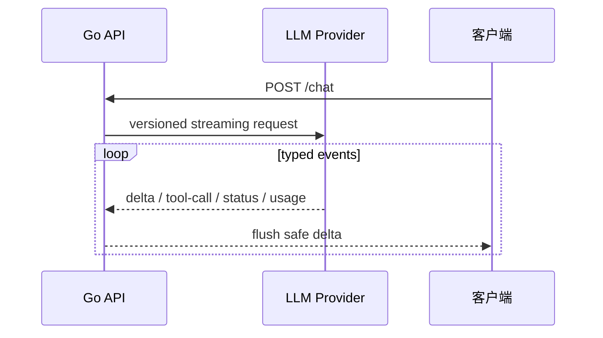

# Go 接入大模型 API：流式、重试、超时

<a id="oral-card"></a>

## 要点卡

[返回 P0 知识图谱](../_meta/p0-knowledge-graph.md)

!!! abstract "30 秒回答"

    大模型 API 应按“慢、贵、可能限流且结果可能部分返回的外部依赖”治理。Go 侧复用连接，
    让 context deadline 和用户取消贯穿调用，分别观测 TTFT、总时延、token、错误和重试。
    流式协议必须由 provider adapter 按 API 版本解析：当前 OpenAI Responses API 是带类型的
    SSE 事件，部分兼容服务仍返回 Chat Completions chunk，不能共用一个 `[DONE]` 解析假设。

**3 分钟展开**

1. 适配层声明 provider、API surface 和版本，把 typed events 归一化为内部 `delta/tool/status/usage` 事件。
2. 只重试明确可重试的状态或网络错误，遵守 `Retry-After`、总 deadline、退避与 jitter；流已向用户输出或工具已产生副作用后不能盲重试。
3. 超时/断线可能是“结果未知”而不是“上游没处理”，因此记录 provider request ID，并避免把两次生成拼成同一次响应。
4. 限制并发、队列、输入/输出 token 和 Agent steps；取消上游可以减少继续计算，但具体计费仍以 provider 语义为准。

| 记忆槽 | 内容 |
|--------|------|
| 三个不变量 | API/事件版本显式化；重试受 deadline 与副作用边界约束；partial stream 不能冒充完整成功 |
| 手画图 | `client → Go adapter → provider`，旁边标 `deadline / limiter / retry / typed events / metrics` |
| 项目落点 | OctoAgentFlow 讲统一 client、流式事件归一化、预算与取消传播；原型证据不包装成生产规模 |
| 一个取舍 | Streaming 改善首段可见时间，但增加部分输出审核、断流恢复和状态机复杂度 |

**错误表达**

- ❌ “OpenAI-compatible 都是 `data: ...` 加 `[DONE]`，429/5xx 统一重试即可。”
- ✅ “不同 API 的事件和终止语义不同；重试必须结合错误分类、deadline、部分输出与副作用。”

**自测追问**：用户断线、provider 超时和首个 token 已返回时，三种场景分别能否重试？

## 10 分钟版（原理 + 图示）



**流式事件处理骨架**

```go
stream, err := adapter.Stream(ctx, req) // adapter 固定 provider/API 版本
if err != nil {
    return classifyProviderError(err)
}
defer stream.Close()

completed := false
for stream.Next() {
    switch event := stream.Event().(type) {
    case TextDelta:
        if err := downstream.Write(event.Text); err != nil {
            return err // ctx 取消会继续传到上游
        }
    case ToolArgumentsDone:
        toolQueue <- event // 仍须 schema、授权和业务校验
    case ResponseCompleted:
        completed = true
        usage.Record(event.Usage)
    case ResponseFailed:
        return event.Err
    }
}
if err := stream.Err(); err != nil { return err }
if !completed { return ErrIncompleteStream } // EOF 不代表成功
return nil
```

当前 OpenAI Responses API 常见事件包括 `response.created`、`response.output_text.delta`、
`response.completed` 和 `error`，工具参数也有独立的增量/完成事件。Chat Completions 风格的
chunk 与 `[DONE]` 是另一套 surface。若不用 SDK，自写 SSE decoder 还必须正确处理事件分帧、
多行 `data`、超长事件和连接中断，不能把“逐行 Scanner”当完整协议实现。

**Client 配置要点**

| 项 | 建议 |
|----|------|
| Deadline | 从端到端 SLO 分配连接、首事件、流式空闲和总时长预算；流式不机械套固定秒数 |
| Transport | 复用单例并按并发压测配置连接池；限制并发与等待队列 |
| Context | 用户取消贯穿下游写入与上游请求；是否节省费用取决于 provider 处理/计费语义 |
| 重试 | 按错误分类和 provider 指引；遵守 `Retry-After`、总预算、指数退避与 jitter |

## 生产场景

- **智能客服**：流式降低首字等待；前端 WebSocket 转发 SSE
- **批处理摘要**：非流式 + 队列削峰；并发受 provider QPS 限制
- **私有化部署**：即使服务宣称 OpenAI-compatible，也要用契约测试确认事件、工具、usage、
  错误码和取消语义；不能只换 `baseURL` 就假设完全兼容

## 排查与工具

- 指标：`llm_request_duration_seconds`、`llm_tokens_total`、`llm_errors_total{code=429}`
- 日志：记录 `model`、`prompt_tokens`、`completion_tokens`（勿记全文 prompt）
- 链路：OTel span 包住 LLM 调用，标注 `gen_ai.system`

## 架构取舍

| 方案 | 适用 |
|------|------|
| 官方 SDK（openai/openai-go） | 按锁定版本使用官方 API；社区 sashabaranov/go-openai 另行验证兼容性 |
| 自封装 `LLMClient` 接口 | 多厂商切换、单测 mock |
| 网关代理（LiteLLM 等） | 统一鉴权、限流、审计 |

**何时不用流式**：短回答、批处理、仅需结构化 JSON 且要完整校验。

## 深挖问答

1. **用户断开连接还要不要继续调模型？** → 监听 `ctx.Done()` 并取消上游；是否停止计算或计费取决于 provider，不能保证退款。
2. **429 怎么处理？** → 读 `Retry-After`；在总 deadline 内退避加 jitter；限制本地并发/队列并按配额治理，不能用轮换 key 绕过服务条款。
3. **和 gRPC 流对比？** → 多数 SaaS 仍是 HTTPS+SSE；自建 Triton 可用 gRPC streaming。
4. **超时设多少？** → 按业务 SLO 和 provider 能力分配总时长、首事件和空闲预算；**TTFT** 单独告警。

## 反模式与事故

- **无超时** → goroutine 泄漏、连接占满
- **每个请求新建自定义 `http.Transport`** → 连接池无法复用，TCP/TLS 握手开销巨大（多个零值 `http.Client{}` 仍共享 `DefaultTransport`）
- **重试边界未考虑** → 可能重复生成/计费；若后续工具有副作用还会重复写业务状态
- **把完整 API Key 打日志** → 安全事故

## 代码示例

接口与仓库实际代码一致，`Usage.Known` 区分报告用量与估算/未知：

```go
type Client interface {
    Complete(ctx context.Context, messages []Message) (string, Usage, error)
    StreamChat(ctx context.Context, messages []Message, onChunk StreamHandler) (Usage, error)
}
```

本地运行（Go 1.24.2+，从仓库根目录执行，无密钥）：

```bash
go test -race ./examples/senior/llmclient/...
go run ./examples/senior/knowledge-demo
```

[`llmclient` 示例说明](https://github.com/twodog-tt/Golang-development-manual/tree/master/examples/senior/llmclient)
包含按词输出的 `MockClient` 和真实 HTTP 的 `LocalHTTPClient`。后者只接受 **HTTP + 字面量 loopback IP**，
禁用代理与重定向，不发送密钥；协议固定为仓库 `local-text-sse-v1` 文本夹具，借用 Responses typed events 的
文本/终止语义，**请求结构不兼容完整 Responses API，也不执行工具事件**。实际 provider 应使用锁定版本的
SDK/adapter 做独立契约验收；此处没有真实模型、生成质量或计费验收。

| 故障验证 | 预期 |
|----------|------|
| LF / CRLF / CR、注释、BOM、多行 data | 按空行分帧，拼接文本后校验 terminal usage |
| EOF / `[DONE]` / failed / incomplete / error / 非法 JSON / 不支持的工具事件 | 返回错误，不冒充完整成功，不自动重试 |
| 首片段后断线或下游 callback 失败 | `StreamError` 保留 request ID、Partial；Complete 不返回部分答案 |
| HTTP 429 且夹具明确声明 before-generation | 最多 1～5 次尝试；遵守 Retry-After、退避、jitter 和总 deadline |
| 429 无拒绝证据、5xx、网络故障 | 可能已生成；默认不重试，用量保持未知 |
| 无 usage / 缺字段 / cached input 超过 input | 无 usage 时 Known=false；畸形 usage 报错，不能记零成本 |
| 超大输入/事件/总流、取消/超时、重定向到外部 | 有界拒绝；取消关闭请求；不跟随重定向 |

示例总时长最多 5 秒，输入 64 KiB、单行/事件 64 KiB、总流 1 MiB，HTTP 响应头等待最多 2 秒；
这些是本地夹具参数，不是生产默认值。每次 HTTP attempt 各发一次观测事件，重试等待被取消不虚构新 attempt。
`MockClient` 的词数估算标注 `Source=mock-word-count, Known=false`，不能作真实 token 账单。

## 延伸阅读

- [OpenAI Streaming API Responses](https://developers.openai.com/api/docs/guides/streaming-responses)
- [OpenAI Function Calling](https://developers.openai.com/api/docs/guides/function-calling)
- [官方 OpenAI Go SDK](https://github.com/openai/openai-go)
- [Go Context](https://go.dev/blog/context)
