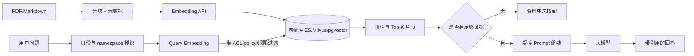

# RAG 架构：分块、向量检索与 Go 落地

## 30 秒版（开场）

> **RAG（检索增强生成）** = 用户问题 → 检索相关资料 → 把受控上下文交给模型生成。检索可组合 dense embedding、BM25、metadata filter 和 rerank。RAG 能提高可追溯性与时效性，但不自动保证答案正确，也不能替代权限控制。

## 3 分钟版（精讲深度）

1. **是什么**：用外部知识库补充模型上下文，减少仅凭参数记忆回答；检索层与生成层解耦。
2. **为什么**：企业文档私有、需可审计答案；纯微调成本高、更新慢。
3. **怎么做**：Ingest（解析→分块→向量化→入库）+ Query（改写→召回→Rerank→组装 Prompt）；Go 常负责 **API 编排、任务队列、权限过滤**。

## 10 分钟版（原理 + 图示）



**分块策略对比**

| 策略 | 优点 | 缺点 |
|------|------|------|
| 固定长度 + overlap | 实现简单 | 切断语义 |
| 按标题/段落 | 结构清晰 | 长短不一 |
| 语义分块 | 质量高 | 成本高 |

**Go 编排示例（伪代码）**

```go
func (s *RAGService) Answer(ctx context.Context, q string, userID string) (string, error) {
    // 1. ACL/tenant filter 必须进入检索查询，不能先全局 Top-K 再事后过滤。
    filter, err := s.acl.SearchFilter(ctx, userID)
    if err != nil {
        return "", err
    }

    // 2. 向量检索（可叠加 BM25 hybrid）
    chunks, err := s.vector.Search(ctx, q, filter, 20)
    if err != nil { return "", err }

    // 3. Rerank（可选小模型或 cross-encoder）
    chunks = s.reranker.TopN(ctx, q, chunks, 5)

    // 4. 组装 prompt + 调 LLM
    prompt := buildRAGPrompt(q, chunks)
    return s.llm.Complete(ctx, prompt)
}
```

## 生产场景

- **内部知识库问答**：Confluence/Notion 同步 → 夜间 ingest
- **客服**：商品详情 + 政策文档 RAG；答案必须带 `source_id` 链接
- **代码助手**：repo 分块 + 路径元数据；与 IDE 索引类似

## 排查与工具

- 评估：**Hit Rate@K**、答案 groundedness、人工抽检
- Bad case：检索为空 → 检查 embedding 模型一致性、分块是否过碎
- ES：`knn` + `bool` filter；Milvus：collection schema 与索引类型（HNSW）

## 架构取舍

| 向量库 | 适用 |
|--------|------|
| Elasticsearch | 已有 ES、要 Hybrid 全文+向量 |
| pgvector | 希望与 PostgreSQL 数据、事务和运维体系共存；容量取决于索引与集群设计 |
| Milvus/Qdrant | 独立向量检索系统，适合需要专门扩展与索引能力的场景 |

**何时不用 RAG**：强实时数据（用 API 查库）；极小知识集（直接塞进 system prompt）。

## 深挖问答

1. **Embedding 模型换了怎么办？** → 全量 re-embed；双写过渡期。
2. **怎么降低无依据回答？** → 检索质量评估、无足够证据时拒答、引用可核验片段、结构化事实校验；一句“仅根据上下文”不是安全保证。
3. **长文档表格怎么处理？** → 结构化抽取或 HTML 表转 Markdown 再分块。
4. **和微调怎么选？** → 风格/格式用微调；事实知识用 RAG。

## 反模式与事故

- **chunk 无元数据** → 无法做权限过滤，**数据泄露**
- 机械固定 Top-K → 不同问题、chunk 大小和模型预算需要不同候选数；用离线评估与 token budget 调参
- **query 不改写** → 口语化问题检索差；可加 HyDE 或 query expansion
- **ingest 与线上 embedding 模型不一致** → 检索几乎随机

## 代码示例

生产可将 [S-ES-01 倒排索引](../middleware/elasticsearch/S-ES-01-inverted-index.md) 与 dense vector 组合。
仓库示例使用**稀疏词项余弦召回**：汉字连续串切相邻双字，英文按词；不再使用整句中文哈希，也不宣称是语义 embedding。
`怎么退款` 与退款片段有正分关联，`火星轨道周期` 无证据时直接返回“资料中未找到”，不调用模型。

```bash
go test -race ./examples/senior/rag/...
go run ./examples/senior/knowledge-demo
```

[`rag` 源码与故障表](https://github.com/twodog-tt/Golang-development-manual/tree/master/examples/senior/rag)
实际接口是 `Service.Answer(ctx, scope, question)`；上文生产向量编排代码为伪代码。
可信宿主从 `Authority.Context` 注入身份，`Scope` 同时绑定 tenant/bot/scene/subject type/subject ID；
客户端不能通过随意填 tenant 或 user 获得授权。片段的 policy、期限、Readers 资源 ACL 必须在评分前通过。
`Readers` 为空表示 namespace 中所有已授权 reader，非空则限定具体 subject；分数为零永远不进入 Top-K。

| 故障验证 | 预期 |
|----------|------|
| 打乱入库顺序，查询中文退款 | 只返回正分退款片段，测试不依赖第一条碰巧相关 |
| 不相关问题、相似度最高但无权读取的片段 | 无命中直接拒答，模型调用次数为零 |
| 跨 tenant/bot/subject、无身份、过期片段、policy 不符 | 检索拒绝或候选排除，越权数据不进 prompt |
| 调用模型过程中删除来源、撤销授权或取消请求 | 返回答案前重查主记录版本和授权；不给出旧答案或证据 |
| 零/NaN/无限阈值、非法 Top-K、超大问题/上下文 | 明确错误；防止无阈值兜底和预算失控 |
| 模型失败、片段含“修改权限/调用工具” | 不交付部分失败答案；资料只作 JSON 数据，示例没有工具执行能力 |

此例 `MockClient` 只验证编排、拒答与输入边界，不能证明真实模型抗注入、引用正确或 groundedness。
中文双字和词项重叠不能处理全部分词/同义词问题；生产阈值、召回率、答案质量仍须标注集评测。
授权校验与本地数据版本检查定义操作边界；已向外部模型发送的数据无法靠撤销“收回”。

## 延伸阅读

- [Pinecone: What is RAG](https://www.pinecone.io/learn/retrieval-augmented-generation/)
- [Elasticsearch dense vector](https://www.elastic.co/guide/en/elasticsearch/reference/current/dense-vector.html)
