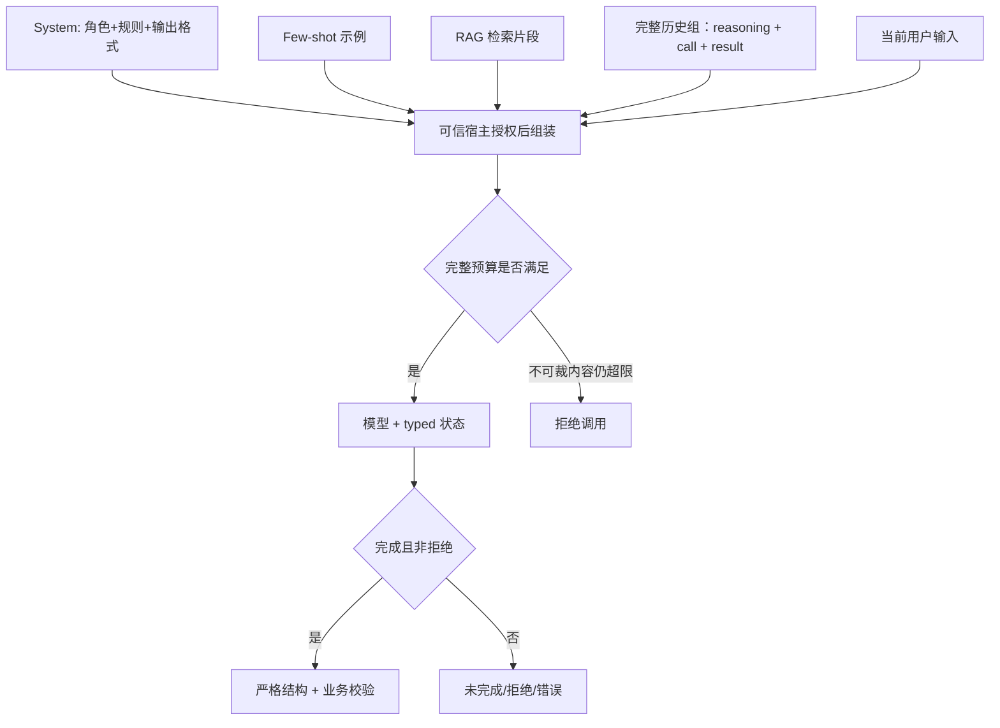

# Prompt 工程与 Context 窗口管理

<a id="oral-card"></a>

## 要点卡

[返回 P0 知识图谱](../_meta/p0-knowledge-graph.md)

!!! abstract "30 秒回答"

    Prompt 在生产系统里是有版本、有评估、有回滚的行为配置；Context 管理同时解决预算、
    相关性和信任边界。系统约束、用户输入、历史、RAG 和工具结果分层组装，先做租户/资源授权，
    再按目标模型 tokenizer 与输出预算裁剪。Structured Outputs 或 strict schema 约束结构，
    但不证明事实正确、业务合法或用户有权执行。

**3 分钟展开**

1. 记录 `prompt_id/version`、模型/API 版本和评估集；变更先离线回归再灰度，不靠主观读几条回答。
2. Context 预算优先保留高优先级约束与当前任务；RAG 和工具结果都是不可信数据，先授权、再裁剪、再明确引用边界。
3. 摘要是有损压缩，应保留事实来源、版本和可回溯原文；不能把摘要中的猜测升级为长期记忆。
4. Schema 输出仍需 JSON 解码、枚举/范围/状态和授权校验；真正副作用交给确定性 executor。

| 记忆槽 | 内容 |
|--------|------|
| 三个不变量 | Prompt 可版本化可回归；上下文先授权再预算；结构正确不等于语义或权限正确 |
| 手画图 | `policy + history + authorized RAG + user → budgeter → model → validator` |
| 项目落点 | OctoAgentFlow 讲 prompt registry、memory namespace、context budget 和发布回滚 |
| 一个取舍 | 更长 context 保留信息但增加成本、延迟和攻击面；摘要节省 token 但可能丢事实 |

**错误表达**

- ❌ “JSON mode/strict schema 能保证业务答案正确；temperature=0 就完全可复现。”
- ✅ “Schema 约束输出形状，业务语义和授权由代码校验；模型行为仍需基于版本和评估集验证。”

**自测追问**：RAG 片段、历史摘要和 system 约束冲突时，如何排序并保留审计证据？

## 10 分钟版（原理 + 图示）



**Context 裁剪策略**

| 策略 | 说明 |
|------|------|
| 最近 N 轮 | 只能按完整历史组裁剪，不能留下孤立工具结果或删掉仍待处理调用 |
| 滚动摘要 | 有损内容带来源/版本；未知结果、审批与资金事实保留在权威系统，不靠摘要恢复 |
| 优先级 | 平台约束和当前任务不可裁；已授权 RAG/旧历史按策略裁剪，不能提升数据的指令优先级 |
| 硬上限 | 必须内容仍超限时拒绝调用；不能截断一半 JSON、工具交互或不透明 reasoning 项 |

上下文预算须同时满足窗口上限和生成上限：

```text
I(格式化输入) + O(可见输出预留) + R(推理预留) + M(余量) <= W(窗口)
O + R <= 最大生成量
```

计数器须锁定模型/API/版本，组装及最终发送计数前后都核对版本，途中变化立即拒绝；覆盖消息框架、工具与 schema；多模态输入另按对应 API 计算。
某些 API 的 `max_output_tokens` 已包含 reasoning，配置时传 O+R，不能再重复加一次推理用量。
provider usage 是事后观测；cached input 仍占上下文，不能按缓存折扣扣掉窗口预算。真实 tokenizer 不可用时明确失败，不能静默按词数降级。
裁剪后以及最终 adapter 格式化资料/消息后都要重新计数，不能漏掉引用转义或框架开销；Assembly绑定当前scope/身份和预算，不跨身份复用。工具调用、对应结果和必要 reasoning items 作为原子组保留，待审批/UNKNOWN 交给权威工作流解决。

**结构化输出：先判状态，再严格解析**

应先区分完整成功、refusal、incomplete/failed 和空结果。JSON mode 只保证 JSON 形状的一部分，不能当 strict schema；
真实 provider adapter 须按选定 surface 启用 strict、required、additionalProperties=false，并验证支持的 schema 子集。
拒绝与不完整响应不能作为普通业务 JSON 继续执行。[官方边界说明](https://developers.openai.com/api/docs/guides/structured-outputs)。

仓库示例使用明确的本地类型接口；它没有 `ChatRequest` 或虚构的 `resp.Content`，也不修改已有文本 `Client`：

```go
fixture := promptcontext.LocalFixture{
    Model: &llmclient.MockClient{
        Reply: `{"action":"query","order_id":"ORD-1"}`,
    },
    Version: promptcontext.PromptVersion,
    Status: "completed", // 可信夹具元数据，绝不能让模型在正文自报成功
}
intent, err := promptcontext.Extract(ctx, fixture, "查 ORD-1")
```

`LocalFixture` 内部调用实际 `Complete(ctx, []Message) (string, Usage, error)`，通过独立 `StructuredClient` 返回本地 typed result。
真实接入需由 provider adapter 从状态/事件读取完成和拒绝信号，不能直接复用测试元数据。
`ParseIntent` 拒绝缺/null/重复（含转义等价）/未知/大小写别名键、尾随 JSON、错误类型、非法 action/订单号。
这里的订单意图只有 `action` 与 `order_id` 两个字段，前后使用同一协议；解析成功仍不能证明订单归属、状态、权限或退款审批。

## 生产场景

- **多租户 SaaS**：租户模板受平台不可覆盖约束限制；持久化版本、审批与灰度，普通租户配置不能提升权限
- **长会话客服**：按上下文压力触发带来源/版本的摘要；摘要不能替代待审批/未知操作记录
- **代码审查 Bot**：固定 checklist few-shot，减少漏项

## 排查与工具

- Token 计数：按模型/API固定的 tokenizer 做调用前估算，provider `usage` 做事后核对；缓存费用折扣不减少窗口占用
- Prompt 回归：golden dataset + 自动评分（LLM-as-judge 慎用）
- 配置：Git 管理 prompt 模板；敏感词过滤前置

## 架构取舍

| 方案 | 适用 |
|------|------|
| 模板 + 配置中心 | 运营可调、需审计 |
| 硬编码 prompt | 强合规、变更少 |
| 动态示例检索 | 复杂分类，类似 dynamic few-shot |

**何时少做 Prompt 花活**：有明确 API 契约时用 **Function Calling** 替代自然语言解析。

## 深挖问答

1. **System prompt 泄露怎么办？** → 不把 system prompt 当秘密存储或授权边界；其中不得放密钥。按它可能被部分推断/泄露设计，真正权限在代码层。
2. **中英文 token 差异？** → tokenizer 和模型不同，不能用固定“字/token”换算；用目标模型 tokenizer 或 provider usage 实测，并预留输出预算。
3. **怎么版本化？** → `prompt_id` + `version` 打日志，便于回放 bad case。
4. **Temperature 怎么设？** → 不同模型支持范围和语义不同，有些推理模型不开放该参数。通过任务评估集调参，不背固定区间；低温也不能保证事实正确或完全可复现。

## 反模式与事故

- **把整个知识库塞进 prompt** → 超窗、贵、注意力稀释 → 用 RAG
- **无输出 schema** → 正则扒 JSON 脆弱
- **prompt 与代码不同步发版** → 线上行为突变
- **在 prompt 里写真实密钥** → 立即轮换

## 可运行示例与故障验证

从仓库根目录执行，不需要密钥或外部模型：

```bash
go run ./examples/senior/promptcontext/cmd/demo
go test -race ./examples/senior/promptcontext/...
bash scripts/verify_reliability_examples.sh --offline
```

[示例源码与完整故障表](https://github.com/twodog-tt/Golang-development-manual/tree/master/examples/senior/promptcontext)。
CLI 将裁剪后的 Assembly 实际交给 ExtractAssembled；仍保留 opaque 工具项时文本夹具明确拒绝，需专用 typed adapter。验证整组裁剪、严格意图解析、incomplete 和重复键拒绝；`effects_executed=0`，没有退款入口。

| 故障验证 | 预期 |
|----------|------|
| 刚好满窗、少一个单位、必要内容超窗、输出+推理超过生成上限 | 临界条件明确；整组移除或拒绝调用 |
| 孤立结果、未完成调用、重复 CallID、跨组关联 | 拒绝，不能靠裁剪把 UNKNOWN 操作变成可重跑 |
| 外 namespace 资料、计数中撤权、缺失/失败/负数计数器、计数途中版本变化 | 失败关闭，不调用模型兜底 |
| refusal/incomplete/failed、空结果、版本不符、正文自报 completed | 不成为正常订单意图 |
| 缺/null/重复/转义同名/未知/大小写键、尾随 JSON、非法枚举/订单号、取消 | 明确错误，不执行副作用 |

`FixtureCounter` 使用 UTF-8 字节与固定框架的 **fixture 单位**，不是生产 tokenizer，也不是实际 token/账单。
本地模型为固定 Mock；没有真实 schema enforcement、摘要质量、生产 prompt registry 或退款系统验收。

## 延伸阅读

- [OpenAI Prompting](https://developers.openai.com/api/docs/guides/prompting)
- [OpenAI Structured Outputs](https://developers.openai.com/api/docs/guides/structured-outputs)
- [Anthropic Prompt Engineering](https://docs.anthropic.com/en/docs/build-with-claude/prompt-engineering)
