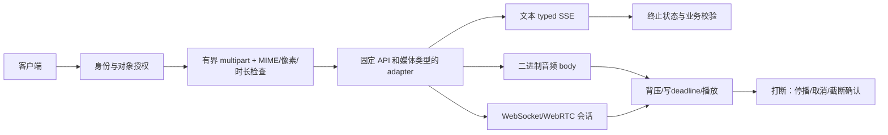

# 多模态与语音接入：图像、音频在 Go 服务中的工程实践

## 30 秒版（开场）

> 多模态服务可处理文本、图像与音频，但输入格式、流协议和完成语义取决于具体 API。
> Go 后端先鉴权并校验媒体与资源预算，再调用对应 adapter；文本 SSE、二进制音频 body、WebSocket/WebRTC 分开处理。
> 语音可采用 ASR → LLM → TTS 链式流程，也可用原生音频模型；选择依据是质量、时延、成本和恢复需求。

## 3 分钟版（精讲深度）

1. 图片/音频须按模型和 API surface 构建类型化请求；Chat Completions 与 Responses 的字段不能混用，也不能把音频 URL 当所有音频 API 的通用输入。
2. 上传前按可信身份检查对象归属；解析 multipart 前限制总请求，之后限制文件、真实 MIME、像素/时长与解码/转码资源，成功失败都清理临时文件。
3. 音频已开始播放后失败不能拼接盲目重试；取消、停播、清缓冲、会话截断与生成完成是不同状态，断连不能默认恢复原会话。

## 10 分钟版（原理 + 图示）



### 多模态请求：字段与类型要对齐

Chat Completions 的图片为 `image_url: {url, detail}`；音频 `input_audio: {data, format}` 中 data 是 base64 音频。
Responses 的图片是另一种 `input_image` part，不能复制字段名后就宣称兼容。[官方请求结构](https://developers.openai.com/api/reference/resources/chat/subresources/completions/methods/create)。

本地源码的真实结构（仅 user content 子集）如下，每个 Part 恰好一个 variant，`MarshalMessage` 会校验后再序列化：

```go
type Part struct {
    Type  string      `json:"type"`
    Text  string      `json:"text,omitempty"`
    Image *ImageURL   `json:"image_url,omitempty"`
    Audio *InputAudio `json:"input_audio,omitempty"`
}
type ImageURL struct {
    URL    string `json:"url"`
    Detail string `json:"detail"`
}
type InputAudio struct {
    Data   string `json:"data"`
    Format string `json:"format"`
}
```

[mediaio 示例](https://github.com/twodog-tt/Golang-development-manual/tree/master/examples/senior/mediaio) 不修改 `llmclient.Message`，
不把媒体喂给仅支持文本的 S-AI-01 SSE parser。其图片 URL 只序列化、不读取或校验云对象归属；生产需宿主先授权，生成最小权限短期 URL，避免记录签名参数。
演示支持 HTTPS 图片引用的 low/high/auto 和 WAV base64；不是对全部模型 detail/编码能力的完整覆盖。

### 上传与 ASR

`Receive` 在 `ParseMultipartForm` 前使用 `http.MaxBytesReader`，只接受一个 file 字段；磁盘临时文件在成功、错误、取消和超时路径均清理。
默认上限为总请求256KiB、单文件128KiB、图片65536像素、音频3秒、上传/探测1秒；示例 PNG/JPEG 先检查尺寸再解码，WAV 校验 RIFF 长度、PCM格式、声道、采样率、对齐与时长，并核对声明 MIME。

字节上限不等于解码资源上限。这里的同步图像解码有大小/像素边界，但不是任意codec沙箱；自定义探测器必须响应 ctx。
生产 ffprobe/转码还需可信子进程配置、CPU/内存/时间限制与隔离；单纯 `context.WithTimeout` 无法杀死不合作的 Go 计算或未受控的子进程。
真实 HTTP 慢上传另用 socket read deadline 约束阻塞读。本地上传夹具没有生产 IAM、对象存储或病毒扫描验收。

`LocalClient.Transcribe` 实际创建 multipart file（含 filename 和 MIME），填写 model/language/response_format、关闭 writer，设置含 boundary 的 Content-Type 后发出请求；
核对非2xx、响应类型/大小、JSON必填/非null/精确字段名/重复键与分片时间戳，传播取消。出错不自动重试，也不把超时视作未生成/未计费。

本地 /asr 的 `fixture-asr-v1`、`fixture-segments-v1` 是教学协议，输出固定 segments；不是实际模型名或 OpenAI 响应格式。
真实文件转写须按所选模型确认大小、格式、流式和时间戳能力。例如需要 Whisper 的词级时间戳时，需相应 verbose_json/时间戳配置；文件转写流式输出不等于持续麦克风实时会话。
参见 [Speech to text](https://developers.openai.com/api/docs/guides/speech-to-text)。

长音频按稳定 chunk ID 保存结果与 offset，恢复时重用相同输入标识。示例 `Merge(totalMS, chunks)` 对相同结果重投幂等，应用时间偏移，并验证无缺口及时间范围；
只有相同全局起止时间和文本的重叠段可直接去重，同ID内容冲突或其他歧义重叠应核对，不能只按文本相同删除真实重复发言。
此算法没有强制对齐/说话人识别或持久重试账本保证。

### 音频转发：不能复用文本 SSE decoder

| 上游形态 | 处理方式 |
|----------|----------|
| 文本/转写 SSE | 固定 API 的事件类型、分帧与显式完成状态 |
| TTS 二进制 body | 核对非2xx及音频类型/编码后原始字节转发，限制长度、背压、读写deadline |
| 音频 JSON events | 按协议解码 base64、协商采样率/声道/编码并维护播放队列 |
| WebRTC | 音轨承载媒体、控制通道承载事件；不能假设它等于 WebSocket 音频 JSON |

本地 `RelayPCM` 采用明确的 PCM16 LE/单声道/24kHz 协议，二进制原样转发，不经过字符串或文本 SSE。
上游状态和格式必须在首次输出前验证；每次下游 Write 设置 deadline，队列/读取有上限，并在所有返回路径关闭上游。
RelayPCM 清除继承的 Content-Length 并 Flush，避免下游提前判断完成。若返回 `RelayError{Started:true}`，HTTP handler 要中断响应（示例用 `http.ErrAbortHandler`），不能追加 JSON 错误或自动重试后拼接两段语音。

夹具用 X-Audio-Bytes 声明长度并校验截断/多余数据，配套 X-Audio-Format 固定编码，二者不是 OpenAI 通用字段。
长度相符只证明本地传输检查，不能推导真实生成语义完整、用户已经听到或费用已确定。
真实 TTS 的格式、事件与结束契约须按 [Text to speech](https://developers.openai.com/api/docs/guides/text-to-speech) 选择 adapter。

### 实时语音：生成、播放和会话恢复分开

浏览器/移动端可按产品需求使用 WebRTC，服务端也可用 WebSocket；凭据和媒体/控制通道按选定 API 设计，服务端项目密钥不能放入客户端。
参见 [连接方式](https://developers.openai.com/api/docs/guides/voice-websockets)。

打断至少涉及：停止本地播放与清空缓冲、取消仍在生成的响应、按**实际已播放位置**截断服务端会话，并核对确认。
WebSocket 风格客户端常需主动截断；WebRTC/SIP 的服务端可能管理播放缓冲和自动截断，应按具体API处理，不能混用手动流程。
[官方中断与截断说明](https://developers.openai.com/api/docs/guides/realtime-conversations#interruption-and-truncation)。

本地 `Voice` 用单事件循环串行驱动，绑定 session、connection epoch、response、sequence；区分 generated 与播放完毕，有界排队。
Played(session,response,epoch,n) 同样核对会话/响应/epoch，拒绝旧设备回调；Interrupt 清队列，按 Played 回执计算截断位置，ACK 前不启动下一响应，拒绝迟到/乱序音频和错误确认。
断连/进程重启不推断旧会话恢复；夹具只接受本句柄从未用过的新确认 session（最多128个，耗尽后需新建句柄并重新握手）并提升 epoch，不重播旧音频、工具或审批。
它是可运行的**本地控制状态机**，没有实现真实 WebSocket/WebRTC 传输、设备播放器或厂商会话恢复验收；涉及工具副作用仍走权威工作流核对。

## 生产场景

- 客服：截图/语音经授权与媒体校验后进入对应链路；ASR无有效转写时展示失败或转文字输入，不让模型猜录音内容。
- 质检：ASR → 文本分析 → 结构化校验；转写和图像内指令仍是不可信数据，不能直接执行SQL/工具。
- 会议：分片时间偏移、重试去重、冲突核对与说话人/时间戳能力分别验证，不能把本地合成测试当真实准确率。

## 排查与工具

观测上传拒绝率、解码/探测超时、ASR延迟与失败、TTS首字节/播放缓冲、打断/截断ACK、断连和未知用量。
记录模型/API/媒体格式和请求标识，默认不记录录音、图片、完整转写或签名URL；如需保留 bad case，先确定授权、脱敏与保留/删除策略。
生产 ffprobe 等工具的调用由可信配置确定，上传文件名或转写文本不能成为 shell 命令。

## 架构取舍

| 方案 | 适用与需要验证的条件 |
|------|----------------------|
| 云 ASR/视觉/TTS | 按具体模型评测质量/时延/计费；核对数据处理和网络路径 |
| 私有化模型 | 可减少外部数据传输；仍须检查遥测、日志、对象存储、监控和外部依赖，不能自动宣称数据不出域 |
| 端侧 ASR + 云端 LLM | 可能减少上传音频，仍会发送转写；评估设备能力、隐私与完整链路成本 |

仅需 OCR 时可先评估专用 OCR，用真实版式/语言/图片质量样本比较准确率与端到端成本，不能断言它一定更便宜、更准。
离线文件与实时 ASR 的成本取决于模型、时长/用量口径、并发、计费和运维，选择文件接口也不自动等于更便宜。

## 深挖问答

1. **图片用base64还是签名URL？** → 按provider能力、大小、授权和网络路径选择；URL不减少图片本身的模型处理费用，签名参数不得进入日志。
2. **TTS读到EOF能证明用户听完吗？** → 不能；传输、模型完成和设备播放是三个状态，实际播放回执才能用于计算打断位置。
3. **断连后可否重发旧语音/工具？** → 先核对API恢复能力与权威操作状态；本地fixture只建新session，不重放旧音频、工具或审批。
4. **为什么只加上传字节上限不够？** → 小压缩文件可能解码出大量像素/样本；限制解码后资源，并给不可控codec独立的隔离和终止能力。

## 反模式与事故

- 媒体直接复用文本SSE decoder → 类型错误、二进制损坏或终止信号误判。
- 把收到/生成的音频字节当作已播放 → 截断位置错误，模型保留用户没听到的内容。
- 打断只取消生成，不清播放器/会话缓冲 → 用户继续听到旧音频，后续会话语义漂移。
- 遇到断流就拼接重试结果 → 重复播放，且可能重复生成/计费。
- 只按文件扩展名/声明MIME放行，或上传失败遗留临时文件 → 资源耗尽与敏感文件残留。

## 可运行流程与故障验证

仓库根目录执行，无密钥/麦克风/外部模型/ffmpeg：

```bash
go run ./examples/senior/mediaio/cmd/demo
go test -race -timeout 30s ./examples/senior/mediaio/...
bash scripts/verify_reliability_examples.sh --offline
```

CLI 串起真实 loopback 上传/ASR/PCM转发、重复分片合并、500ms已播放位置截断及新会话隔离。
应输出 passed=true、ASR/TTS各1次、二进制6字节、去重后1段、new_epoch=2。
[运行说明与完整故障矩阵](https://github.com/twodog-tt/Golang-development-manual/tree/master/examples/senior/mediaio)。

| 故障验证 | 预期 |
|----------|------|
| oneof混用、错误base64/媒体格式、非loopback调用端点 | 序列化或请求前拒绝 |
| 总请求/文件/像素/时长超限、假MIME、损坏媒体、缺boundary、探测失败/超时、取消、慢上传 | 有界失败且清理临时文件 |
| ASR非2xx、坏/超大JSON、缺/null/重复/大小写别名字段、错误时间戳或取消 | 不接受结果、不自动重试 |
| PCM非2xx、错误类型/编码/长度、截断/多余数据 | 不冒充正常音频，已输出后明确中断 |
| net.Pipe慢下游、取消或无deadline writer | 写超时/拒绝，关闭并取消上游 |
| 重复分片、时间偏移、精确重叠/冲突、缺片或越界 | 精确去重；有歧义时失败而非猜测合并 |
| 打断、迟到/乱序音频、错误/丢失ACK、断连、历史session复用、旧epoch与旧播放回调 | 不继续播放旧数据，不默认恢复旧会话 |

这些测试只证明本地固定契约与有限恢复分支，不证明真实模型质量、网络协议互通、云端账单、生产IAM或数据驻留认证。

## 延伸阅读

- [Images & vision](https://developers.openai.com/api/docs/guides/images-vision)
- [Speech to text](https://developers.openai.com/api/docs/guides/speech-to-text)
- [Text to speech](https://developers.openai.com/api/docs/guides/text-to-speech)
- [Realtime conversations](https://developers.openai.com/api/docs/guides/realtime-conversations)
- 关联：[模型接入](./S-AI-01-llm-api-integration.md)、[Prompt/Context](./S-AI-04-prompt-context.md)、[工作流与恢复](./S-AI-09-agent-workflow-hitl-publishing.md)
