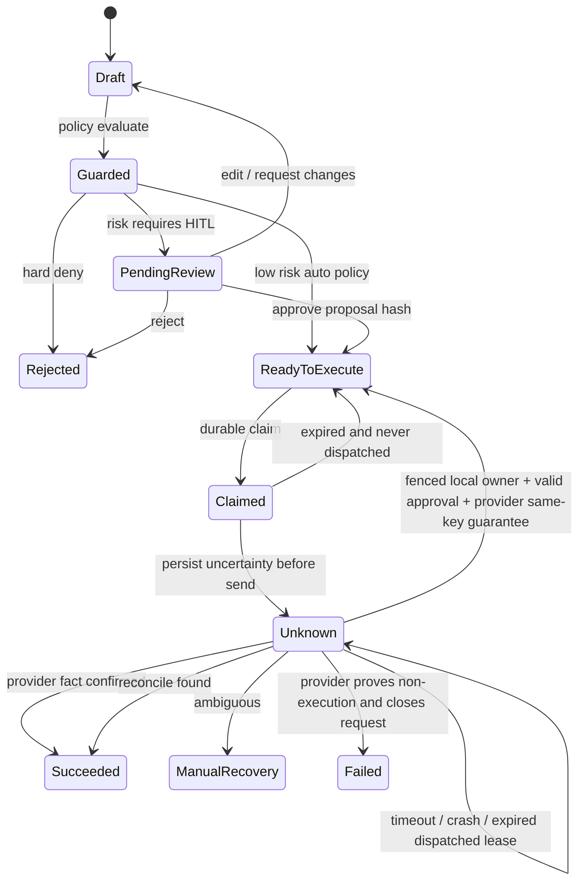
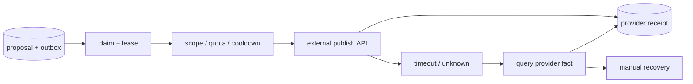

# Agent 工作流、Human-in-the-loop 与可靠发布控制面

<a id="oral-card"></a>

## 要点卡

[返回 P0 知识图谱](../_meta/p0-knowledge-graph.md)

!!! abstract "30 秒回答"

    生产 Agent 必须把模型生成和外部副作用分开。模型生成不可变 proposal，审批绑定 proposal
    hash、策略版本和 reviewer；批准后由持久化 execution job 执行。worker 用 lease 加 fencing
    claim 任务，外部调用保存 intent key 和 receipt；网络超时进入 `UNKNOWN`，先查询 provider
    事实再决定重试或人工恢复，不能让模型从头规划并盲目重发。

**3 分钟展开**

1. 决策面产生 draft/proposal 和风险等级；控制面维护 draft→review→approved→executing→终态。
2. Review Queue 管“人批准了什么”，Execution Queue 管“机器执行什么”，两者不能共用一个布尔状态。
3. 审批后执行前重新检查内容版本、权限、OAuth scope、配额和 cooldown；编辑内容使旧审批失效。
4. checkpoint 解决流程恢复，不是外部事实源；HTTP 200/timeout 都要结合 provider object ID、
   查询接口和 receipt 对账。

| 记忆槽 | 内容 |
|--------|------|
| 三个不变量 | 审批对象不可静默变化；过期 worker 不能提交状态；UNKNOWN 必须 reconcile 后再重试 |
| 手画图 | `proposal(hash) → review → execution job(lease+epoch) → provider → receipt/UNKNOWN → reconcile` |
| 项目落点 | OctoAgentFlow 讲工作流和 HITL 的设计/原型边界；不要把 checkpoint 设计表述成生产 exactly-once |
| 一个取舍 | 自建 Go 状态机语义清晰；通用工作流引擎恢复能力成熟，但引入新运行时和版本治理 |

**错误表达**

- ❌ “加一个 `approved=true` 就完成 HITL；发布超时直接重试即可。”
- ✅ “审批必须绑定不可变 proposal；模糊成功先对账，只有证明安全时才自动重试。”

**自测追问**：lease 已过期为什么还需要 fencing token？reviewer 编辑内容后如何处理旧审批？

## 10 分钟版（原理 + 图示）



### 五类持久化对象

下表是生产逻辑对象划分。教学 fixture 把 proposal、approval、execution job 合并保存在同一原子记录中，run 独立保存；
固定为单人审批的 publish/v1，不实现低风险自动审批、分布式队列、日配额/cooldown 或自动退避调度。

| 对象 | 关键字段 | 不变量 |
|------|----------|--------|
| `agent_run` | tenant、bot、workflow/version、checkpoint | 同一 run 可暂停和恢复，不靠进程内存 |
| `action_proposal` | args、content hash、risk、policy version | 审批对象不可悄悄变化 |
| `review_task` | proposal hash、reviewer、decision、reason | 编辑 proposal 后必须重新审批 |
| `execution_job` | intent key、attempt、lease owner/epoch、next retry | 同一业务 intent 只有一个有效执行谱系 |
| `external_receipt` | provider、request ID、object ID、status、raw digest | 外部事实可对账，不把 HTTP 200 当最终成功 |

`Review Queue` 是 **人的决策队列**，`Execution Queue` 是 **机器的副作用队列**。两者不能共用一个
“待处理”状态，否则无法回答：谁批准了什么、批准后内容是否改变、任务是否已经被外部平台接受。

### 审批绑定与恢复

```text
approval_subject =
  tenant_id + provider + account_id + credential_subject + credential_scope
  + proposal_id + proposal_version + intent_key
  + tool_name + tool_schema_version + workflow_version + policy_version
  + canonical_args_hash + content_hash
```

这里表示有类型、无歧义的结构化摘要，不是直接拼接可变长字符串。fixture 的 publish 参数固定为 Text，
`Proposal.Digest()` 对有类型结构体编码计算 SHA-256；Tool/Workflow/Policy 仅支持 v1，未知版本拒绝执行。

- 审批绑定稳定 proposal/version 与精确业务 intent，不能只绑定对话或 OAuth scope；相同 scope 不能区分两个发布账号。
- reviewer 身份从可信认证上下文取得，并检查 tenant/provider/account/tool 的 review 权限；fixture 强制禁止自批。记录 reviewer 名字不等于完成鉴权。
- 审批记录保存摘要、reviewer、expires/revoked；执行时同时复核执行者与审批人的当前权限、凭据主体/scope 和审批有效性。审批与编辑由原子事务串行化，重复批准只产生一份有效记录。
- 未派发前的撤销阻止执行；派发标记落盘后已进入外部不确定窗口，撤销只能阻止后续新尝试，不能承诺撤回在途 HTTP 请求。确认旧操作成功仍须如实记录 receipt，补偿另建 action。
- pause 前发生的副作用必须幂等；否则 resume 可能重复执行。
- checkpoint 记录的是可恢复状态，不是业务事实的唯一来源；外部发布结果仍需 reconcile。
- workflow/prompt/tool schema 升级后，旧 run 要么按旧版本恢复，要么显式迁移，不能静默套用新语义。

### 发布可靠性



外部平台不一定支持幂等键，也无法与本地数据库做同一事务，因此目标不是宣称“严格 exactly-once”，而是：

- 本地 `tenant + account + intent_key` 唯一；
- proposal、审批和 payload hash 冻结；
- provider 支持幂等键时传稳定键；不支持时保存 request fingerprint 和返回对象 ID；
- 派发前先持久化 UNKNOWN/intent/payload。worker 在发送前后、provider 已接受后或写 receipt 前崩溃，接管者都不能把“本地无 receipt”当成未执行；
- 过期且从未进入派发的 claim 可返回 ready；已派发的 claim 接管后仍为 unknown。推进本地 epoch 只能拒绝旧 worker 提交本地状态，不能阻止它稍后在外部产生效果；
- 网络超时先查询；not-found/404/索引延迟不证明旧在途请求将来不会成功。不支持幂等的 provider 查询未命中时进入 manual，禁止自动重发；
- 只有 provider 明确保证同一作用域、同 intent、同 payload 且幂等保留期覆盖整个恢复窗口，才可在本地 owner 已封存、审批仍有效时显式同键重试。本例不自动根据“未找到”解锁重试；
- 明确失败必须证明未执行且该请求以后也不会生效。request fingerprint 只帮助查找，不能替代 provider 幂等或最终拒绝凭据；
- 重试使用指数退避、jitter、`Retry-After`、租户配额和账号 cooldown；
- 撤回、删除、退款等补偿是新 action，不篡改历史状态。

### OAuth2 与凭据边界

- access/refresh token 加密存储，日志和 prompt 中禁止出现明文；
- scope 最小化，按 tenant/account 隔离，记录授权主体与过期时间；
- refresh 先按凭据记录互斥，并持久化 refreshing/attempt/version；不能持锁跨 provider 网络调用；
- provider 已轮换但回包丢失，或进程在新 token 落盘前崩溃，会留下未知结果。互斥无法修复此窗口；本例隔离为 reauth_required，禁止重放旧 refresh token，待可信新授权恢复；
- 新 token 保存要用 credential version + attempt 的 CAS，迟到响应不能覆盖后来的重新授权。正常轮换不改变 credential_subject；重新授权变更主体时，旧审批不再有效；
- provider 的重放检测可能撤销活跃 refresh token，不能把 invalid_grant 当成普通瞬时网络错误。本地 fixture 只模拟轮换/旧 token 拒绝，不声称实现完整 token family 撤销；
- `401` 不等于无限 refresh；区分过期、撤销、scope 不足和账号风控；
- OAuth2 安全实践会演进，讲解时不要背死 provider 的固定有效期或限额。

## 生产场景

以社媒运营 Agent 为例：

1. Opportunity 进入后生成 draft，并保存输入来源与 prompt/workflow 版本。
2. Guardrail 检测禁区、事实声明、语言和重复内容，产出 risk reason。
3. 高风险 draft 进入 Review Queue；reviewer 可批准、拒绝或编辑后重新评估。
4. 批准结果通过事务内 outbox 生成 Execution Job。
5. worker claim 后检查账号授权、日配额、cooldown 和内容版本，再调用发布 API。
6. timeout 进入 `unknown`；reconciler 查询平台对象，确认后写 receipt，无法判定则人工处理。

## 可运行示例与故障验证

```bash
# 仓库根目录；Linux/macOS、Go 1.24.2+；只运行本地 fixture
go test -race ./examples/senior/agentworkflow/...
go run ./examples/senior/agentworkflow/cmd/demo -dir "$(mktemp -d)"
bash scripts/verify_reliability_examples.sh --offline
```

正常流程依次经历 `pending → ready → claimed → unknown → succeeded`；unknown 在调用前落盘，成功回执随后消除不确定性。
run 的 paused 与 job 的 unknown 是两种独立状态，恢复 run 不会直接给 job 授权。
[示例 README](https://github.com/twodog-tt/Golang-development-manual/tree/master/examples/senior/agentworkflow) 提供分步 plan/approve/run/reconcile 命令，
可以制造“外部接受但回包丢失”，看到 `external_effects=1`、模型轮数保持不变，对账后再恢复，副作用仍为 1。

测试实际覆盖：伪造/跨租户审批、账号/凭据/版本替换、自批、审批过期/撤销、角色变更、并发 approve/edit/claim；
旧 worker 在租约接管后仍迟到调用外部、not-found 后禁止非幂等重发、同键重试、错误回执拒绝；
真实子进程在发送前、外部接受后、run 输出落盘前和 refresh 轮换后直接退出，再重新打开状态文件恢复。
还覆盖完整工具调用历史、100 次调用批量预算、恢复后累计预算和并发 Continue。

**证据边界**：标准库 JSON 文件 + Unix 文件锁/原子替换演示持久化与并发边界，外部 provider 使用独立文件。
它不是生产数据库/分布式锁、真实 OAuth 服务、OpenAI/LangGraph SDK 兼容测试或模型质量验收；
凭据文件只含 NONSECRET 标记，不得保存真实 token。生产需事务数据库、加密凭据库、可信认证入口及 provider 特定幂等/查询契约。
框架恢复的语义也要单测：例如 LangGraph 的 interrupt 会从节点开头重跑，不能认为只从下一行继续。

## 排查与工具

重点指标：

- `review_queue_age`、approval/rejection/edit 比例；
- `execution_queue_age`、claim 冲突、lease takeover；
- publish success/definitive failure/unknown 比例；
- provider 429、401、5xx，按 tenant/account/provider 分组；
- 每个 workflow 版本的完成率、人工介入率、token/成本和副作用重复数。

排障先按 `run_id → proposal_id → review_id → execution_id → provider_object_id` 串联，不只看
模型 trace。

## 架构取舍

| 方案 | 优点 | 风险 |
|------|------|------|
| Go 自建状态机 + DB/outbox | 业务语义清晰、审计可控 | 要自行实现 checkpoint、迁移和运维 |
| Agent 框架 persistence/HITL | pause/resume 与开发体验好 | 仍不能替代业务授权、账本和外部对账 |
| 通用工作流引擎 | 长流程、定时、重试成熟 | 引入新运行时与版本治理成本 |

固定发布流程优先确定性状态机；LLM 只负责候选生成、分类或非确定性决策，不要让模型拥有整个
workflow 的最终状态写权限。

## 深挖问答

1. **人工审批后 worker 为什么还要重新校验？** → 审批到执行之间凭据、策略、配额和内容版本可能变化。
2. **HTTP 200 是否代表发布成功？** → 只代表接口层响应；还要解析业务状态并保存 provider object ID，必要时查询最终事实。
3. **任务超时能否直接重试？** → 不能一概而论；先判断外部副作用是否可能已经发生。
4. **HITL 框架是否自动保证一次执行？** → 不保证；checkpoint 解决恢复，副作用仍需幂等与对账。
5. **reviewer 编辑内容怎么办？** → 生成新 proposal/version，重新过 guardrail；旧审批不能沿用。
6. **Execution Queue 为什么需要 fencing？** → epoch 可阻止过期 owner 提交本地状态；外部 API 若不验证该 token，旧 worker 仍可能产生副作用，因此还需要 provider 幂等或保守对账/人工恢复。

## 反模式与事故

- 把 `approved=true` 放在可编辑 draft 上，审批后内容被替换仍直接发布。
- Review Queue 与 Execution Queue 共用状态，无法区分“未审批”和“已批准但未执行”。
- worker 收到超时立即创建新请求，外部平台最终出现重复内容或重复扣费。
- refresh token 进入 prompt/trace，形成跨租户凭据泄漏。
- 发布前只信模型输出的“安全”，没有代码层 policy、账号 scope 和配额校验。
- 进程重启后让模型重新规划整个流程，得到不同 tool args，却沿用旧审批。

## 延伸阅读

- [OpenAI Agents SDK: Human-in-the-loop](https://openai.github.io/openai-agents-python/human_in_the_loop/)
- [LangGraph Interrupts](https://docs.langchain.com/oss/python/langgraph/interrupts)
- [LangGraph Persistence](https://docs.langchain.com/oss/python/langgraph/persistence)
- [OAuth 2.0 Security Best Current Practice](https://www.rfc-editor.org/rfc/rfc9700)
- 关联：[S-AI-03 Agent 与 Function Calling](./S-AI-03-agent-tool-calling.md)、
  [S-ARCH-04 幂等设计](../03-system-design/S-ARCH-04-idempotency.md)

## 相关链接

- [Agent 控制面概念地图](../../maps/agent-control-plane.md)
- [钱包执行边界](../../maps/wallet-custody.md)
- [Persona/Memory](./S-AI-10-persona-memory-feedback-governance.md)
