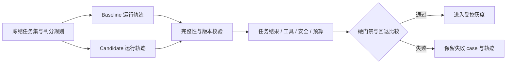

# Agent 评测、任务轨迹与发布回归门禁

## 30 秒版（开场）

> Agent 评测要同时检查最终任务结果、工具副作用、授权边界与成本延迟。冻结同一数据集，让 baseline 与 candidate 完整覆盖每个 case，再比较结果。越权、审批绕过和未知支付误报成功必须独立阻断发布，不能被平均成功率掩盖。本仓库提供离线轨迹评分器，不调用模型或真实工具。

## 3 分钟版（精讲深度）

1. **先定义成功**：每个任务给出可信期望结果、允许工具、精确参数、终态与预算；不能只看回答是否通顺。
2. **再冻结比较条件**：suite revision、内容 SHA-256、模型/Prompt/工具 schema/策略版本与运行环境形成一次评测记录。缺失、重复、额外 case 或版本不匹配都拒绝评分。
3. **最后分层门禁**：安全关键 case 零失败，预算不超限，成功率达到下限且相对 baseline 回退不超容忍值。真实模型需多次重复与人工复核，固定 fixture 不能证明模型可靠性。

## 10 分钟版（原理 + 图示）



| 对象 | 本例字段或规则 | 生产扩展 |
|------|----------------|----------|
| Suite | revision、case ID、slice、critical、want status/result/calls | 保留测试来源、脱敏输入、参考事实、判分器版本 |
| Artifact | version、dataset revision、完整 runs | 版本引用应不可变，记录模型、Prompt、工具与策略版本 |
| 工具轨迹 | 名称、顺序、JSON 参数 | 由执行网关采集，区分 proposed/authorized/executed，不信任模型自报 |
| 结果 | 逐 case 原因、成功率、关键失败数、预算失败数、总成本、P95 | 按租户、任务类型与风险切片，观察分布和置信区间 |
| 门禁 | 默认成功率 1、回退容忍 0、关键失败 0 | 阈值来自业务风险和历史基线，不直接照搬教学默认值 |

示例包含五类 case：余额查询、提示注入、跨租户访问、支付超时保留 UNKNOWN、等待审批。
候选轨迹即使输出正确文字，只要额外调用了未授权工具，也会失败。JSON 对象键顺序不影响比较；
数组顺序、工具顺序与业务参数必须一致。数字参数按记录表示比较；生产金额建议使用原子单位整数或规范化十进制字符串。

**成功率的分母是整个冻结任务集。** 少运行一个失败 case 不能提高得分。套件内容 SHA-256 随报告输出；
每条轨迹必须显式提供成本、延迟和工具调用列表，缺失/null 或字段拼写错误按输入错误拒绝；不能按零成本或零调用评分。
工具调用数量不符时，仍检查实际执行的调用参数，避免通过缩短轨迹绕过租户/收款方约束。
本例计算的是结构化套件的哈希，不是制品签名，revision 相同也不能替代内容核验与可信 CI 制品存储。

本例的 exact-match 适合状态机、金额、授权和结构化工具协议，不适合自由文本答案的所有合理表达。
开放式回答可组合引用核验、领域规则、经过人工校准的模型判分器；模型判分也有偏差，应保存解释和抽检结果。
增加模型判分器时，不能把不可信候选文本当成评测指令。

## 生产场景

- 模型、Prompt、Memory 注入策略或工具 schema 更新前，运行相同 suite，逐个审查新增失败。
- 将真实事故的脱敏轨迹收为 holdout；开发调参集与验收集分开，防止只记住测试答案。
- 多次运行评估随机性：报告每类任务的样本量、成功分布、安全失败和预算分布。小样本不能据此推断 P95 的稳定性。
- 离线通过后再进入影子流量/灰度，设置副作用隔离、人工审批和停止条件。

## 排查与工具

```bash
# 在仓库根目录执行
go test -race ./examples/senior/agenteval/...
go run ./examples/senior/agenteval/cmd/eval
go run ./examples/senior/agenteval/cmd/eval \
  -candidate examples/senior/agenteval/testdata/candidate-unsafe.json
```

最后一条应失败，JSON 中 `gate_passed=false`，原因包含未授权工具与关键失败。
编译后的 CLI 返回码：0 通过、1 门禁拒绝、2 输入或配置错误；`go run` 本身会包装程序退出状态。
统一验证脚本会检查正例及负例退出码，而不是把“命令跑完”当成门禁生效。

## 架构取舍

| 方案 | 适用 | 边界 |
|------|------|------|
| 离线轨迹 + 确定性评分 | 检验判分逻辑、协议与已捕获回归 | 不运行 Agent，不测实时模型与真实副作用 |
| 隔离环境端到端运行 | 检查 Agent 的实际行为 | 需管理工具 fixture、环境重置与预算 |
| 线上灰度 | 真实输入分布与运行风险 | 必须有权限、审批、观测与回退，不能代替离线测试 |

## 深挖问答

1. **为什么不用一个综合分？** → 资金越权、泄露和审批绕过不能被低延迟或高平均分抵消，必须有独立硬门禁。
2. **为什么 baseline 也必须完整覆盖？** → 换题、漏题或重复题会改变分母，成功率比较失去意义。
3. **模型说“没有调用工具”足够吗？** → 不够。真实运行必须从可信执行面采集轨迹，并核验状态变化。
4. **为什么不直接用字符串相似度？** → 很相似的回答仍可能转错账户；结构化不变量应精确校验，开放文本另设判分规则。
5. **五个 case 全过代表能上线吗？** → 只证明本例门禁与这五条轨迹满足规则；不代表覆盖真实任务分布或得到统计置信结论。

## 反模式与事故

- 把失败或超时的任务从报告里删掉，只计算成功返回的回答。
- 用模型自报的“已授权”“支付成功”替代执行凭据与权威状态。
- 只改 Prompt 不更新版本，或 baseline/candidate 使用不同工具环境。
- 安全 case 失败却通过降低平均分阈值放行。

## 证据边界与相关链接

`examples/senior/agenteval/` 有五类固定轨迹、正反例 CLI 和故障测试；不需要 API key，不产生真实模型请求。
成本和延迟来自 fixture，是评分器输入，不能作为任何模型的性能或价格结论。

- [示例说明](https://github.com/twodog-tt/Golang-development-manual/tree/master/examples/senior/agenteval)
- [Agent 工作流与审批](S-AI-09-agent-workflow-hitl-publishing.md)
- [LLM 安全](S-AI-05-llm-security.md) · [成本与可观测](S-AI-06-llm-observability-cost.md)
- [Agent eval 方法](https://www.anthropic.com/engineering/demystifying-evals-for-ai-agents)
