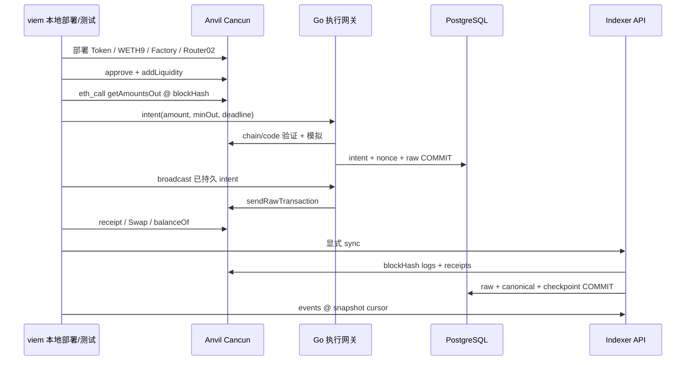

# DeFi 协议接入实战：Uniswap V2 报价、授权、执行与事件核对

## 30 秒版（开场）

> 接入 DeFi 需要把协议身份、资产精度、报价区块、授权范围、minOut/deadline、交易回执和最终余额串起来。我用锁定版本的真实 Uniswap V2 构建产物部署到 Anvil，viem 获取指定 block hash 的报价，Go 网关模拟并持久签名，最后用 Swap、Transfer 和余额差核对成交。故障验证覆盖零授权、过期参数、滑点不足，以及模拟后储备改变导致实际 reverted。池内报价只用于本地确定性测试，不能冒充独立价格保护。

## 3 分钟版（精讲深度）

1. **协议版本固定**：本例明确为 V2 Factory/Pair/Router02，不把 V3 tick 或新版本路由器行为混进来。
2. **资产元数据明确**：本地合成 LAB-USD 为 6 decimals、LAB-ETH 为 18 decimals；原子金额全部使用 bigint/string。
3. **报价可追溯**：固定 block hash 调用 `getAmountsOut`，报告链/合约/路径与代码哈希；报价不是成交承诺。
4. **权限和执行分离**：approve 改变 allowance，swap 才是交易；网关自身固定路径、recipient 与 Router，不接受任意 calldata。
5. **结果多维核对**：receipt status、Pair Swap、Token Transfer、接收余额差与 Indexer canonical 结果一致，才有完整集成证据。

## 10 分钟版（从合约制品到查询）



### 制品与链身份

| 组件 | 固定范围 |
|---|---|
| 节点 | Anvil 1.4.4，chain 31337，Cancun hardfork |
| Go SDK | go-ethereum 1.14.12，PostgreSQL pgx 5.7.4 |
| 钱包客户端 | viem 2.57.7，Node 22，npm lock |
| 协议 | @uniswap/v2-core 1.0.1、@uniswap/v2-periphery 1.1.0-beta.0 |
| 测试 Token | 自有最小 ERC20，solc 0.8.30，Paris target，optimizer 200 |

运行器从 npm 锁定包读取已构建 ABI/bytecode，实际部署协议合约并创建池，报告记录 Router 运行时代码哈希。编译自有 Token 时检查 compiler error，未运行第三方 npm install scripts。

公共链接入还需按 chain ID 核对官方部署地址、工厂/池关系、代理实现和可升级权限，不能只看合约名称。V2 是本课选定的学习协议，不表示它是当前最新协议，也不表示某个同名 Token 就是真实 USDC/WETH。

### 金额与报价

输入示例：`100 LAB-USD = 100000000` 原子单位。输出为 18 位小数，测试中余额增量超过 JS 安全整数，仍以 bigint 精确比较；不能经过 Number、parseFloat 或浮点中间运算。

```javascript
const data = encodeFunctionData({
  abi: routerABI, functionName: 'getAmountsOut',
  args: [amountIn, [tokenA, tokenB]],
});
const raw = await client.request({
  method: 'eth_call',
  params: [{ to: router, data }, { blockHash, requireCanonical: true }],
});
// ABI decode 返回 bigint[]；minOut 使用整数基点计算。
```

固定 hash 使多次读取有明确参照；节点不支持 EIP-1898 时需明确降级策略，不能默默切到 latest。生产还要有报价过期策略和独立价格偏离约束。本地 `quote × 9900 / 10000` 只是测试中的 1% 输出保护，它无法发现池价已被操纵。

V2 常见报价公式为 `amountInWithFee = amountIn × 997`，输出按 `amountInWithFee × reserveOut / (reserveIn × 1000 + amountInWithFee)` 向下取整；本例直接调用锁定 Router 的实现。这个公式不能原样用于 V3、不同手续费池或 transfer-tax Token。

### 授权、deadline 与模拟

本地夹具给 Router 有限测试额度，不使用 uint256 最大授权；失败用例先设置 allowance=0，确认模拟拒绝且数据库不产生意图，再恢复额度。生产宜按业务预算授权、检查剩余额度并提供撤销；某些 Token 需要先置零或不返回标准 bool，必须单独适配，不能从本例推断通用兼容。

deadline 由链上时间定义，不以用户电脑时钟作为最终执行判据。模拟发生在特定观察时刻，不能预定交易排序；测试先模拟一个极紧 minOut，再由另一个账户成交改变储备，原交易上链后 receipt status=0，输出余额保持不变。这证明模拟是门禁，而非成功保证；失败交易仍消耗 gas。

### 事件和资金核对

第一次正常 swap 同时检查：

- intent 的 hash/nonce 在响应丢失、进程重启后保持一致。
- receipt status 成功，指定 Pair 恰好一个 Swap。
- 接收者 TokenOut 余额增量不小于 minOut，且大于 JS 安全整数时仍精确。
- Indexer 对目标 Token Transfer 和 Pair Swap 进行 ABI/receipt 对照并写入 canonical 投影。
- reorg 移除该分支后，旧 raw 仍在，查询不再当作当前有效成交。

原独立入口断言输出余额和事件；新增端到端入口补齐支付与双资产账本，仍不提供全池资产负债表、LP 收益或手续费归因。若连接 [稳定币资金运营](../18-web3-payments-stablecoin/S-PAY-11-stablecoin-channel-operations.md)，应以 canonical/finality 策略驱动幂等入账，不能从 WebSocket 一条 Swap 直接确认清算。两个独立入口继续保留，新的 e2e 入口已经接通实际收款、执行、索引和账务。

## 生产场景

资金运营中的换币适配器应输出协议标识、quote block、路由、期望/最低金额、授权需求、费用预算和 deadline，经过授权策略后交给执行网关。协议 adapter 负责语义转换，signer 负责允许签什么；不要让未经审核的报价服务提供任意 to/data。

本课只实现单池、单向 exact-input，不涉及 lending、清算、vault、staking、跨链 bridge、V3 集中流动性或跨 DEX 最优路由。扩协议前先定义资产与偿付风险、不变量和独立故障矩阵，而不是只增加 ABI 文件。

## 排查与工具

出现 revert 时保存协议版本、Router code hash、quote block、amount/path/minOut/deadline、allowance、余额、receipt 和意图 ID。区分 `eth_call` 失败与已上链 status=0；追踪 nonce/attempt 到 [交易执行网关](../19-node-rpc-staking/S-NODE-11-transaction-execution-gateway-lab.md)，数据缺失则查 [Indexer](../19-node-rpc-staking/S-NODE-12-indexer-query-data-quality-lab.md) 水位。

ABI 的可解码性不等于经济正确性。Token decimals、权限、黑名单、暂停、费用、rebase 和升级可能改变业务语义；只有标准自有 ERC20 的本地成功不能作为真实资产适配证明。

## 可运行示例与故障验证

```bash
docker pull postgres:17-alpine
python3 examples/onchain-execution/verify.py --report /tmp/onchain-execution/result.json
```

[项目 README](https://github.com/twodog-tt/Golang-development-manual/tree/master/examples/onchain-execution) 说明工具版本、接口和证据边界。自动报告包含真实协议部署地址、Router hash、输出金额、replacement 交易、数据质量错误和 reorg 保留数量。全组还会真正 SIGKILL/restart Go 服务、制造 PostgreSQL 写入失败，不只调用纯内存模型。

## 稳定币支付到 DeFi 资金运营的完整项目

[端到端实战](../18-web3-payments-stablecoin/S-PAY-08-temporal-money-workflows.md#payment-e2e) 已实际接通前四篇支付项目：商户 SIWE 登录 → 钱包支付带订单引用的 LABUSD → Indexer 验证 → 支付账本入账 → 资金冻结 → 本课网关执行 V2 swap → 根据 canonical 实际输出记 LABDAI → Outbox/商户 Inbox。

新入口使用两种 6 位小数合成稳定币；本篇原独立入口继续验证 6→18 位小数。10 LABUSD 的输入与实际 LABDAI 输出分别记两笔同资产零和 journal，swap-in、swap-out 和 conversion 状态一次 COMMIT，不能用不同币种金额抵消。价格、手续费和舍入造成的输出差异由实际 Transfer 金额体现，本例未实现独立价格保护或收益归因。

```bash
python3 examples/stablecoin-ops/e2e/verify.py --serve
# source 输出的临时 lab.env 后：
node examples/onchain-execution/client/payment-cli.mjs demo 10
```

可独立 `create/approve/pay/show/convert`。自动验证另用 `--report /tmp/payment-e2e/result.json`；7 组覆盖从缺日志、响应未知、进程中断到跨资产回滚、实际 reverted 和已结算全链路 reorg。指南与接口见 [项目说明](https://github.com/twodog-tt/Golang-development-manual/tree/master/examples/stablecoin-ops/e2e)。

支付和兑换都是本地实际 EVM 调用，不是模型模拟；Token、RPC 和资金场景仍是教学夹具。chain 模式不执行旧模拟退款，没有公链资产托管、真实稳定币风险或线上 DeFi 验收。

## 架构取舍

选择 V2 是为了把后端交付闭环做完整：部署、报价、授权、执行、结果未知恢复、质量门禁、查询回放。加入 V3/V4 或借贷协议时仍能复用意图与查询边界，但需要新的协议约束、费用模型和 Token/position 语义；本课不把 V2 集成成功扩大为所有 DeFi 协议兼容。

## 深挖问答

1. **为什么同一池的报价不能作为独立价格保护？** 它与待执行交易使用相同可操纵储备，缺少独立参照。
2. **授权成功等于 swap 一定成功吗？** 否，额度只是前提，储备、minOut、余额、deadline 和执行顺序仍可能变化。
3. **输出余额增加为什么还要查事件和回执？** 余额可能来自另一笔转账，需将变化与指定 intent/receipt/Pair 关联。
4. **本地 WETH9 代表真实 ETH 风险已覆盖吗？** 不代表；这里没有测试原生币 wrap/unwrap、真实链费用或公共流动性。
5. **reverted 要不要退款？** 先识别哪层资产事实发生；链上状态回滚、gas 消耗和上游业务订单是不同账务问题，不能统一处理。

## 反模式与事故

- 把池内瞬时价格直接认作市场公允价。
- 金额转 Number 后再转换 bigint，精度已不可恢复。
- 无限授权任意报价服务给出的 spender。
- 把模拟成功或广播 hash 当作实际成交。
- reorg 后只删数据，不保留曾观察到成交的证据。

## 证据边界与延伸阅读

`integration_harness` 覆盖本地真实协议字节码与合成资产，无公链资金、真实 Token、MEV、预言机或生产性能验收；公开测试私钥与无认证 API 只绑定回环。协议原理见 [Uniswap V2/V3](S-EXCH-30-uniswap-v2-v3-protocol.md)、[滑点与聚合](S-EXCH-07-aggregator-slippage.md)。

来源：[Uniswap V2 换币指南](https://developers.uniswap.org/docs/protocols/v2/guides/swapping)、[V2 Core](https://github.com/Uniswap/v2-core)、[Router02 源码](https://github.com/Uniswap/v2-periphery/blob/master/contracts/UniswapV2Router02.sol)、[EIP-1898](https://eips.ethereum.org/EIPS/eip-1898)、[viem readContract](https://viem.sh/docs/contract/readContract)。
