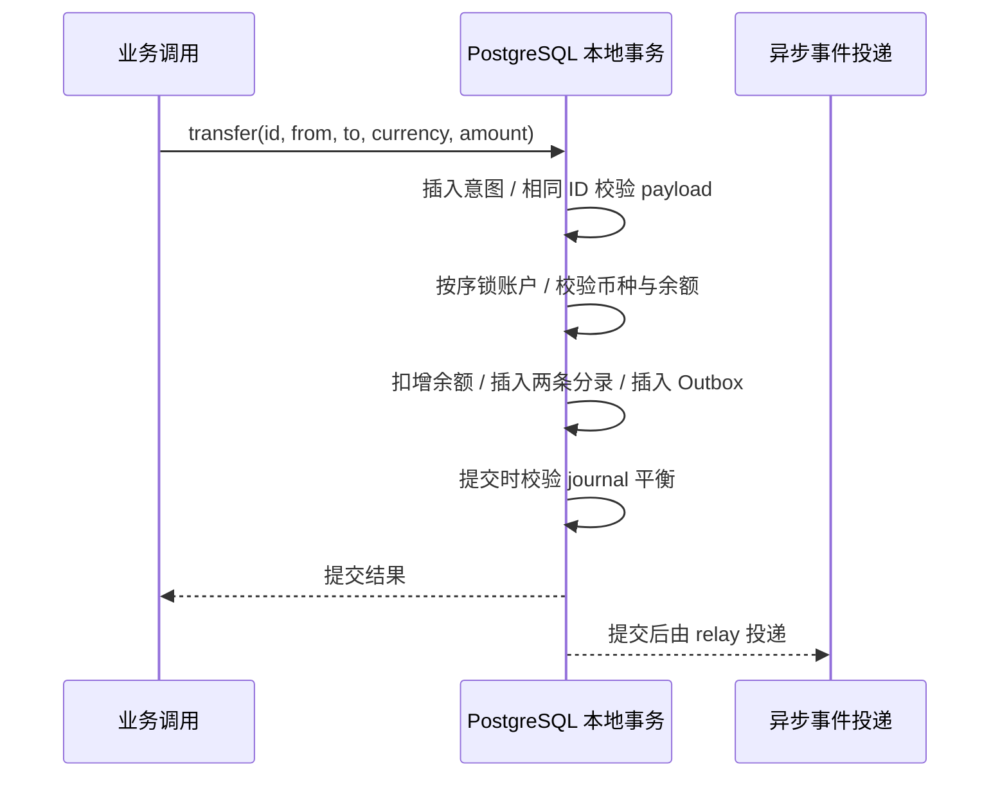

# PostgreSQL 双分录账本：并发扣款、冻结冲正与故障验证

## 30 秒版（开场）

> 资金账本用不可变 journal/entries 保存事实，账户余额是同事务维护、可重建的投影。每笔转账在同一币种下两条有符号分录净额为零；锁定账户、验证余额、写分录和 Outbox 必须原子提交。重试绑定完整业务意图，冲正追加反向事实。仓库提供真实 PostgreSQL 并发、连接终止与差异修复演练。

## 3 分钟版（精讲深度）

1. **金额表示**：例子以原子单位 `bigint` 记账，按币种管理精度，不使用浮点；USDC 与 BTC 不可相加证明守恒。
2. **交易边界**：唯一业务 ID + intent 绑定；按账户 ID 排序加行锁，条件扣减防负余额，同时写 journal、entries、余额和 outbox。
3. **恢复边界**：未提交故障全部回滚；已提交但响应丢失时，用同业务 ID 查询/重试。冲正只新增事实，余额差异先核验不可变事实再在受控写入隔离下重建。

## 10 分钟版（原理 + 图示）



| 表或对象 | 职责 | 不变量 |
|----------|------|--------|
| accounts | 币种、期初快照、当前余额 | 余额非负；币种不可混记；普通应用无直接写权限 |
| journals | ID、完整 intent、reversal_of | ID 重试必须匹配同意图；原事实不可更新/删除 |
| entries | journal、account、currency、delta | 本例每笔恰好两条，按币种 SUM(delta)=0 |
| outbox | 相同本地事务内的待发事件 | journal 未提交时不存在可投递事件 |
| balance_drift | 对比余额与期初 + entries 汇总 | 差异必须可见，不能仅证明分录平衡就声称账户余额正确 |

本例用“来源账户负 delta、目标账户正 delta”表示双边守恒，**不是完整会计科目系统**。
资产/负债科目、正常借贷方向、手续费多分录、批量过账、多币种兑换需单独建模；
兑换应拆成每个币种各自平衡的分录组。期初快照是显式 fixture，生产期初导入必须有可核验对账证据。

冻结将 `alice_available` 转入 `alice_held`；解冻对冻结 journal 追加反向 journal。
这是子账户迁移模型；示例只演示全额释放/全额冲正，不实现部分冻结消耗、部分退款或业务授权服务。
冲正也必须有足够可用资金；已被花掉的收款不能靠强制负余额掩盖，需要催收/应收或其他明确科目。

`lab.transfer` 与 `lab.reverse_transfer` 是固定 `search_path` 的 SECURITY DEFINER 入口。
底层过账函数不授予应用执行权限，表也不授予 DML；避免应用绕过分录直接改余额或伪造 reversal。
这仍然是内部数据库接口，不能直接暴露给用户；租户/账户授权、审批与额度应在可信服务层检查。
管理员能够绕过或破坏约束，演练的误删与漂移注入正是管理员故障，数据库超级用户不是威胁隔离边界。

## 生产场景

- 提现预占、订单冻结与支付转账使用稳定业务键；请求超时不能直接创建新业务 ID 再扣一次款。
- 只在确认 SQLSTATE 和事务结果后重试；死锁/序列化冲突需要完整事务重试，未知提交要先查权威 journal。
- 本例排序加锁降低常见反向转账死锁，不能保证包含其他对象锁的复杂流程永远无死锁。

## 排查与工具

```bash
# Python 标准库 + Docker；自动创建并清理独立容器，不连接现有数据库
python3 examples/postgres-reliability/verify.py --only ledger
```

| 故障注入 | 应观察到的结果 |
|----------|----------------|
| 同业务 ID 并发重试 4 次 | 只扣一次；相同 ID 改金额被拒绝 |
| 余额 100 的账户并发支付两笔 80 | 只允许一笔，剩余 20 |
| 冻结后重复解冻、另一 ID 再次冲正 | 同 ID 幂等；第二次冲正被唯一约束拒绝 |
| 转账函数执行后、COMMIT 前终止连接 | journal、分录、余额、Outbox 全部回滚 |
| 无分录 journal 尝试 COMMIT | 延迟约束拒绝提交 |
| 管理员制造余额 +1 的漂移 | drift 视图检出；隔离写入后从分录重建归零 |

记录 `business_id`、journal ID、账户、币种、金额、SQLSTATE 和事务耗时；监控余额差异、
锁等待、失败比例与 Outbox 最老年龄。日志不记录敏感用户资料。

## 架构取舍

单库行锁与本地事务适合先建立可靠资金核心；跨库资金移动需要清结算与补偿，不能把本例行锁扩大为跨服务原子性。
将过账逻辑放在数据库便于将约束与事实放在一起，但增加 SQL 迁移、权限与版本测试责任。
Go 服务可调用这些入口；演练通过 `psql` 操作真实 PostgreSQL，不另加 Go 数据库驱动。

## 深挖问答

1. **为什么不只 UPDATE balance？** → 缺少可追溯事实、重建依据与按币种守恒核验，也无法解释历史变动。
2. **唯一业务键足够吗？** → 不够。同键不同金额/账户必须报冲突，不能返回第一次结果并静默忽略新意图。
3. **为什么冲正不能 DELETE 原分录？** → 会破坏审计与下游已消费事实，应追加引用原 journal 的反向事实。
4. **漂移能直接修余额吗？** → 必须先核验期初和分录可信、明确差异来源并隔离并发写入；若事实本身错误，应走业务纠错而非投影覆盖。
5. **为什么不用分布式锁？** → 权威数据就在同一数据库，行锁与约束能直接保护事务；外部租约不能代替数据库原子条件。

## 反模式与事故

- 金额使用 float，或将不同资产数量相加声称账平。
- 在拿到数据库提交结果前发送不可撤销外部事件。
- 超时后换新 ID 重扣，或把未知提交一律标失败。
- 普通应用可以直接 UPDATE 余额，跳过过账入口。

## 证据边界与相关链接

本例在 PostgreSQL 单实例演练中检查守恒、余额投影、权限、并发与回滚；没有实现完整会计、审批、
数据库 HA 或生产资金托管。固定样本通过不代表吞吐能力或所有隔离异常均已覆盖。

- [账本与三方对账](S-PAY-04-ledger-clearing-settlement-reconciliation.md)
- [Outbox/Inbox 实战](../middleware/distributed/S-DIST-06-outbox-inbox-fault-lab.md)
- [数据库恢复演练](../middleware/postgresql/S-PG-04-pitr-restore-drill.md)
- [PostgreSQL 显式锁](https://www.postgresql.org/docs/17/explicit-locking.html) · [约束](https://www.postgresql.org/docs/17/ddl-constraints.html)
