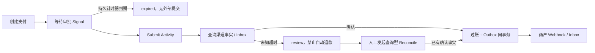

# Temporal 资金长流程：审批、恢复、补偿与版本回放

## 30 秒版（开场）

> Temporal 持久化 Workflow 历史，Worker 重启后通过确定性重放继续执行。它不能替代业务幂等或保证渠道只收一次钱。本项目把人工审批、渠道提交、查询、账本过账和商户通知串成流程；Activity 的外部副作用各有稳定业务 ID，状态未知进入人工核对，不自动重新付款。

## 3 分钟版（精讲深度）

1. **确定性边界**：Workflow 只编排，用 `workflow.Now/Sleep/GetVersion`；SQL、HTTP 和真实时钟留在 Activity。不要在 Workflow 中启动原生 goroutine 或访问数据库。
2. **副作用边界**：渠道以 payment ID 去重，账本以 `settle:<id>` 去重，退款以相同支付 ID 查找已存在的退款，商户通知以 journal/event ID 去重。
3. **人工边界**：商户会话校验通过后，API 才发送审批 Signal。收到 Signal 不代表已完成支付；审批超时没有渠道转账，观察超时保留 `review`。

## 10 分钟版（原理 + 图示）



`Input` 保存 payment ID、商户、金额、资产和报价截止时间，不能在重试时生成新的付款业务 ID。API 创建数据库记录后若启动 Workflow 失败，调用者使用同一幂等键重试，重新启动相同 Workflow ID。

`PaymentWorkflow` 在审批后执行 `Submit → Observe → Settle → Notify`。提交响应丢失时 Activity 重试同一渠道业务 ID；超过重试次数进入 review，不推导“对方没收到”。`ReconcileWorkflow` 只查询既存渠道记录，不调用创建转账。

退款使用独立 `RefundWorkflow`：先进入 `refund_pending`，渠道确认退款后才写反向账本。重试耗尽时状态继续保留，不自动假设外部退款失败。这个示例只支持全额退款，没有跨渠道资金腿的通用 Saga 自动补偿。

### 运行中流程升级

`approval-audit` 的 `GetVersion(DefaultVersion, 1)` 为新流程增加审批审计 Activity，旧历史走不新增命令的分支。实验先用无 marker 的旧实现夹具运行，SIGKILL 后换新实现接续；最终导出真实历史，并分别用兼容实现和故意不兼容实现重放。

这验证一个具体兼容变化，不证明任意 Workflow 修改安全。不要删除旧分支、变更已有 Activity 顺序或把 `GetVersion` 当作滚动升级的万能开关。生产还需评估 Worker Versioning、历史保留、长流程重放和数据转换器兼容。

## 生产场景

- 渠道提交成功但 HTTP 504：复用原业务 ID，回查状态，不创建第二笔。
- 账本提交后 Activity 响应丢失：重试仍返回同一 journal，余额只增加一次。
- 商户收件后响应丢失：同 event ID 重投，收件方 Inbox 去重；通知失败不撤销已过账资金。
- 运营审批超时：Workflow 持久计时器结束，原支付保留 expired；延期应建明确的新业务尝试。

## 排查与工具

关联 `payment_id / workflow_id / run_id / activity_attempt / provider_id / journal_id / event_id`。本地运行器保存历史回放结果；Temporal UI/CLI 可查看等待 Signal、重试和失败 Activity。金额、商户等会进入历史，生产要限制敏感字段、配置 namespace 权限与保留期限，不能把私钥或 bearer token 放入 Workflow 参数。

## 可运行示例与故障验证

统一项目入口：[stablecoin-ops](https://github.com/twodog-tt/Golang-development-manual/tree/master/examples/stablecoin-ops)。在仓库根目录运行：

```bash
docker pull postgres:17-alpine
docker pull temporalio/temporal:1.5.1
python3 examples/stablecoin-ops/verify.py --report /tmp/stablecoin-ops.json
```

实际验证：旧 Worker 进程 SIGKILL、新 Worker 接续、提交响应丢失、持久审批超时、账本提交后响应丢失、真实历史正向回放，以及不兼容流程的负向回放。SDK 单测另验证新流程审批与 Activity 重试，不能将单测时间跳跃等同于服务端持久性验证。

## 架构取舍

简单、短时任务可用数据库状态机与队列；当流程跨人工操作、分钟以上等待、外部请求和多阶段恢复时，再评估 Temporal。Activity 重试不是分布式事务，渠道、账本和通知仍分别定义幂等键。

## 深挖问答

1. **Worker 崩溃为什么不会从头付款？** 历史记录已完成的命令结果；但 Activity 完成结果未持久化时仍可能重试，外部幂等不可省略。
2. **为什么不用通用补偿把超时的钱退回？** 超时可能已经付款；退款本身也是新的外部资金操作，应先核对权威事实。
3. **为什么需要负向回放？** 仅跑新流程不能发现已有历史与新命令序列不一致。
4. **Signal 能替代审批权限吗？** 不能；访问控制属于受保护 API/Temporal 网络边界，Signal 只是流程输入。

## 反模式与事故

- 在 Activity 每次重试生成不同 payment ID。
- 把 Workflow 重试解释为端到端 exactly-once。
- 旧历史未验证就调整命令顺序或删除版本分支。
- 付款状态未知时解除冻结或自动创建反向外部付款。

## 证据边界与相关链接

`integration_harness`：真实本地 Temporal、PostgreSQL 与进程中断，渠道和商户为本地 HTTP 夹具，没有真实稳定币转账或生产验收。继续阅读 [钱包身份](S-PAY-09-wallet-auth-siwe.md)、[SDK 联调](S-PAY-10-go-typescript-web3-integration.md)、[渠道运营](S-PAY-11-stablecoin-channel-operations.md) 与 [既有账本](S-PAY-07-postgresql-double-entry-ledger-lab.md)。

## 延伸阅读

- [docs.temporal.io](https://docs.temporal.io/develop/go)
- [docs.temporal.io](https://docs.temporal.io/develop/go/workflows/versioning)
- [docs.temporal.io](https://docs.temporal.io/develop/go/best-practices/testing-suite)
