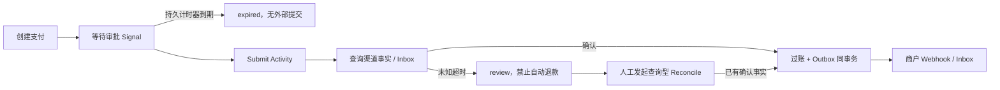
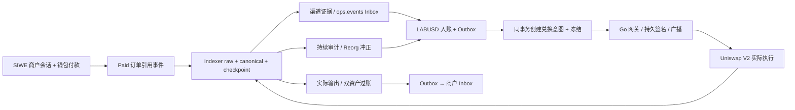

# Temporal 资金长流程：审批、恢复、补偿与版本回放

## 30 秒版（开场）

> Temporal 持久化 Workflow 历史，Worker 重启后通过确定性重放继续执行。它不能替代业务幂等或保证渠道只收一次钱。本项目把人工审批、渠道提交、查询、账本过账和商户通知串成流程；Activity 的外部副作用各有稳定业务 ID，状态未知进入人工核对，不自动重新付款。

## 3 分钟版（精讲深度）

1. **确定性边界**：Workflow 只编排，用 `workflow.Now/Sleep/GetVersion`；SQL、HTTP 和真实时钟留在 Activity。不要在 Workflow 中启动原生 goroutine 或访问数据库。
2. **副作用边界**：渠道以 payment ID 去重，账本以 `settle:<id>` 去重，退款以相同支付 ID 查找已存在的退款，商户通知以 journal/event ID 去重。
3. **人工边界**：商户会话校验通过后，API 才发送审批 Signal。收到 Signal 不代表已完成支付；审批超时没有渠道转账，观察超时保留 `review`。

## 10 分钟版（原理 + 图示）



`Input` 保存 payment ID、商户、金额、资产和报价截止时间，不能在重试时生成新的付款业务 ID。API 创建数据库记录后若启动 Workflow 失败，调用者使用同一幂等键重试，重新启动相同 Workflow ID。

`PaymentWorkflow` 在审批后执行 `Submit → Observe → Settle → Notify`。提交响应丢失时 Activity 重试同一渠道业务 ID；超过重试次数进入 review，不推导“对方没收到”。`ReconcileWorkflow` 只查询既存渠道记录，不调用创建转账。

退款使用独立 `RefundWorkflow`：先进入 `refund_pending`，渠道确认退款后才写反向账本。重试耗尽时状态继续保留，不自动假设外部退款失败。这个示例只支持全额退款，没有跨渠道资金腿的通用 Saga 自动补偿。

### 运行中流程升级

`approval-audit` 的 `GetVersion(DefaultVersion, 1)` 为新流程增加审批审计 Activity，旧历史走不新增命令的分支。实验先用无 marker 的旧实现夹具运行，SIGKILL 后换新实现接续；最终导出真实历史，并分别用兼容实现和故意不兼容实现重放。

这验证一个具体兼容变化，不证明任意 Workflow 修改安全。不要删除旧分支、变更已有 Activity 顺序或把 `GetVersion` 当作滚动升级的万能开关。生产还需评估 Worker Versioning、历史保留、长流程重放和数据转换器兼容。

## 生产场景

- 渠道提交成功但 HTTP 504：复用原业务 ID，回查状态，不创建第二笔。
- 账本提交后 Activity 响应丢失：重试仍返回同一 journal，余额只增加一次。
- 商户收件后响应丢失：同 event ID 重投，收件方 Inbox 去重；通知失败不撤销已过账资金。
- 运营审批超时：Workflow 持久计时器结束，原支付保留 expired；延期应建明确的新业务尝试。

## 排查与工具

关联 `payment_id / workflow_id / run_id / activity_attempt / provider_id / journal_id / event_id`。本地运行器保存历史回放结果；Temporal UI/CLI 可查看等待 Signal、重试和失败 Activity。金额、商户等会进入历史，生产要限制敏感字段、配置 namespace 权限与保留期限，不能把私钥或 bearer token 放入 Workflow 参数。

## 可运行示例与故障验证

统一项目入口：[stablecoin-ops](https://github.com/twodog-tt/Golang-development-manual/tree/master/examples/stablecoin-ops)。在仓库根目录运行：

```bash
docker pull postgres:17-alpine
docker pull temporalio/temporal:1.5.1
python3 examples/stablecoin-ops/verify.py --report /tmp/stablecoin-ops.json
```

实际验证：旧 Worker 进程 SIGKILL、新 Worker 接续、提交响应丢失、持久审批超时、账本提交后响应丢失、真实历史正向回放，以及不兼容流程的负向回放。SDK 单测另验证新流程审批与 Activity 重试，不能将单测时间跳跃等同于服务端持久性验证。

<div id="payment-e2e"></div>

## 端到端实战：支付到链上兑换

这次将支付项目与交易网关、Indexer 和 Uniswap V2 真正接通。原模拟渠道验证入口保留；新模式的收款由钱包向本地 PaymentReceiver 付款，Indexer 证明订单引用、Token、金额与确认深度，随后才进入账本。不是由测试脚本把渠道数据库改成 confirmed。



### 一键运行与逐步交互

需要原项目依赖与 Anvil 1.4.4；链固定 Cancun/31337，LABUSD 和 LABDAI 都为 6 位小数。仓库根目录执行：

```bash
docker pull postgres:17-alpine
docker pull temporalio/temporal:1.5.1
python3 examples/stablecoin-ops/e2e/verify.py --report /tmp/payment-e2e/result.json

# 启动全新交互环境，不先运行重组故障矩阵
python3 examples/stablecoin-ops/e2e/verify.py --serve
# 另一终端 source 运行器输出的临时 lab.env 后：
node examples/onchain-execution/client/payment-cli.mjs demo 10
```

`demo` 完成 SIWE 登录、建单、审批、钱包授权/付款、等待入账、请求报价、兑换与输出入账。也可逐步 `create KEY AMOUNT`、`approve ID`、`pay ID`、`show ID`、`convert ID`。完整工具、接口、恢复与故障矩阵见 [端到端运行指南](https://github.com/twodog-tt/Golang-development-manual/tree/master/examples/stablecoin-ops/e2e)。

### 不能省略的提交边界

| 边界 | 持久身份 / 判定 |
|---|---|
| 支付收款 | payment ID 写入 bytes32 reference；Paid 的 reference/amount/Token 与订单一致 |
| 收款过账 | ops.events 保存不可变链证据；入账时重核 canonical 并持久化 settlement_evidence；settle 与 Outbox 同事务 |
| 资金冻结 | 一个订单只有一个 conversion；hold journal 与不可变请求同事务，intent 固定 convert_paymentID |
| 链上执行 | 原文先持久化；响应未知、进程中断后仍查询原 nonce/hash/attempt |
| 输出入账 | 已索引 canonical Swap + 输入/输出 Transfer；swap-in、swap-out、conversion 状态同事务 |
| 后续审计 | ChainPaymentWorkflow 入账后持续查询，通知失败仍审计，50 轮 ContinueAsNew；冲正失败或证据变化进入 review_chain，不自动重发 |

各币种分别平衡；不把 10 LABUSD 输入写成 10 LABDAI 输出。输出使用实际链上金额字符串，最小输出只是一条拒绝条件。节点观察、chain 数据库与支付数据库不构成跨系统 ACID；持续审计处理观察后重组窗口。

新模式使用单独的 ChainPaymentWorkflow / ConversionWorkflow / ChainReconcileWorkflow，原 PaymentWorkflow 的命令顺序与 approval-audit 历史版本分支保留。原历史正负回放继续由旧 harness 验证；新监控的 ContinueAsNew 与 chain-monitor-after-notify 新旧分支另有 SDK 时间跳跃测试，不夸大成生产滚动升级验收。

### 故障与验收

12 组实际集成验证覆盖收款缺 Paid、Worker 重启、广播成功但响应丢失、gateway/worker SIGKILL、缺 Swap 时维持冻结、跨资产 COMMIT 抛错与同意图恢复、实际 reverted 后释放冻结、错误金额不入账、已结算 Paid/Swap 重组后的顺序冲正，以及真实 custody/账本/未归属资金对账。新增验证通知重试耗尽仍审计、输出已消费时整组冲正回滚与商户暂停换币、新分支不足确认深度拒绝旧证据、旧 Activity 参数不能再次入账/释放，以及无 intent 的冻结仍能识别收款重组。通知持久化后丢 ACK 仍只有一个 Inbox。详细断言与逐组证据见运行指南及本次报告。

错误金额占用 reference、spend 在其他分支仍存在、资金已被消费或长期结果未知都不能自动退款；本例会拒绝入账或进入独立的 review_chain、保留原记账阶段并暂停该商户后续换币，需人工核对；普通数据库失败的 conversion=review 仍可在 payment=settled 且证据一致时 resume。chain 模式禁用旧模拟退款接口和模拟 webhook；没有实现真实链上退款、gas 会计或生产资产托管。

<div id="operator-recovery"></div>

### 人工核对与安全恢复

`review_chain` / `review_required` 的解封需要完整恢复决定。新增本地操作员 CLI：`inspect` 查看两库与 canonical 证据；`plan rebind|cancel|compensate|release-signer TARGET --out FILE` 保存计划；人工阅读后 `apply FILE --operator NAME --ticket ID`。计划绑定事实与过期时间，执行时重新核验；禁止直接清除状态标记。

```bash
python3 examples/stablecoin-ops/e2e/verify.py --recovery --report /tmp/payment-recovery/result.json
# 构造可交互的隔离案例，按输出的 lab.env 继续操作：
python3 examples/stablecoin-ops/e2e/verify.py --recovery --serve
```

5 组恢复验证覆盖计划篡改/过期、原分录核对、真实同 nonce 取消及未知回包、跨资产原子冲正、跨库封存先提交、审计启动 ACK 丢失，以及解封后新的真实付款/兑换。取消必须先持久签名，再等待 canonical 确认；无 intent 时先写不可自动撤销的退休屏障。恢复提交同时写入审计启动任务，Worker 重启后也能补启动。完整命令、支持/拒绝矩阵与证据见 [人工恢复运行手册](https://github.com/twodog-tt/Golang-development-manual/blob/master/examples/stablecoin-ops/e2e/RECOVERY.md)。

普通支付/链上/端到端的 11/10/12 组入口保留，恢复入口独立 5 组，总计 38 组集成场景。解封须所有相关业务已核对、无 pending/nonce 缺口、托管与账本一致。已经冲正又重新出现的兑换、未知 nonce、余额不足和事实缺失仍然隔离；本例不自动生成新 nonce 或改写账本绕过人工判断。

## 架构取舍

简单、短时任务可用数据库状态机与队列；当流程跨人工操作、分钟以上等待、外部请求和多阶段恢复时，再评估 Temporal。Activity 重试不是分布式事务，渠道、账本和通知仍分别定义幂等键。

## 深挖问答

1. **Worker 崩溃为什么不会从头付款？** 历史记录已完成的命令结果；但 Activity 完成结果未持久化时仍可能重试，外部幂等不可省略。
2. **为什么不用通用补偿把超时的钱退回？** 超时可能已经付款；退款本身也是新的外部资金操作，应先核对权威事实。
3. **为什么需要负向回放？** 仅跑新流程不能发现已有历史与新命令序列不一致。
4. **Signal 能替代审批权限吗？** 不能；访问控制属于受保护 API/Temporal 网络边界，Signal 只是流程输入。

## 反模式与事故

- 在 Activity 每次重试生成不同 payment ID。
- 把 Workflow 重试解释为端到端 exactly-once。
- 旧历史未验证就调整命令顺序或删除版本分支。
- 付款状态未知时解除冻结或自动创建反向外部付款。

## 证据边界与相关链接

`integration_harness`：原模式覆盖真实本地 Temporal/PostgreSQL 与模拟渠道；新端到端模式另覆盖实际本地链收款/兑换、双资产账本及持续审计。商户为 HTTP 夹具，没有公链资金或生产验收。继续阅读 [钱包身份](S-PAY-09-wallet-auth-siwe.md)、[SDK 联调](S-PAY-10-go-typescript-web3-integration.md)、[渠道运营](S-PAY-11-stablecoin-channel-operations.md) 与 [既有账本](S-PAY-07-postgresql-double-entry-ledger-lab.md)。

## 延伸阅读

- [docs.temporal.io](https://docs.temporal.io/develop/go)
- [docs.temporal.io](https://docs.temporal.io/develop/go/workflows/versioning)
- [docs.temporal.io](https://docs.temporal.io/develop/go/best-practices/testing-suite)
