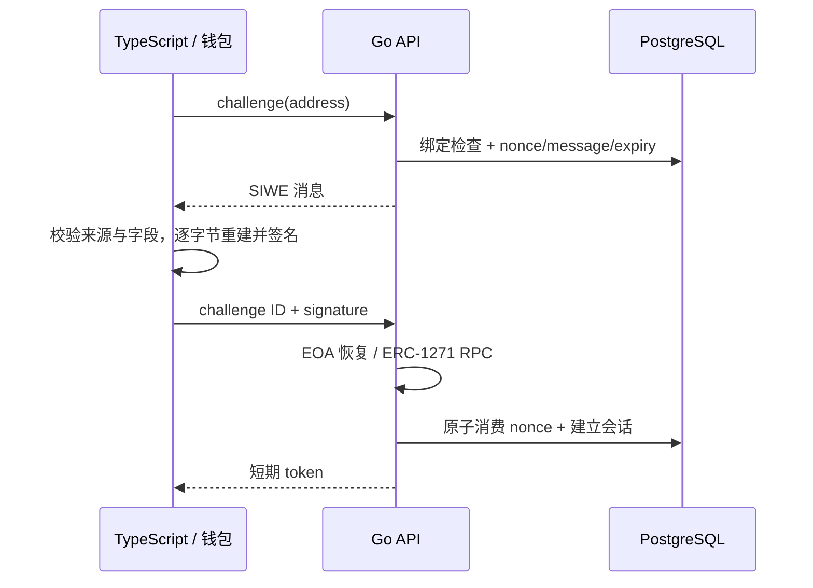

# 钱包登录与账号绑定：SIWE、合约验签和会话撤销

## 30 秒版（开场）

> 钱包登录证明对指定消息的签名能力，不代表有权付款或管理任意商户。服务端生成绑定 domain、URI、chain、地址、nonce 和有效期的 SIWE 消息；验证后原子消费 nonce，再签发短期会话。EOA 与合约钱包采用不同验证路径，租户来自服务端绑定关系，解绑必须撤销会话而保留账本。

## 3 分钟版（精讲深度）

1. **消息属于谁**：服务端以配置生成 domain/URI，不能信任来路 Host header。客户端重建消息并检查请求来源，签名不能用于另一个站点。
2. **nonce 只用一次**：随机生成，数据库记录有效期；并发验签都通过时，原子 DELETE 也只能允许一次登录成功。
3. **会话属于谁**：opaque bearer token 在服务端仅存 SHA-256 摘要，绑定商户并有期限。支付接口不接受调用者自行声明的 merchant ID。

## 10 分钟版（原理 + 图示）



本例使用 ERC-191 消息签名，不把 EIP-712 typed-data 或交易签名混用为 SIWE。消息由服务器生成并保存，登录只提交 challenge ID 和签名，因此客户端不能替换服务端已绑定的 domain、URI 或链字段。

### EOA 与合约钱包

| 路径 | 检查 | 失败行为 |
|---|---|---|
| EOA | 65 字节签名、合法 recovery ID、低 s、恢复地址一致 | 拒绝登录 |
| 已部署 ERC-1271 钱包 | 绑定记录指定模式；核对 RPC chain ID，在固定块高调用 isValidSignature | 错链、错误 magic、RPC 错误均拒绝 |
| 未部署/其他钱包 | 本例没有 ERC-6492 或完整委托验证 | 不以 EOA fallback 掩盖不支持 |

钱包模式由服务端可信绑定记录确定，调用者不能自由切换。RPC 验证只覆盖当时区块状态；合约权限后来改变时，既有离线会话不会天然失效，生产需缩短期限并设置重新验证/撤销机制。

### 绑定和撤销

项目初始化 SQL 将两个公开夹具钱包分别绑定到商户 A/B，没有匿名注册或自助增加绑定。生产新增钱包应是独立的、带当前账号授权和新钱包所有权证明的流程，不能仅提交一个地址。

`DELETE /wallets/{address}` 仅删除当前商户的绑定，同时删除关联 challenge 并撤销该商户全部会话；它不会删除支付、journal 或历史分录。最后一个钱包解绑后需管理员恢复。`DELETE /session` 只撤销当前 token。生产还需 step-up、审批职责分离、审计与恢复策略。

## 生产场景

- 恶意站点诱导用户签名：前后端都检查预期 domain/URI，不能仅看 recovered address。
- 两个登录请求竞争 nonce：两个签名都可能合法，最终只有一个数据库消费成功。
- 合约 RPC 不可用：显式失败，不能降级成“签名看起来正确就放行”。
- token 被盗：短期到期、退出和解绑撤销减少暴露窗口；bearer 仍须通过 HTTPS 传输。

## 排查与工具

记录 challenge ID、预期 scope、验证模式、固定链/块高和拒绝类型；不要记录完整 bearer token、用户私钥或把登录消息当作付款授权。失败限流和防账户枚举属于生产边界，本例只监听回环且没有完整实现。

## 可运行示例与故障验证

```bash
python3 examples/stablecoin-ops/verify.py --report /tmp/stablecoin-ops.json
cd examples/stablecoin-ops && go test -race ./...
```

TypeScript/Go 联调验证：原消息成功，篡改 URI、过期 nonce、并发 replay 和跨租户请求失败；退出/解绑后会话失效，账本事实仍在。Go 单测的 ERC-1271 HTTP RPC fixture 验证正确 magic、固定块高、错误 chain、错误 magic 与 RPC 故障，**不是实际链上合约验收**。

## 架构取舍

钱包签名适合账号所有权证明，普通后端会话依然需要期限、作用域、撤销和安全传输。受监管资金操作通常还需要更强身份、角色、额度和人工复核，不能以“钱包已登录”替代。

## 深挖问答

1. **为什么验签成功后仍要原子消费 nonce？** 验签可以并发成功，一次性语义必须由存储保证。
2. **为什么不接受前端传入 merchant ID？** 地址证明属于登录主体，商户权限来自服务端可信映射。
3. **1271 失败能否再尝试 EOA？** 本例严格按绑定模式处理，避免绕过合约的权限策略。
4. **解绑后删除支付记录吗？** 不删除，账号访问与资金审计生命周期不同。

## 反模式与事故

- 只验证恢复地址，不验证消息 scope 和 nonce。
- 在内存保存 nonce，重启或多实例后出现 replay 窗口。
- 把错误 RPC 的响应视为签名有效。
- 用一个永久 bearer token 表示所有钱包、所有商户和全部审批权限。

## 证据边界与相关链接

本例 EOA 路径由 viem 签名并由 Go 验证；合约钱包仅模拟 RPC，未实现 Passkey、ERC-6492 或完整账户委托。项目入口见 [Temporal 资金流程](S-PAY-08-temporal-money-workflows.md)，后续阅读 [SDK 联调](S-PAY-10-go-typescript-web3-integration.md)、[渠道运营](S-PAY-11-stablecoin-channel-operations.md)。

## 延伸阅读

- [ercs.ethereum.org](https://ercs.ethereum.org/ERCS/erc-4361)
- [ercs.ethereum.org](https://ercs.ethereum.org/ERCS/erc-1271)
- [viem.sh](https://viem.sh/docs/siwe/utilities/createSiweMessage)
