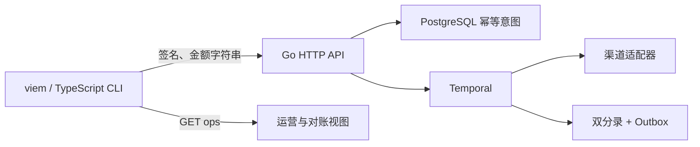

# Go 与 TypeScript Web3 联调：精度、消息签名和支付 API

## 30 秒版（开场）

> Go 与 TypeScript 的边界需要明确金额、地址、消息字节和错误契约。本项目用 viem 生成签名，Go 验证 SIWE 并执行业务；所有原子金额以十进制字符串通过 JSON，TypeScript 用 bigint，Go 用受限 int64，拒绝隐式舍入和浮点数。

## 3 分钟版（精讲深度）

1. **金额契约**：USDC 夹具使用 6 位小数，`1.000001 → "1000001"`；输入超过 6 位小数明确拒绝，不能让 SDK 替资金业务决定舍入策略。
2. **签名契约**：Go 返回完整 SIWE 消息，viem 解析并重建；时间格式、换行、大小写或 scope 不同都停止签名。
3. **接口契约**：前端只提供 amount、asset、幂等键；后端从会话派生 merchant。HTTP 409 表示意图/状态冲突，503 表示创建记录后 Workflow 暂时不可用，重试仍用原幂等键。

## 10 分钟版（原理 + 图示）

| 值 | TypeScript | JSON | Go / PostgreSQL |
|---|---|---|---|
| 金额 | bigint / 格式校验后的十进制字符串 | string | int64 / bigint，正数且 ≤10^18 |
| 支付 ID | string | string | 服务端随机生成，同商户同幂等键返回同 ID |
| 地址 | viem account 的校验地址 | string | common.Address 规范化 |
| SIWE 时间 | Date 与规范化 ISO 字符串 | 消息内部字符串 | UTC、毫秒格式，与 SDK 重建逐字节比较 |
| token | 短期进程内变量 | bearer header | 仅存摘要、商户及到期时间 |



`Number.MAX_SAFE_INTEGER` 约束的是 JS Number。本例创建金额原子字符串 `9007199254740993`，确认经 API 和数据库后仍完全相同；该大额用例没有审批或真实资金转移。Go 不接受科学计数法、前导零、负数或超界值。

### 签名兼容

`OpsClient.login` 调用 `parseSiweMessage/createSiweMessage` 对照后再 `account.signMessage`，Go 使用对应 EIP-191 摘要恢复 EOA。不能把 `signTransaction`、`signTypedData` 与这条消息签名路径相互替代。生产客户端应由用户钱包签名；CLI 的私钥 1/2 仅是公开本地夹具。

首轮联调能发现日期末尾 `.000Z` 与 `Z` 这类语义相同但字节不同的差异。服务端和客户端最终固定一种表示，不让客户端“随便重排字段后继续签”。

## 生产场景

- 同时点击八次创建：发送同业务幂等键，后端只有一个支付 ID。
- 同 key 修改金额：后端返回 409，不静默复用错误意图。
- 伪造 merchant header：后端覆盖为当前会话租户，不能读取另一商户支付。
- 小数位过多：前端和服务端拒绝，不能先用 Number 计算后再转 string。

## 排查与工具

在请求中关联 payment ID 和幂等键；只在脱敏 fixture 中比较原消息、摘要和签名。生产日志不能输出 token 或私钥。使用 `npm ci` 与锁文件重现依赖，Go 独立 module 固定 SDK，不污染原仓库 vendor。

## 可运行示例与故障验证

```bash
python3 examples/stablecoin-ops/verify.py --serve
# 按运行器输出在另一终端 source 临时 lab.env
cd examples/stablecoin-ops/client
npm run ops -- create order-001 1.000001
npm run ops -- approve PAYMENT_ID
npm run ops -- get PAYMENT_ID
npm run ops -- ops
```

完整自动验证：

```bash
python3 examples/stablecoin-ops/verify.py --report /tmp/stablecoin-ops.json
```

编译检查、签名成功/失败、超 JS 安全整数、舍入拒绝、并发幂等、租户隔离均在真实 Go API + PostgreSQL 上验证。项目当前 SDK 实战范围是钱包消息签名和资金 API；没有声称已经验证真实合约 ABI 调用、交易签名或 SDK 在所有链上的兼容性。

## 架构取舍

Go 承载资金约束和后端流程，TypeScript 用于钱包 SDK 与运营联调。选择一个主力 SDK 并验证边界即可，增加另一套 SDK 应有具体兼容需求。CLI 用小 DTO 和严格服务端解码；更大系统可通过 OpenAPI 生成客户端，但生成类型不能替代运行时校验。

## 深挖问答

1. **为什么金额要 string 而不直接传 bigint？** JSON 不直接支持 bigint，Number 可能丢失精度，十进制字符串的跨语言语义更明确。
2. **有 TypeScript 类型还需服务端校验吗？** 调用者可以绕过 TS，服务端必须独立检查金额、资产、租户和幂等意图。
3. **相同时间为何可能验签失败？** 签名针对字节，不针对解析后的日期对象。
4. **503 后换新幂等键能提高成功率吗？** 可能创建第二笔业务，必须保留原意图并查状态。

## 反模式与事故

- 金额经过 `parseFloat` 再转字符串。
- 依赖 SDK 默认小数舍入，业务未指定规则。
- 保存登录签名作为长期付款授权。
- 只在前端实现租户隔离，后端信任 caller header。

## 证据边界与相关链接

这是可运行 Go/viem 互操作项目，未接真实钱包扩展、真实链或真实 USDC。继续阅读 [钱包身份](S-PAY-09-wallet-auth-siwe.md)、[资金流程](S-PAY-08-temporal-money-workflows.md)、[渠道运营](S-PAY-11-stablecoin-channel-operations.md)。

## 延伸阅读

- [viem.sh](https://viem.sh/docs/siwe/utilities/createSiweMessage)
- [viem.sh](https://viem.sh/docs/accounts/local/signMessage)
- [viem.sh](https://viem.sh/docs/utilities/parseUnits)
