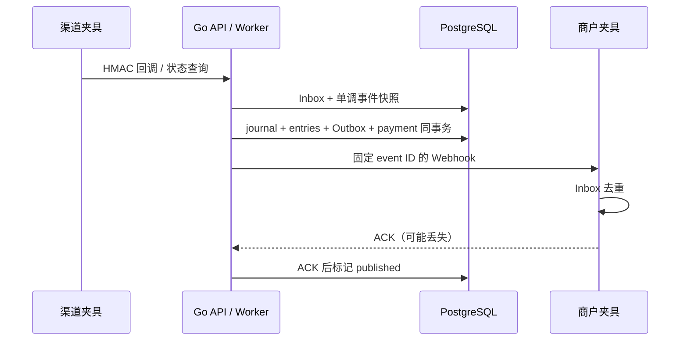

# 稳定币渠道与资金运营：未知状态、Webhook、退款和对账闭环

## 30 秒版（开场）

> 渠道请求、链上/支付确认、内部过账和商户通知是不同事实。运营系统应能查清每个支付的当前状态、渠道证据、账本分录与通知进度；提交超时进入未知状态处理，不能自动重新付款。本项目用一个本地渠道夹具串起确认、双分录、商户通知、退款、异常恢复与漂移检测。

## 3 分钟版（精讲深度）

1. **渠道适配**：稳定业务 ID、明确资产身份与整数金额、报价截止时间、状态查询，以及渠道错误映射。超时不能映射为“没有成功”。
2. **事件接入**：校验原始 body 的 HMAC 与时间窗口，再检查 payment、金额、资产和事件身份；同 ID 不同意图冲突，低序号事件不能覆盖新事实。
3. **资金运营**：人工审批、review 查询恢复、退款、通知补发、不可变账本和余额重建，各有独立入口及审计边界。

## 10 分钟版（原理 + 图示）

| 状态 | 已知事实 | 允许操作 |
|---|---|---|
| created | 本地支付意图存在 | 审批，或等待超时 |
| pending | 渠道请求已受理 | 查询、接受验证后的事件 |
| expired | 审批窗口结束 | 不自动提交渠道 |
| review | 重试/观察窗口结束，外部事实不确定 | 人工发起查询型 reconcile，不自动退款 |
| settled | 确认事实已过账 | 全额退款、通知补发 |
| refund_pending | 退款开始，最终结果尚未确认 | 保持原业务 ID 核对与恢复 |
| refunded | 渠道退款已确认，账本完成反向分录 | 查询与通知补发 |
| review_reversed | 已结算支付发生 provider reversal，内部已冲正 | 人工处置，禁止再发一次退款 |



### 三个幂等边界

- 创建支付：`merchant + Idempotency-Key`；同 key 不同金额/资产返回冲突。
- 外部副作用：渠道以 payment ID 查询/重试，退款仍关联同一支付，不生成新的未知资金意图。
- 内部与通知：`settle:/refund:/reorg:` journal ID；过账与 Outbox 同事务，商户 Inbox 按 event ID 去重。

`confirmed` 是模拟渠道给出的业务确认，不是通用的区块 finality。真实渠道须明确链、token 合约、确认阈值、重组处理和法律/运营结算语义，不能直接复用本地状态名称作为保证。

### 退款与冲正

`refund` 是渠道新资金操作，必须确认后再抵消内部余额；provider `reversed` 是收到的外部逆转事实，内部反向过账并进入 review_reversed。两者不能同时作为新的出款指令。本例没有用户消费/提现路径，因此余额可全额反向；生产资金可能已被使用，需冻结、负债/损失账户和人工处置。

## 生产场景

- 创建渠道记录后 504：保留相同 ID 重试，或者查询已有记录。
- 回调先后颠倒：记录事件身份，低序号不回退状态；序号只适用于此渠道契约，不能假设所有供应商提供序号。
- 回调完全丢失：Worker 主动查询渠道，不能只依赖 Webhook。
- 通知投递失败：支付仍可已结算；Outbox 保留待发，运营可用 notify 补发。
- 对账出现 +1：报告 drift，暂停自动修复假设，先核对期初快照和不可变分录。

## 排查与工具

`GET /ops` 返回当前商户余额、按期初/分录重建值、drift 和支付/渠道状态；测试还直接检查 journal、Outbox、Inbox。生产需补待处理年龄、投递次数、渠道延迟、积压、退款不确定金额等指标。

本例对账只检查本地账本投影，并展示渠道状态，不包含银行流水、链上余额或真实 PSP 结算文件的三方对账。供应商 webhook、分页、错误码、幂等有效期及签名算法都必须按目标厂商的实际文档适配。

## 可运行示例与故障验证

```bash
python3 examples/stablecoin-ops/verify.py --report /tmp/stablecoin-ops.json
```

运行真实 PostgreSQL、Temporal、Go API/Worker 和 TypeScript CLI，验证：报价过期拒绝、提交响应丢失、重复/乱序/伪造/过期回调、金额篡改、提交后 Activity 失败、商户 ACK 丢失、未知状态查询恢复、退款响应丢失、结算后逆转与账本漂移。

交互模式使用 `verify.py --serve`，按项目 README 初始化回环环境，再使用 CLI 的 `create / approve / get / refund / reconcile / notify / ops`。模拟渠道由隔离数据库 fixture 控制，没有连接任何真实厂商或资金账户。

## 架构取舍

教学夹具将业务、渠道与商户 Inbox 放在同一 PostgreSQL，但经独立 HTTP 进程交互；它可以验证明确的进程与网络响应窗口，不能证明跨数据库、跨机房或跨组织一致性。生产适配器应独立凭据、权限和审计，先完成 sandbox 验收再讨论生产范围。

## 深挖问答

1. **为何不把 504 标为 failed 后重建付款？** 对方可能已提交，重建会重复付款。
2. **回调已签名为什么还验金额和资产？** 签名只能证明来源和完整性，不能证明事件属于这笔业务。
3. **通知失败要冲正账本吗？** 不要；通知只是事实传播，资金状态须由真实资金事实决定。
4. **为什么不能在生产直接运行漂移修复 SQL？** 需要写入隔离、可信期初与外部对账证据，不能覆盖资金不一致。

## 反模式与事故

- 一个 success 同时表示渠道、链确认、账本与商户收件成功。
- 接到旧回调后直接覆盖当前状态。
- 商户通知每次重试换新 event ID。
- 超时后无证据地自动退款，或退款重试耗尽就解除资金约束。

## 证据边界与相关链接

单资产、全额退款、模拟渠道；没有少付/多付自动处理、真实 USDC、银行通道、FX、合规验收或生产资金 SLA。参考项目 [README](https://github.com/twodog-tt/Golang-development-manual/tree/master/examples/stablecoin-ops)，配套 [Temporal](S-PAY-08-temporal-money-workflows.md)、[钱包登录](S-PAY-09-wallet-auth-siwe.md)、[SDK 联调](S-PAY-10-go-typescript-web3-integration.md)、[已有账本](S-PAY-07-postgresql-double-entry-ledger-lab.md) 和 [支付状态机](S-PAY-01-payment-state-idempotency-reversal.md)。

## 延伸阅读

- [www.rfc-editor.org](https://www.rfc-editor.org/rfc/rfc9110)
- [docs.stripe.com](https://docs.stripe.com/webhooks)
- [developers.circle.com](https://developers.circle.com/stablecoins)
