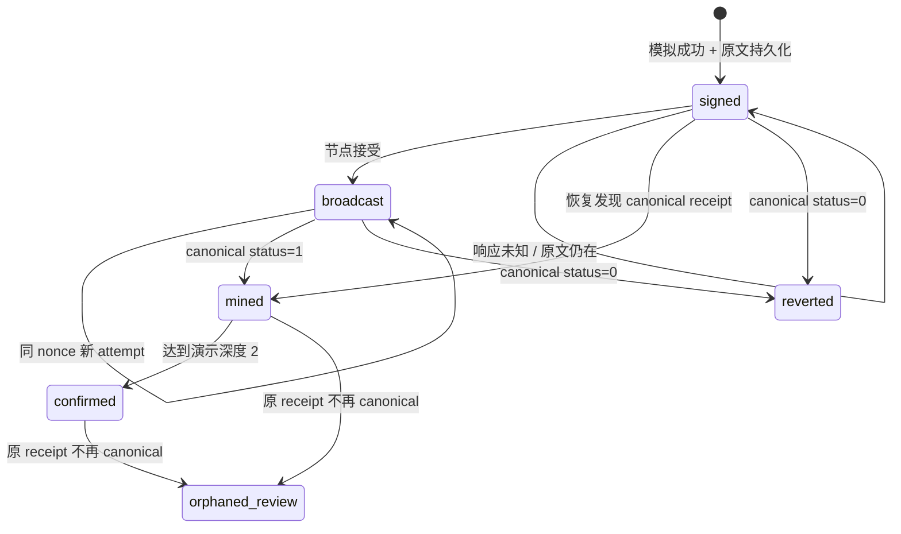

# 交易执行网关实战：持久签名、Nonce、提价与状态恢复

## 30 秒版（开场）

> 交易网关的核心不是包一层 sendTransaction，而是把业务意图、nonce 和每次签名 attempt 持久化。先提交签名原文，再广播；RPC 超时只能说明结果未知，恢复时查原 hash，重试仍用原字节。同 nonce 提价创建新 attempt，保留替换关系。只有 canonical receipt 才能驱动 mined/reverted，确认深度达到业务阈值才进入 confirmed；已确认交易被重组移除则停止自动动作，进入人工核对。

## 3 分钟版（精讲深度）

1. **两层身份**：业务 intent ID 跨重试稳定；attempt hash 随 fee replacement 改变。账务或履约不能只认最新 hash。
2. **分配 nonce**：同 chain/signer 的网关共享 PostgreSQL 事务锁，取节点 pending nonce 与已持久最大 nonce+1 的较大值。账户不能由其他服务并发签名。
3. **提交顺序**：模拟 → 分配 → 签名 → COMMIT → 广播。COMMIT 前失败没有可发送交易；COMMIT 后失败有原文可恢复。
4. **失败分类**：创建前校验失败、广播结果未知、链上 status=0、canonical receipt 消失各是不同事实。
5. **有界替换**：本例 legacy gas price 每次加倍、最多两次；保持 nonce、to、value、data 不变，检查所有 attempt 是否已有 receipt。

## 10 分钟版（状态机与持久化）



`intents` 保存原始业务 payload、全局 ID、nonce、状态和上链 block hash；`attempts` 保存 `(intent,seq)`、hash、raw、gas_price。唯一 nonce 与事务锁共同约束协作网关，幂等键重复时逐字比较规范化 Request JSON；同 key 改金额/minOut/deadline 返回 409。

```text
Create:
  pg_advisory_xact_lock(signer scope)
  查已有 intent → 相同返回 / 不同冲突
  chainId + Router bytecode hash + 参数边界 + eth_call
  nonce = max(node.pending, db.max_nonce + 1)
  sign EIP-155 → INSERT intent/attempt → COMMIT

Broadcast:
  读取已提交 raw → sendRawTransaction
  error → 保留原文与 hash，返回“结果未知”

Reconcile:
  查所有 attempt receipt → 验证该高度 canonical hash
  成功/失败/深度 → 更新；原有 receipt 消失 → orphaned_review
```

本课的 Create 与 Broadcast 为两个显式接口，便于观察“已持久但未发送”的边界；生产常由持久任务调度器扫描 signed 意图并广播，仍需保留相同不变量。本例没有后台扫描器，需要显式调用。

### 不接受任意交易参数

API 只接收金额字符串、minOut 和 deadline，服务端固定 Router、两个 Token 的路径和收款 signer。chain ID 固定 31337，Router 运行时代码哈希从本次部署记录加载，每次新建/广播/提价检查。签名原文固定 400000 gas，采用 legacy 费用是为了清楚展示同 nonce 替换，不宣称覆盖 EIP-1559、blob 或 L2 费用。

deadline 必须处于 `(head.time, head.time+3600]`；金额为正原子整数且不超过 30 位，不允许浮点数、科学计数法或隐式舍入。限长不等于真实业务资金限额，上线前仍需资产和总费用策略。

### 不确定窗口

| 窗口 | 数据库事实 | 恢复动作 |
|---|---|---|
| 模拟失败 | 无 intent | 修复参数/授权，不能报告已发起 |
| 原文 COMMIT 后尚未广播 | intent + attempt | 按同 ID 读取并广播原文 |
| 节点接受但返回 503 | 原 attempt 存在，可能仍为 signed | 查询原 hash；不得生成新业务 ID |
| 旧 attempt 被提价替换 | 同 nonce 多 hash | 查全部 hash，以实际 canonical receipt 为准 |
| status=0 | canonical 失败回执 | 记录 reverted；gas 已消耗，输出资产未到账 |
| confirmed 后 reorg | 原 block hash 不再 canonical | orphaned_review，停止自动重发/履约 |

## 生产场景

稳定币支付项目确认渠道付款后，运营方可能需要执行池内换币或资金调拨。支付订单 ID 不应直接等价于某个 tx hash：审批、执行、receipt、最终资金事实分别关联，链上结果未知时冻结自动重建，明确人工恢复责任人。接入上一轮 [资金工作流](../18-web3-payments-stablecoin/S-PAY-08-temporal-money-workflows.md) 时，可将 intent ID 作为 Activity 幂等键，现已通过独立支付库/索引库和 HTTP 证据接口接通；详见下方端到端实战。

## 排查与工具

排查时关联 intent、signer/chain、nonce、attempt seq、hash 和 block hash；记录 pending/mined/confirmed 的停留时间、nonce gap、替换次数、结果未知比例和费用。不能把“RPC 返回 hash”当作履约成功，也不能把“not found”当作永远不会上链。

演示使用 Anvil 1.4.4 / Cancun，geth 1.14.12 解码对应区块头。新硬分叉会增加 Header 字段，兼容性必须跟着目标节点验证；使用旧类型重算新头 hash 可能误判 canonical。工具版本约束也是数据正确性的一部分。

## 可运行示例与故障验证

```bash
docker pull postgres:17-alpine
python3 examples/onchain-execution/verify.py --report /tmp/onchain-execution/result.json
```

[完整项目与接口](https://github.com/twodog-tt/Golang-development-manual/tree/master/examples/onchain-execution) 中的集成验证执行：

- 8 路同 key 创建、异 payload 冲突；数据库只有一个意图。
- 4 个不同意图并发分配到唯一连续 nonce，按序广播全部上链。
- 代理先将 sendRawTransaction 交给 Anvil，再返回 503；SIGKILL Go 进程，重启后同 nonce/hash 恢复，receipt 中只有一个池 Swap。
- 关闭自动挖块，提交并提价；新 hash 成功、旧 hash 无 receipt，已上链再次 bump 被拒。
- 模拟通过后改变储备，交易实际执行 reverted，输出余额不增加。
- snapshot/revert 移除已 confirmed 的交易，状态变为 orphaned_review，广播接口拒绝自动重发。

报告中保存实际 hash、nonce、胜出 attempt 和资产原子余额差。脚本任一断言失败都非零退出；代码存在只说明可审计，运行成功以本次报告/CI 为准。

## 接入稳定币支付与冻结资金

[完整端到端实战](../18-web3-payments-stablecoin/S-PAY-08-temporal-money-workflows.md#payment-e2e) 已将上游订单、资金冻结与本课网关接通。intent 固定为 convert_paymentID；换币参数与 hold journal 在支付库同事务创建，Temporal Activity 只使用这份参数请求网关。支付 API 与网关库之间没有分布式事务，恢复靠持久意图、既有链事实和幂等过账。

新增 `/quote` 和 `/evidence/executions/{id}`：后者要求 canonical receipt 已被 Indexer 覆盖，并核对指定 Pair 的 Swap、精确输入及收款人的实际输出 Transfer。达到两块演示深度才向资金系统返回 confirmed；reverted 同样须已索引，结果未知时保持冻结。orphaned_review 还要确认旧 block 已离开索引 canonical 映射，才能作为补偿观察。

```bash
python3 examples/stablecoin-ops/e2e/verify.py --report /tmp/payment-e2e/result.json
```

12 组验证中，先广播后丢响应并 SIGKILL gateway/worker，恢复后仍只有一个 attempt 和一次兑换入账；缺 Swap 时不释放冻结；数据库过账失败后 resume 原 intent。前面的独立示例仍负责同 nonce 提价验证，完整运行范围见 [端到端指南](https://github.com/twodog-tt/Golang-development-manual/tree/master/examples/stablecoin-ops/e2e)。

## 架构取舍

PostgreSQL 锁适合这个单 signer 教学模型；大量账户应按 signer 分片并维护 lease/fencing、并发预算。数据库失联时必须停止新签名，不能退回内存 nonce。单账户 nonce 串行天然存在队头阻塞，不应该用无界加价或跳 nonce 掩盖问题。

这里没有取消交易、自动释放 nonce 或重组后补发。取消同样是占用同 nonce 的新交易，不是撤销事实；生产应将 cancellation 作为独立受审策略，保证费用、权限和原业务状态一致。

### 重组后的 nonce 缺口

端到端验证发现：已分配且曾包含的交易被重组移除后，节点 pending nonce 可以回落，但数据库高水位仍然更大。直接分配 max(nonce)+1 会把新交易卡在缺口后；自动重用旧 nonce 也可能与原签名冲突。示例现在对 unresolved orphaned_review 或 pending nonce 回落到已有包含位置暂停整个 signer 的新建意图、广播及提价，等待核对全部 attempt。广播与 reconcile 共用 advisory lock；端到端故障组验证重组后新意图 409 且 attempt 不增加。review_required 独立持久化，原签名后来重新包含也不自动解封；独立 harness 真实重广播原文并确认后验证新 intent 仍被拒绝。该保护没有实现自动解封或 nonce 取消服务。

## 深挖问答

1. **为什么先落 raw 再广播？** 进程可以在节点接受后死亡；没有原文就无法证明恢复发的是同一笔。
2. **同 nonce 能保证业务 exactly once 吗？** 只约束同一 canonical 链上的账户 nonce；跨链、重组、不同 signer、新业务 ID 仍需业务幂等与事实核对。
3. **提价后只查新 hash 可以吗？** 旧 attempt 可能已先上链，必须遍历所有已签 attempt。
4. **两块 confirmed 是 finalized 吗？** 不是；它只是演示业务深度，真实 EL/CL 与 L2 的终局规则另行建模。
5. **模拟成功为什么仍会 reverted？** 储备、授权、时间、状态和交易顺序都能在模拟与执行之间变化。

## 反模式与事故

- 超时后换 key 重发，产生两个独立 nonce 的资金动作。
- 在数据库提交前发送签名交易。
- 多个服务共享热钱包，各自在内存维护 nonce。
- 提价时悄悄改变 path/minOut/收款人，替换成另一笔业务。
- reorg 后自动把旧订单重置为“未发送”，再次产生不可核对的履约。

## 证据边界与延伸阅读

这是实际本地 EVM + PostgreSQL + Go 进程故障验证，证据等级为 `integration_harness`。没有公链资金、HSM、真实 RPC 厂商容灾或生产 SLA 验收。公开测试私钥与无认证回环 API 只能用于本课。

继续阅读 [Relayer 原理](S-NODE-05-relayer-transaction-manager.md)、[Indexer 查询与质量](S-NODE-12-indexer-query-data-quality-lab.md)、[DeFi 协议接入](../14-dex-cex-engineering/S-EXCH-32-defi-protocol-integration-lab.md)。规范来源：[Ethereum JSON-RPC](https://ethereum.org/developers/docs/apis/json-rpc/)、[EIP-155](https://eips.ethereum.org/EIPS/eip-155)、[Anvil RPC](https://www.getfoundry.sh/anvil/reference/)。
