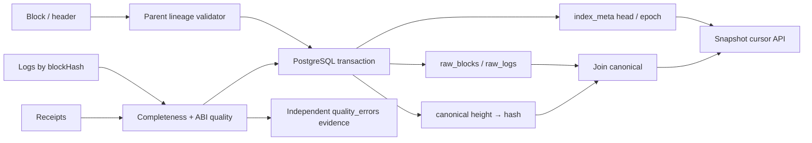

# Indexer 查询服务实战：快照游标、数据质量与 Reorg 回放

## 30 秒版（开场）

> Indexer API 返回的是带水位的 canonical 投影，不是链本身。我的最小实现保留按 block hash 标识的 raw 区块和日志，用独立 canonical 映射决定当前有效分支，raw、映射和 checkpoint 在同一个数据库事务提交。查询第一页固定高度/hash/epoch，后续用 keyset 游标读同一快照；新增区块不混页，reorg 改变 epoch 后旧游标返回 409。日志缺失或 ABI 不符时停止推进，并保留独立质量诊断。

## 3 分钟版（精讲深度）

1. **身份**：事件键为 `(block_hash,tx_hash,log_index)`；同高度不同 hash 不能互相覆盖。
2. **一致性**：按 blockHash 获取日志，再对该块所有 receipt 的目标事件做交叉比较，检查数量、身份、内容和重复。
3. **解码质量**：只处理两个 Token 的 Transfer 和指定 Pair 的 Swap；检查 topic 数、address padding、payload 长度、removed 标记。
4. **提交**：整批验证、raw 写入、canonical 切换、checkpoint/epoch 更新同事务；任何写入失败全部回滚。
5. **查询**：repeatable read + 固定上界 + `(height,log_index)` keyset；返回 snapshot_height/hash，避免把不同时刻的页拼成一个结果。

## 10 分钟版（数据模型与算法）



| 表 | 作用 | reorg 处理 |
|---|---|---|
| raw_blocks | hash/height/parent | 保留旧分支 |
| raw_logs | 事件身份、原始 JSON、decoder=v1 | 保留旧分支 |
| canonical | 当前高度到 hash 的唯一映射 | 删除共同祖先以上映射，再接新分支 |
| index_meta | 当前已提交 head/hash/epoch | 与切换同事务更新 |
| quality_errors | 历史质量错误与观察时间 | 独立写入，不随失败批次回滚 |

### 同步批次

1. 读取节点 head，固定本批目标 hash。
2. 获取 PostgreSQL 单写者事务锁，从已提交水位向前找共同祖先，最多回退 64 块；超界停止，不能盲删全库。
3. 如果旧 canonical 被替换，删除祖先以上映射并增加 epoch；raw 保留。
4. 逐块检查 parent 连续，按该 blockHash 拉日志，与完整 receipt 集合中的目标日志对比。
5. ABI 严格验证后写 raw，再写 canonical；最后复查目标高度仍是原 head hash。
6. 更新 checkpoint 并 COMMIT。并发请求不能越过这批未提交数据。

本例从 genesis 扫描，适合几十块的 localnet。大链应分批限流、设置重叠区间、持久 backfill 任务和深重组处理流程；不能把教学循环直接跑全网历史。最终 RPC 检查与数据库提交也不是跨系统原子事务：提交后链仍可能重组，下一次同步负责更正，API 明示的是数据库已提交观察。

### 查询快照与游标

```json
{
  "epoch": 1,
  "height": 24,
  "hash": "0x...",
  "after_height": 13,
  "after_index": 2
}
```

游标用 base64url 编码上述结构。第一页在 repeatable-read 事务中读取元数据，再查询 `height <= snapshot_height` 且 `(height,log_index) > last_position` 的 canonical 事件；多取一行判断下一页。后续请求核对 epoch、快照高度和 canonical hash。新块增加不会改变已有快照，任何 reorg 则保守地使旧 epoch 游标失效。

响应包含 `snapshot_height`、`snapshot_hash`、`epoch`、`events`、`next`。游标为查询位置，不是授权凭证；当前 API 无租户/过滤条件，生产加入地址、资产、权限等过滤时，必须把规范化查询作用域绑定到签名游标，并控制过期和查询预算。

### 质量门禁与覆盖盲区

| 故障 | 检查 | 动作 |
|---|---|---|
| 同一高度分支混用 | parent + blockHash + receipt.blockHash | 整批失败 |
| getLogs 丢一条 | 与 receipts 目标日志数量/集合比对 | 整批失败，质量记录 |
| 数据篡改/重复 | 事件身份、完整日志 JSON、seen set | 整批失败 |
| ABI payload 不正确 | Transfer=32 bytes、Swap=128 bytes、3 topics、规范 address padding | 整批失败 |
| 数据库中途抛错 | 单事务写 raw/canonical/meta | 回滚，下次重扫 |
| 查询跨 reorg | cursor epoch + canonical snapshot hash | HTTP 409，重开第一页 |

日志与 receipts 来自同一节点，交叉检查只能发现接口间不一致，不能证明节点诚实，也无法发现两接口一致漏报。独立来源对照、交易/receipt 根验证、范围覆盖率、解码版本重放和账实对账仍是生产门槛。严格 ABI 只证明结构符合，不证明经济含义或资产可信。

## 生产场景

资金运营页面应展示“数据截至 block N / hash H，落后 head K 块”，业务方才能区分暂无事件和索引滞后。本例 `GET /health` 提供 indexed/head/lag/epoch 与历史累计质量错误；lag=0 不证明 finality，质量错误累计值也不表示当前仍有故障。

这里没有实现余额投影：API 返回事件，不能把 Transfer 累加自动当作所有 Token 的真实余额。rebasing、fee-on-transfer、合约升级或特殊 mint/burn 都需要资产级适配与链上状态对账。

## 排查与工具

先区分 RPC head、已提交 checkpoint、API 快照与客户端游标，排查 batch 的起止 hash、父链、decoder 版本和质量错误。对遗漏问题同时保存 raw response 与请求范围；生产应脱敏并限制证据容量。本例 raw 由应用 append-only 写入，但 lab 数据库角色可改表，未实现数据库权限层的不可变保障。

大型分析场景再接 [ClickHouse / Lakehouse](S-NODE-10-chain-data-clickhouse-lakehouse.md)：PostgreSQL canonical control plane 与列存读取的版本传播需要额外协议，不能把列存最终 merge 当成这套事务的延伸。本课没有声称已覆盖吞吐、压缩、复制或跨存储一致性。

## 可运行示例与故障验证

```bash
python3 examples/onchain-execution/verify.py --report /tmp/onchain-execution/result.json
# 故障矩阵跑完后保留环境，按输出的回环地址交互：
python3 examples/onchain-execution/verify.py --serve
```

[项目代码](https://github.com/twodog-tt/Golang-development-manual/tree/master/examples/onchain-execution) 使用真实 PostgreSQL 和 Anvil 事件：

- 翻页过程中新增 Transfer 并同步，验证固定快照完整读取且无重复。
- RPC 代理删除 Transfer 或把 payload 改为一个字节，验证水位完全不变，质量错误持久化。
- 在 canonical INSERT 安装抛错触发器，验证已写 raw 也回滚；去掉触发器后重扫成功。
- 已索引 Swap 后恢复 Anvil 快照并建立不同分支，验证旧 raw 数量不变、旧 canonical 成交数为零、epoch+1、旧游标返回 409。

这些判定写入逐组 JSON 报告；链 rollback 为本地故障夹具，不模拟完整 PoS 网络 fork choice。

## 架构取舍

本例选择“坏批次停住”，没有隔离坏日志后继续推进。继续推进需要额外表达 holes、隔离事件覆盖率和补偿水位，否则“已到 head”会掩盖数据缺口。单事务整批回放易验证，但大回填需限制事务大小、锁时长和 RPC 预算。

质量错误单独落库便于观察失败批次；如果数据库整体不可用，连诊断也无法持久化，因此仍需外部日志/指标。累计错误是审计证据，恢复后不会清零；告警应使用速率和未解决事件，而不是把累计值大于零永远判红。

## 深挖问答

1. **为什么不直接删除旧 raw？** 否则失去重组与解码问题的证据，也无法说明先前页面为何显示过该成交。
2. **只有 checkpoint 事务够吗？** 不够，raw、canonical、投影和水位的提交边界必须一致，否则可能跳过未写数据。
3. **offset 分页有什么风险？** 新插入和删除会改变位置；固定快照加 keyset 更容易表达读取边界。
4. **游标未过期为什么返回 409？** 数据分支版本变了，位置仍可解码但已经失去原语义。
5. **logs 与 receipts 相同能证明没有漏数据吗？** 只能证明这两个节点接口一致；独立验证范围还需更强证据。

## 反模式与事故

- 用最大 block_number 代替 canonical lineage。
- 先提交 checkpoint 再异步补 raw。
- 解码异常直接吞掉，同时报告完整同步成功。
- 返回列表不带水位，让读者把索引结果当作实时链状态。
- reorg 后继续接受旧游标，拼出两个分支混合结果。

## 证据边界与延伸阅读

证据等级 `integration_harness`；范围是本地单链、两 Token/一 Pair、两类事件与显式同步 API，没有高可用调度、全链 schema 覆盖或生产吞吐验收。前置阅读 [Canonical merge](S-NODE-07-canonical-backfill-realtime-merge.md)、[Trace 与 Decoder](S-NODE-08-trace-state-diff-versioned-decoder-quality.md)，后续连到 [DeFi 实战](../14-dex-cex-engineering/S-EXCH-32-defi-protocol-integration-lab.md)。

规范来源：[EIP-234 blockHash logs](https://eips.ethereum.org/EIPS/eip-234)、[EIP-1898 hash-scoped state](https://eips.ethereum.org/EIPS/eip-1898)、[PostgreSQL repeatable read](https://www.postgresql.org/docs/17/transaction-iso.html)。
