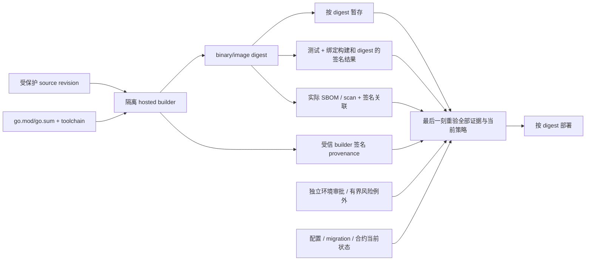

# SBOM、SLSA Provenance 与发布准入

## 30 秒版（开场）

> SBOM 回答“产物里有什么”，provenance 回答“由哪个 builder、哪些输入和步骤构建”，签名证明某身份认可了某 digest；三者都不自动证明软件无漏洞或业务上允许部署。生产发布应以不可变 digest 为主键，把 source revision、依赖锁定、测试、SBOM、构建 provenance、签名和环境准入串成验证链。按 SLSA v1.2 Build Track，L1 是存在 provenance，L2 是托管构建平台生成并签名，L3 还要求 hardened build；不要继续背旧版单一 SLSA 1–4。

## 3 分钟版（精讲深度）

| 证据 | 能回答 | 不能单独回答 |
|------|--------|--------------|
| SBOM | 包、版本、关系、license/标识 | 这些组件是否恶意、运行时是否加载、构建过程是否被篡改 |
| Provenance | builder、source、参数、依赖输入、产物 digest | builder 本身是否值得信任、代码是否安全 |
| Artifact signature | 某 key/identity 对 digest 的认证 | 签名者是否有发布权限、签名时是否经过测试 |
| Vulnerability scan | 已知数据库与可达性分析结果 | 未知漏洞、业务逻辑漏洞、恶意但无 CVE 的代码 |
| Admission policy | 当前环境是否允许该证据组合 | 运行后不会被配置、身份或依赖服务攻破 |

所以正确表达是“建立可验证的供应链与风险门禁”，不是“生成 SBOM 后供应链安全了”。

## 10 分钟版（发布链路）



### 当前版本事实

- SLSA v1.2 将 Build 和 Source 分 track；Build L1/L2/L3 的含义如上。
- SPDX 是 ISO/IEC 5962:2021 的开放标准。**本次 2026-10-20 复核时，官方规格页列出的 current version 是 3.0，仓库发布页的稳定补丁为 3.0.1；3.1-RC1 仍为 pre-release。** 组织应明确接受的稳定 schema/version，而不是仅写“3.x”。下方教学示例选择 SPDX-2.3 JSON 的限定配置，不宣称支持 SPDX 3.x。
- SBOM schema 版本、生成器版本和 artifact digest 都应入证据；“最新格式”不是兼容策略。

### Go 供应链边界

- `go.sum` 校验下载 module 内容与记录一致，不证明上游源码可信或没有恶意逻辑。
- `go mod verify` 检查下载的 module cache 中 zip/解压目录是否被改动，**不检查实际 vendor、本地 replace 或工作区模块源码**。因此它通过后，正在编译的程序仍可能变化；下方演练会真实复现三种情况。[Go Modules Reference](https://go.dev/ref/mod#go-mod-verify)
- `replace`、私有 proxy、`GOPRIVATE/GONOSUMDB` 会改变信任链，必须审计；不能为了下载成功全局关闭 checksum。
- 固定 Go toolchain、CGO compiler、OS base、代码生成器和构建 flags；只固定 `go.mod` 还不等于 bit-for-bit reproducible。
- `govulncheck` 结合调用信息减少噪声，但无报告不代表没有未知漏洞或动态加载路径。
- 用 `go version -m` 辅助反查 module/build settings；它是产物内元数据，不能代替验签和认证来源。结合实际二进制/镜像 digest、SBOM 与 provenance，不能只记录 Git tag。

构建前应从受保护 commit 建立独立、不可变的输入快照，覆盖 vendor、所有 replace/workspace 根、生成文件、toolchain、CGO 与构建配置；构建和测试使用同一快照，构建前后比对摘要。示例 `Fingerprint` 覆盖指定根内全部普通文件的路径、内容和可执行位，拒绝链接/特殊文件及超限输入；它不能自动发现根外依赖、认证 Git commit 或把可并发修改的目录变成原子快照。生产环境还需约束外部输入和网络、可信源码获取及构建平台隔离。

### Web3 还要追踪什么

合约 ABI、bytecode、compiler/optimizer、link reference、部署参数、proxy implementation、genesis/chain config、数据库 migration 和 decoder schema 都是发布物。后端镜像签名通过，不代表它将调用的链上 implementation 就是审核版本；应在有明确 block hash/确认策略的观察中核对 chain ID、proxy 地址、implementation 地址与 implementation code hash。升级前后分别核对 ABI、decoder、migration 兼容性；链重组或观察不可用时重新评估，不能沿用旧观察直接放行。

### 准入策略示例

生产 admission 可以要求：

1. image 只能按 digest 引用，来自允许 registry；
2. 验证真实签名，再按 issuer、identity、环境和证据角色授权；provenance 的 builder ID 必须与受信身份映射匹配，subject digest 与实际制品一致；
3. 固定 buildType、source repo/ref policy、commit、输入快照与构建 workflow；测试结果属于同一次构建且必需套件全部成功；
4. 验证实际 SBOM/scan 字节摘要、格式、制品与平台、生成器/扫描器、数据库版本及新鲜度；缺失、解析错误、扫描失败都阻断；
5. 将目标环境、配置、migration、feature flag、chain/proxy/implementation/code hash 纳入审批摘要，并在最终执行边界核对；
6. 风险例外由被授权的例外审批者签发，绑定制品、完整目标、策略和具体风险，有 owner、理由、补偿控制、到期与撤销；不能豁免坏签名、未授权来源、缺失测试或缺失证据。

签名 key 的身份认证与“该身份是否被授权发布到 mainnet”是两次判断。

### 身份、参数与报告验证契约

**身份不能由 JSON 自报。** `builder.id` 是待核对的声明，信任配置应建立“签名身份 → builder / workflow / 环境 / 证据角色”的对应关系。Key 模式用受保护、公钥固定的信任集合；keyless 模式还要核对受信证书链、OIDC issuer、准确的 certificate identity/workflow，以及所采用 Sigstore bundle 的透明日志/时间证据策略。不要跳过 claim/digest 检查，或只匹配一个宽泛邮箱后缀。详见 [SLSA artifact verification](https://slsa.dev/spec/v1.2/verifying-artifacts) 和 [Cosign verification](https://docs.sigstore.dev/cosign/verifying/verify/)。

**SLSA 规范版本与 predicate major version 不同。** SLSA v1.2 的 provenance 使用 `_type=https://in-toto.io/Statement/v1`、`predicateType=https://slsa.dev/provenance/v1`，不能拼成 `/v1.2`。根据受信 buildType 的契约解释参数；示例要求 externalParameters 恰为预期 repository/ref，并在 resolvedDependencies 核对 source commit 与输入快照。通用未知扩展字段应忽略，不能一律 `DisallowUnknownFields`；但未知或意外的 externalParameters 应拒绝。未设置/null/空字段按同样语义处理，本例缺少必需参数均拒绝。resolvedDependencies 的完整性即使到 Build L3 仍是 best effort，不能把“存在该字段”写成完整依赖证明。[SLSA Build Provenance](https://slsa.dev/spec/v1.2/build-provenance)

**测试是门禁输入。** 只有本次 invocation、source commit、inputs、平台与制品 digest 匹配，unit/race/vet 均 passed 的受信测试声明才通过本例策略。源码单测只能证明对应输入上执行了测试；产物集成测试应直接测试待发布 digest。测试后重新构建必须重新绑定证据，不能把“某个 CI job 是绿色”套用到另一个产物。真实测试、扫描报告应由可信 producer 在任务完成后签发，本例 producer 是合成夹具。

**报告存在不等于报告有效。** 示例的签名关联声明同时绑定 subject artifact、平台、工具版本、完成时间和实际 reportDigest。SPDX-2.3 限定配置要求文档标识、创建者/时间、包标识与版本、SHA256 checksum、license 哨兵及有效关系；根包 checksum 必须等于实际制品，重复 ID、悬空关系、其他格式均拒绝。它只支持 `filesAnalyzed=false`、`NOASSERTION` license/download/copyright 和 DESCRIBES/DEPENDS_ON 的窄结构，不是通用 SPDX schema/许可证表达式验证器，更不证明组件清单完整；生产应固定并验证完整 [SPDX schema](https://github.com/spdx/spdx-spec/blob/v2.3/schemas/spdx-schema.json) 及生成器策略。

本例扫描格式是本地 `local-scan-v1`，检查 complete、明确 findings 数组、无重复风险 ID、已知 severity、允许 scanner/DB 版本和报告/数据库时间。high/critical 阻断，medium/low 放行；这是演练策略，不是适用于所有组织的 exploitability 判定。数据库时间是受信扫描器的声明，本例不会下载漏洞库或运行 govulncheck；生产还需扫描器完整性与真实库新鲜度。拉取/扫描超时应当失败，不能转成空列表；已有且仍有效的认证离线证据可按策略使用。

### 例外、最终重验与恢复

风险例外必须精确列出本次阻断风险集合，绑定 policy version、TargetDigest 和 EvidenceDigest，由独立授权角色验签；构建者不能凭构建签名给自己放行。更新扫描后风险集合或证据摘要改变，即使 artifact digest 不变也必须重审。例外不是“跳过所有检查”开关；先执行来源/签名/测试/报告硬门禁，再考虑风险豁免。

本地示例分 `Prepare → Commit`：Prepare 存入私有证据副本并生成不可猜测 ticket，Commit 在互斥临界区重验当前目标、策略、撤销集合、证据时效和输入，再记录一次干运行效果。同 intent 只能对应同一完整请求；并发重试最多一条回执。目标、策略、密钥、审批、例外或制品撤销会推进 epoch，目标改走再改回（ABA）也使旧 ticket 失效；旧 policy version 不可复用。审批过期、输入变化或证据不可用均阻断，回滚旧 digest 仍走当前策略。策略升级后应重新收集当前有效证据并审批；恢复不能重用旧 ticket，例外撤销后应修复风险或取得新的有效授权。

这只是**进程内、内存式的最终准入模型**：重启丢弃 ticket，不提供真实部署的持久幂等/UNKNOWN 恢复。Target/Policy/撤销接口只接受可信宿主管理输入，不向模型或未授权用户开放，也不自动查询 IAM/链。生产执行器必须在实际副作用边界实现 fencing/CAS、当前权限与状态核验、持久 intent/回执和未知结果对账；一次本地检查无法与独立 Kubernetes/链上升级原子提交。无法确认时阻断并人工核对，不应盲目重试。

## 可运行示例与故障验证

代码与完整矩阵：[releaseadmission](https://github.com/twodog-tt/Golang-development-manual/tree/master/examples/senior/releaseadmission)。仓库根目录运行，需 Go 1.24.2+ 与 Python 3，无外部服务或密钥：

```bash
go run ./examples/senior/releaseadmission/cmd/demo
go test -race -timeout 60s ./examples/senior/releaseadmission/...
go vet ./examples/senior/releaseadmission/...
python3 examples/senior/releaseadmission/verify_go_inputs.py
# 连同既有 Agent 可靠性示例一起检查；还需 Node 22.15+
bash scripts/verify_reliability_examples.sh --offline
```

Demo 输出 `passed=true`、`dry_run_effects=1`、三个阻断字段为 true、`real_deployments=0`、`slsa_level_claimed=false`。Go 输入演练输出三种案例的程序 `original → tampered`、`go_mod_verify_passed_after_tamper=true` 和 `input_change_blocked=true`；vendor 重新生成后还会验证恢复原始摘要。

| 修复点 | 可执行故障验证 | 期望 |
|---|---|---|
| 测试接入门禁 | `TestRequiredTestEvidence`：失败/缺失/跳过、错误 run/commit/input/platform/suite、过期/未来时间、产物替换 | 拒绝且无效果 |
| 身份授权 | `TestSignatureAndAuthorization`：篡改、错 key/role/issuer/identity/env/builder、构建者审批、公钥别名 | 拒绝 |
| Provenance 契约 | `TestProvenanceContract`、`TestStrictJSONAndBounds`：错 URI/来源/参数、重复键/别名/尾随/超限；另有通用扩展正例 | 错误阻断，合法扩展接受 |
| 报告内容绑定 | `TestSBOMActualBytesAndProfile`、`TestScanFailuresAndFreshness`：错 checksum/关系、改报告、扫描 error、无结果、旧库和错误平台 | 拒绝 |
| 实际 Go 输入 | `TestFingerprint*` 与 `verify_go_inputs.py`：vendor/replace/workspace 篡改、链接、超限、取消、内容和执行位变化 | 缓存校验不能替代输入摘要 |
| 例外权限 | `TestExceptionScopeAndHardGates`：缺失/过期/错风险/错目标/错证据、自批和豁免硬门禁 | 仅精确有效例外通过 |
| 最后一刻与恢复 | `TestTargetChangesAndABA`、`TestRevocationRollbackAndPolicy`、`TestCommitRevalidatesEvidenceAndInput`、并发/副本测试 | 旧 ticket、撤销/过期和回滚绕过被阻断，重复 Commit 效果为 1 |

验签采用真实 DSSE PAE + Ed25519，但密钥来自**公开教学种子**；Issuer/Identity 为受信配置标签，没有执行 OIDC/Fulcio/Rekor 校验。测试/扫描/SBOM 内容和制品均为合成数据，source commit 不对应真实构建，不能证明真实测试执行、供应链完整性或任何 SLSA 等级。离线 Go 演练单独运行真实编译/执行，生成本地 file:// proxy 并隔离 module cache；仅其子进程对自造模块设置 GOSUMDB=off，不修改全局 Go 配置。

## 生产场景

- 上游 Go module 被接管：快速从 SBOM 找受影响 digest，再结合 provenance 定位 builder/source，阻断新部署并重建。
- CI runner 被污染：普通 artifact signature 可能照常成功；需要隔离 builder、短期签名身份和可信 provenance。
- 合约升级：将 audited source/compiler settings 映射到 bytecode/code hash，并让后端 decoder 和 allowlist 同步版本化。
- 紧急修复：可以缩短常规流程，但不能发布无来源 digest；exception 必须可追溯和自动过期。

## 排查与工具

从线上 pod/process 读取实际 image/binary digest，再反向查询 registry、provenance、SBOM、source revision 和 CI run。不要从 deployment label 的版本字符串推断实际运行内容。

## 架构取舍

完全可复现构建价值很高，但部分 CGO/平台产物实现成本大；至少保证输入可枚举、builder 可认证、产物按 digest 不可变、可独立重建比较。供应链门禁要在风险和恢复速度之间设计分级，而不是所有 CVE 一刀切阻塞。

## 深挖问答

1. **SBOM 和 provenance 区别？** → 前者是组成清单，后者是构建来源与过程证据。
2. **签了镜像是否安全？** → 只证明签名身份认可 digest；还要验证身份授权、builder、source 和策略。
3. **`go.sum` 能防恶意依赖吗？** → 能发现内容与已记录 checksum 不一致，不能判断已记录内容是否恶意。
4. **为什么按 digest 部署？** → tag 可移动，digest 才能把扫描、签名、provenance 与运行对象绑定。
5. **合约也需要 provenance 吗？** → 需要追踪源码、compiler/config、bytecode、部署与链上 code hash。

## 反模式与事故

- 生成 SBOM 后不归档、不绑定 artifact digest，也不用于查询或事件响应。
- CI 用户自定义步骤可读取 provenance signing secret，仍宣称 hardened build。
- admission 只验证“有签名”，不校验 signer identity、source repo 和 workflow。
- 部署使用 `latest`/可移动 tag，扫描对象与运行对象不是同一 digest。
- 把 SPDX 3.1 RC 说成最终标准，或把旧 SLSA 1–4 当成 v1.2 当前模型。

## 延伸阅读

- [SLSA v1.2 Build Track](https://slsa.dev/spec/v1.2/build-track-basics)
- [SLSA v1.2 Build Provenance](https://slsa.dev/spec/v1.2/build-provenance)
- [SLSA artifact verification](https://slsa.dev/spec/v1.2/verifying-artifacts)
- [Sigstore / Cosign verification](https://docs.sigstore.dev/cosign/verifying/verify/)
- [SPDX current specifications](https://spdx.dev/use/specifications/)
- [SPDX 3.1-RC1 announcement](https://spdx.dev/spdx-3-1-ontology-and-schema-available-for-review/)
- [Go Modules Reference](https://go.dev/ref/mod)
- [S-GOENG-06 静态分析与依赖供应链](../16-go-production-engineering/S-GOENG-06-static-analysis-supply-chain.md)
