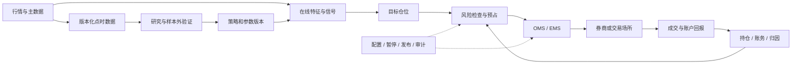

# 量化开发全景：研究平台、交易系统与 Go/Python/C++ 分工

## 30 秒版（开场）

> 量化开发把研究想法变成可复现、可监控的研究与交易系统。完整链路是数据 → 特征/信号 → 目标组合 → 风控 → 执行 → 成交/账务 → 归因。工程师需要同时理解软件正确性和市场语义：数据何时可见、订单何时生效、资金何时被占用。回测收益、系统吞吐和实盘收益分别需要证据，不能互相替代。

## 3 分钟版（精讲深度）

1. **先定职责**：研究平台、行情基础设施、交易执行和低延迟系统的交付物不同。
2. **先定频率与市场**：日频研究、分钟执行和微秒级报价的资源预算、成交模型与故障容忍度不同。
3. **把研究与生产连接起来**：同一数据与策略版本能重现决策；生产订单必须有状态、约束和恢复路径。

## 10 分钟版（原理 + 图示）

### 职责与交付物

| 方向 | 主要工作 | 可检查的产物 |
|------|----------|--------------|
| Quant Research | 假设、因子/模型、统计检验与组合研究 | 样本外实验、成本假设、失败解释 |
| Research Engineer / Quant Developer | 数据与研究工具、回测引擎、模型工程化 | 数据契约、实验重现、研究与生产一致性 |
| Trading Systems Developer | 行情、OMS/EMS、接入、风控和对账 | 订单恢复、敞口约束、执行质量与故障演练 |
| Low-latency Developer | 网络、内存、CPU、协议与尾延迟优化 | 指定硬件和负载下的延迟分布、容量与降级行为 |

2026-11-08 查阅的 [Citadel Python Quantitative Developer](https://www.citadel.com/careers/details/python-quantitative-developer/) 示例涉及研究工具、数据管道和研究想法的工程化；
[Optiver Pricing Data](https://www.optiver.com/join-us/jobs/technology/amsterdam/quantitative-developer-pricing-data/) 示例涉及定价数据及 C++/Python 协作。
这些是职责样本，不能据此推断整个招聘市场的岗位数量或语言占比。

### 数据面与控制面

研究产物可以是信号、目标权重或模型参数；执行层应显式接收带版本、生成时间、有效期和数量单位的意图。
“买入”不能脱离账户、标的、目标数量、期限和风险预算直接进入网络重试循环。

### 工程分工建议

| 工具 | 适合承担 | 必须验证的边界 |
|------|----------|----------------|
| Python / NumPy / pandas | 数据探索、统计计算、研究和批处理 | 时间对齐、数据类型、内存和实验复现 |
| Go | 并发接入、数据服务、OMS、风险与控制面 | 分配、GC、队列、时钟与协议状态 |
| C++ 等系统语言 | 对延迟与内存布局有严格控制需求的路径 | 硬件、网络栈、并发安全与部署复杂度 |
| SQL / 列存 / Parquet | 点时查询、实验数据与历史分析 | 快照、可用时间、排序、schema 演进 |

这是按工作负载划分的建议；具体团队可能用同一种语言承担多层。Go 后端经验有迁移价值，仍需补金融数据、统计与执行语义。

### 起步所需知识

- 数学：条件概率、期望/方差、协方差、回归、统计显著性、时间序列相关性。
- 市场：bid/ask、价差、订单类型、交易时段、tick/lot、结算和做空约束。
- 工程：Linux/网络、数据结构、SQL、并发、恢复、可观测和版本管理。
- 研究：基准、假设、样本外、参数搜索记录、成本与风险暴露。

衍生品定价还可能需要随机过程、数值方法和 Greeks；本模块只建立通用工程主线。

## 生产场景

日频组合可采用批量研究与受控再平衡；盘中交易需要持续处理行情与订单回报；做市系统还要约束库存与报价陈旧度。
股票需处理公司行动与历史成分，期货需处理合约、换月和保证金，数字资产需处理交易场所、资金费和全天运维。
这些差异应进入主数据与适配层，不能靠更换 ticker 字符串解决。

## 排查与工具

每个决策记录 `dataset_version / strategy_version / parameter_hash / decision_time / input_watermark / target_id`。
将研究结果到成交的差异拆成四段：数据可见性、信号实现、执行成交、费用/资金处理。
先按同一输入重放比较，再讨论增加线程或替换语言。

## 架构取舍

统一研究/生产核心逻辑可降低行为漂移，但不同运行模式仍有时钟、数据和适配器差异。
拆成语言服务便于使用不同生态，也增加序列化、发布与版本协同成本；不要在每个行情事件上引入不必要的远程调用。

## 深挖问答

1. **后端开发最先补什么？** → 市场与订单语义、点时数据、统计验证和成交模型，随后按职责补 Python 或系统性能。
2. **为什么不直接把研究脚本部署成交易服务？** → 需要显式处理时钟、未知订单、账户共享、暂停与重启恢复。
3. **会写撮合引擎是否等于会做量化？** → 撮合是场所侧组件；交易方还需要研究、风险、执行质量和资金约束。
4. **为什么不一开始就追求微秒延迟？** → 先确认策略频率、信号衰减、场所接入和硬件预算，再判断优化是否改善可成交结果。

## 反模式与事故

- 用一条漂亮收益曲线替代数据、成本和样本外证明。
- 只会提交订单，忽略未知结果、重复回报和账户对账。
- 按岗位名称推断团队职责与语言栈。
- 将模拟成交或本地吞吐包装成生产交易能力。

## 证据边界与相关专题

本文为 `explanation_only`，没有招聘趋势统计、策略收益或场所接入验收。
下一步：[行情与微观结构](S-QUANT-02-market-data-microstructure.md) → [统计验证](S-QUANT-03-factor-research-statistical-validation.md) → [回测](S-QUANT-04-event-driven-backtesting.md)。

## 延伸阅读

- [Citadel：Python Quantitative Developer](https://www.citadel.com/careers/details/python-quantitative-developer/)
- [Optiver：Quantitative Developer — Pricing Data](https://www.optiver.com/join-us/jobs/technology/amsterdam/quantitative-developer-pricing-data/)
- [LEAN Algorithm Engine](https://www.quantconnect.com/docs/v2/writing-algorithms/key-concepts/algorithm-engine)
