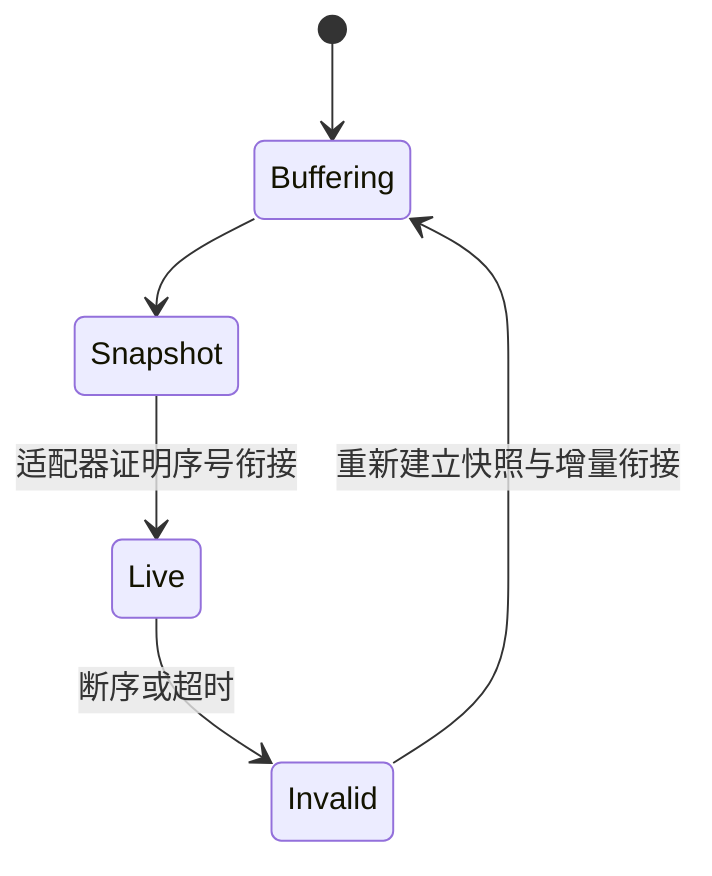

# 量化行情与微观结构：盘口、时间戳、点时数据和质量控制

## 30 秒版（开场）

> 行情工程需要保存市场事实、到达顺序与当时可见的信息。逐笔成交、最优买卖价、聚合深度和逐单订单簿的语义不同；历史数据还要保留当时的标的集合和修订版本。策略只能使用决策时已可用的数据，盘口断序或行情过期时应停止依赖它新增风险。

## 3 分钟版（精讲深度）

1. **先看数据级别**：成交价不能替代可执行 bid/ask，L2 聚合深度不能唯一还原订单排队。
2. **保留多种时间**：交易场所事件时间、采集接收时间、处理时间和数据可用时间分别承担不同职责。
3. **质量是显式状态**：连续性、陈旧度、覆盖范围、交易时段与修订状态都应成为策略输入。

## 10 分钟版（原理 + 图示）

| 数据 | 提供什么 | 无法直接证明什么 |
|------|----------|------------------|
| Trade / Tick | 已发生的成交及其价格、数量 | 当前可成交价格与剩余挂单 |
| L1 / BBO | 场所或数据产品定义的最优报价 | 全市场最优价、全深度与个人排队位置 |
| L2 / MBP | 按价位聚合的深度 | 同价位每笔订单、撤单发生在队首还是队尾 |
| L3 / MBO | 逐订单事件，通常带订单标识 | 隐藏流动性、跨场所顺序和自身网络延迟 |
| OHLCV / Bar | 时间区间内的聚合信息 | 区间内成交先后、买卖价差与限价排队 |

L1/L2/L3 是常用称呼，字段、覆盖范围与撮合阶段仍由数据产品定义。
中间价 `mid = (best_bid + best_ask) / 2`，价差 `spread = best_ask - best_bid`；两者都不是无条件可成交价格。
薄盘口、集合竞价、锁盘和跨盘状态应按市场语义处理，不能把所有异常值都直接删除。

### 最小可审计 schema

```text
instrument(venue, instrument_id, symbol, currency, tick_size, lot_size,
           multiplier, valid_from, valid_to)
market_event(venue, instrument_id, session_id, sequence, event_type,
             event_time, receive_time, ingest_time, payload_version, raw_ref)
reference_record(instrument_id, effective_time, available_time,
                 revision_id, ingested_at, snapshot_id, value)
```

`symbol` 可能改名或复用；连续期货与可交易的具体合约也不是同一 instrument。
价量建议在执行边界使用带刻度的整数或十进制数，同时检查乘法溢出与单位。
不要根据字符串小数位数猜 tick/lot 规则。

### 点时查询：当时生效与当时知道

查询时同时约束：`effective_time <= decision_time` 与 `available_time <= decision_time`，并在合法版本中选当时已知的最新修订。
需要重现“本系统当时知道什么”时，还应约束自己的采集/入库时间；采购后补历史与当日实时到达的可用性不是一回事。

例如，季度结束日在 3 月末、报表 4 月才发布，该值不能进入 3 月末信号。
历史成分、已退市标的、拆股分红和修订后的财务值都需按版本保留。
研究用复权收益与实际成交、现金股息、持仓数量变化要统一口径，避免重复计入公司行动。

### 盘口连续性与数据有效性



序号规则按具体 feed 实现。Binance Spot diff-depth 使用区间更新 ID 和绝对档位数量；其他市场可能使用逐消息序号、订单事件或不同快照协议。
通用不变量是：只向策略发布经过连续性检查的视图，并标明 snapshot epoch 与接收水位。
详细恢复算法复用 [S-EXCH-19](../14-dex-cex-engineering/S-EXCH-19-market-data-sequence-gap-recovery.md)。

## 生产场景

历史研究需要可重复的数据快照；在线特征需要有界延迟与陈旧度门禁。
跨场所数据应在本地可见顺序下比较，不能只按未经校准的场所时间戳排序，就假定在真实交易时已经同时知道两边价格。
K 线需区分未结束与已结束区间，并定义迟到成交的修订策略。

## 排查与工具

监控 `sequence_gap_count / book_age / receive_lag / invalid_book_duration / duplicate_rate / coverage_ratio`。
跨机器时延比较先检查时钟偏差与同步误差；单进程耗时使用单调时钟。
数据变更保留行数、缺失、异常、退市覆盖、校验和与来源版本，避免“清洗后更漂亮”成为唯一质量标准。

## 架构取舍

Raw 事件便于重放但存储成本高；规范化数据便于研究但可能丢失原始字段与时间顺序，宜保留可追溯映射。
快照加增量可减少存储，但快照水位必须与事件日志兼容。
极低延迟可使用内存视图，仍需明确异步归档失败时的审计边界。

## 深挖问答

1. **为什么不只保存最新修订值？** → 会把后来的知识泄漏到历史研究，无法重现当时决策。
2. **为什么不能用 L2 深度精确模拟排队？** → 聚合档位缺少同价位逐单位置与撤单归属。
3. **事件时间更早的数据一定更早可交易吗？** → 不一定，还要考虑传输、解码与可用时间。
4. **没有收到成交是否表示市场没交易？** → 需区分休市、无成交、连接中断、订阅缺失和数据许可范围。

## 反模式与事故

- 用当前存活标的名单回测整个历史。
- 用整天完整 K 线计算尚未收盘时的信号。
- 行情断序后继续更新中间价并下单。
- 将所有市场统一为相同交易日历、价格精度和 symbol 主键。

## 证据边界与相关专题

本文为 `explanation_only`，schema 和状态机是设计示意，没有新增采集服务或历史数据集验收。
继续阅读：[统计验证](S-QUANT-03-factor-research-statistical-validation.md)；[Go 生产路径](S-QUANT-08-go-trading-systems-production.md)。

## 延伸阅读

- [Binance Spot WebSocket Streams](https://github.com/binance/binance-spot-api-docs/blob/master/web-socket-streams.md)
- [QuantConnect Research Guide：点时信息与研究偏差](https://www.quantconnect.com/docs/v2/writing-algorithms/key-concepts/research-guide)
- [QuantConnect Corporate Actions](https://www.quantconnect.com/docs/v2/writing-algorithms/securities/asset-classes/us-equity/corporate-actions)
