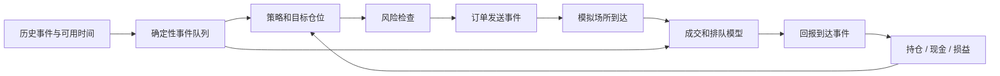

# 事件驱动回测：时钟、成交模型、交易成本与可复现验证

## 30 秒版（开场）

> 回测是在历史输入和明确成交假设下运行策略的模拟器。信号产生、订单到达、撮合成交、回报到达与账户更新应有独立事件和时钟。可重复的回测只能证明给定输入和模型下的结果一致，不能证明真实市场会按同样价格、数量和顺序成交。

## 3 分钟版（精讲深度）

1. **因果顺序**：决策只能看到当时已经可用的信息，订单只能参与到达后允许参与的市场事件。
2. **成交模型**：买卖价差、深度、延迟、排队与部分成交决定可交易结果。
3. **可重现配置**：数据、策略、费用、撮合规则、随机种子和事件排序一起版本化。

## 10 分钟版（原理 + 图示）



### 一个最小时间推演

以下毫秒数仅用于说明事件顺序：

| 时点 | 事件 | 可以做什么 |
|------|------|------------|
| 10:00:00.000 | 一个 bar 结束 | 不能默认此时策略已经收到了完整 bar |
| 10:00:00.005 | bar 到达并生成信号 | 发出目标或订单，不能回到 .000 成交 |
| 10:00:00.008 | 买单到达模拟场所 | 按此时可用卖价、深度和撮合规则判断 |
| 10:00:00.010 | 部分成交回报到达 | 更新已知持仓、现金及剩余挂单 |

若只有 OHLCV，无法知道该 bar 内最高价和最低价先后发生的顺序。
同一 bar 内止盈和止损都触及时，应声明更保守的假设或使用更细数据，不能任意选有利结果。

### 成交模型的层次

| 层次 | 能模拟什么 | 主要限制 |
|------|------------|----------|
| 下一时点参考价 + 费用 | 验证策略流程和基线 | 缺乏可执行报价、深度与排队 |
| Bid/ask + 深度约束 | 价差、有限流动性和分档成交 | 通常缺少自身市场冲击与真实排队 |
| 事件簿 + 排队模型 | 延迟、撤单、部分成交 | 依赖逐单数据或对未知队列的假设 |
| 场所仿真 / 交互模型 | 订单影响市场与其他参与者 | 校准复杂，模型风险仍然存在 |

限价单价格被历史成交“触及”，不足以证明本单已成交。
历史行情不包含本策略假设订单对市场的影响；即使复用真实撮合代码，也不能自动重建反事实市场。
QuantConnect 的默认成交模型存在完全成交等假设，使用任何回测框架前都应检查实际启用的模型。

### 成本与双重计数

当成交价已经使用真实 bid/ask 或模拟滑点时，价差/滑点已进入成交现金流，不应再次从 PnL 中重复扣除。
可按以下方式组织假设：

```text
现金变化 = 成交现金流 - 显式手续费 + 返佣 - 其他实际现金费用
其他费用按产品包括：借券、融资、资金费、换汇和结算费用
执行质量分析 = 相对预先定义基准的价格差 / 未完成量 / 延迟
```

滑点、冲击模型和排队假设分别版本化；买卖方向、maker/taker、数量单位与费率等级需要显式定义。
压力场景可改变成本、可用深度、成交延迟和断线时长，不只缩放手续费一个参数。

### 决定性与恢复

事件排序键可采用 `(simulation_time, priority, source_id, source_sequence)`，但同一时间的优先级必须符合因果约束。
外部请求、墙上时钟、无固定顺序的 map 遍历与随机抽样都可能破坏重放。
保存 `data_hash / strategy_hash / fill_model_version / fee_version / seed / event_order_version`；检查点还需包含待处理事件、订单、现金、持仓及随机状态。

## 生产场景

向量化回测适合快速筛选低频假设；涉及订单状态、盘中风险和多腿执行时，应使用相应事件与账户模型。
研究回测、历史回放、仿真交易和真实交易的输入/适配器不同，需逐层比较信号、目标、订单、成交和费用。

## 排查与工具

先找第一个分歧事件，比较输入水位、状态哈希、订单时间和成本模型。
诊断表至少包括信号数、订单数、成交率、未完成量、参与率、价差/费用归因和现金持仓不变量。
从少量手工可算事件开始核对，再运行长历史；不以“跑完没有异常”作为财务正确性标准。

## 架构取舍

更细的仿真需要更细数据与可校准假设，成本更高且不必然更真实。
回测应选与策略频率相称的模型，并将关键未知量做敏感性分析。
共享策略核心可以减少漂移；仿真环境仍需显式阻止真实网络副作用。

## 深挖问答

1. **为什么不默认按信号 bar 收盘价成交？** → 收盘信息产生与到达后才能决策；参与收盘竞价等特殊安排要单独建模。
2. **为什么不能把撮合引擎直接当完整回测器？** → 还缺历史可见性、对手订单、延迟、账户、费用及反事实影响假设。
3. **固定随机种子是否足够？** → 还需事件顺序、版本、输入和并发行为确定。
4. **如何比较两版策略？** → 相同数据与模型，逐层比较决策和风险，保留全部候选与选择过程。

## 反模式与事故

- 市价单全部按中间价无限量成交。
- 历史价格触及限价就给全量成交。
- 成交价已含价差，又统一扣一次价差成本。
- 使用未来数据校准当前成交模型，或让模拟器直接调用真实下单接口。

## 证据边界与相关专题

本文为 `explanation_only`，没有新增回测引擎或执行模型验收。
[现有确定性撮合](../14-dex-cex-engineering/S-EXCH-17-runnable-deterministic-matching-engine.md) 的测试只覆盖其撮合语义。
下一步：[OMS / EMS](S-QUANT-05-oms-ems-execution-algorithms.md)；[组合风控](S-QUANT-06-portfolio-risk-pnl-reconciliation.md)。

## 延伸阅读

- [LEAN Algorithm Engine](https://www.quantconnect.com/docs/v2/writing-algorithms/key-concepts/algorithm-engine)
- [QuantConnect Fill Models](https://www.quantconnect.com/docs/v2/writing-algorithms/reality-modeling/trade-fills/key-concepts)
- [QuantConnect Slippage Models](https://www.quantconnect.com/docs/v2/writing-algorithms/reality-modeling/slippage/key-concepts)
