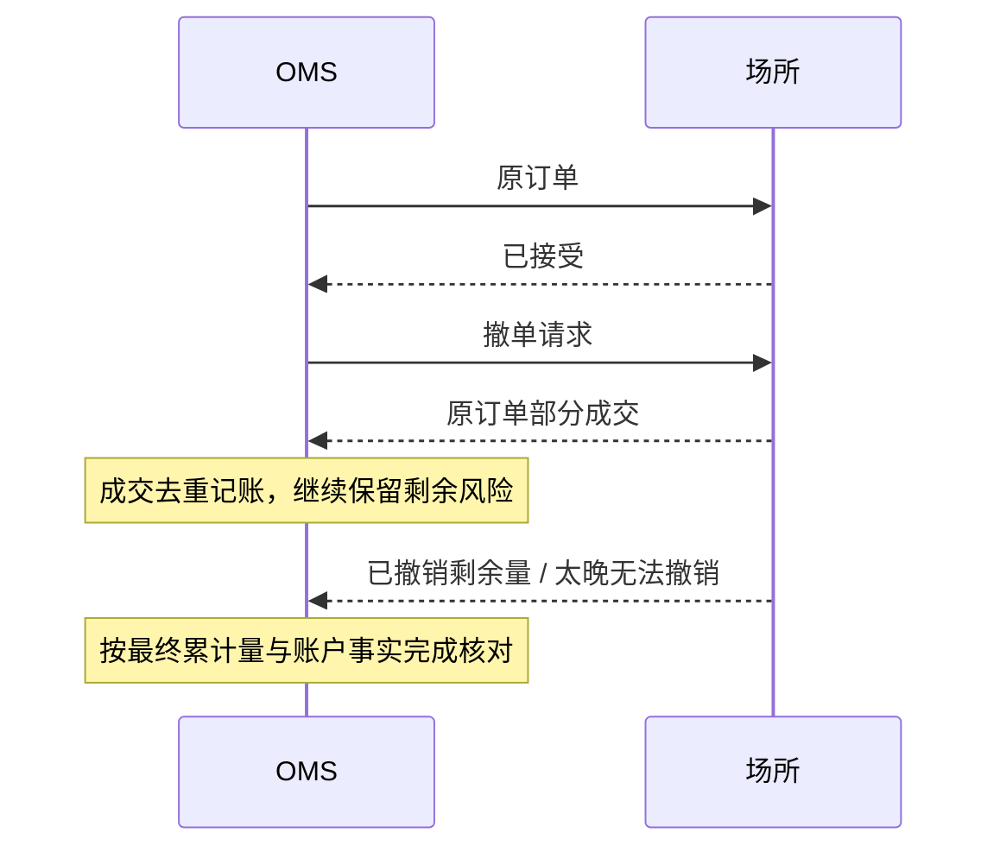

# OMS 与 EMS：订单恢复、撤单竞态和 TWAP/VWAP/POV 执行

## 30 秒版（开场）

> OMS 管理订单意图、身份、状态、风险预占与审计，EMS 决定如何拆单和路由。网络超时意味着结果未知，撤单请求意味着撤销意图，两者都不能直接释放全部资金或重发新订单。成交回报应幂等记账，重启后先恢复订单与账户事实，再允许新增风险。

## 3 分钟版（精讲深度）

1. **分离状态**：本地请求状态、场所订单状态、成交累计与撤单/改单请求状态分别保存。
2. **保留身份与链路**：目标、母单、子单、场所订单、成交回报需要可追溯关联。
3. **执行受约束**：价格、参与率、到期时间、风险预算和数据有效性限制拆单行为。

## 10 分钟版（原理 + 图示）

### 数据与状态

```text
target(id, strategy_version, account, instrument, target_qty, expires_at)
parent_order(id, target_id, qty, start_at, end_at, algorithm, limit_price)
child_order(id, parent_id, client_order_id, venue_order_id,
            transport_state, venue_status, cum_qty, leaves_qty, version)
order_request(id, child_id, kind, request_state, orig_request_id)
execution(venue, account, execution_id, order_id, qty, price, fee,
          correction_ref, received_at)
risk_reservation(order_id, currency, amount, state, version)
```

`client_order_id` 的唯一性范围、重用时机、查询方式和幂等支持由场所协议决定。
它是恢复关联键，不是对所有券商都成立的“重复请求自动去重保证”。

| 观察 | 本地处理 | 仍需保留 |
|------|----------|----------|
| 发送后超时 | 标记提交结果未知，按协议查询/消费账户流 | 订单身份、预占与风险敞口 |
| 已部分成交 | 幂等记成交、更新剩余量与预占 | 剩余订单的潜在成交风险 |
| 撤单处理中 | 保存撤单请求状态，继续接受合法成交 | 未确认撤销的剩余敞口 |
| 场所报告已撤销 | 核对累计成交及未决回报后释放相应剩余预占 | 已成交仓位及晚到消息的审计 |
| 改单失败 | 按协议确定原单是否仍有效 | 原单风险；不能默认“改单失败=原单消失” |

FIX 的 `OrdStatus` 有状态优先级，例如 Pending Cancel 期间仍可能发生部分或全部成交。
不要把场所所有状态强行映射成一个互斥的本地业务枚举。

### 撤单与成交交错



按协议定义的成交 ID 去重；若有撤销成交、修正回报，应保存更正链并生成逆向账务。
不能在所有协议下强制 `cum_qty` 永远增加，也不能把所有晚到回报都当重复丢弃。
会话序号连续只证明消息链路的一部分，业务仍需订单/成交/账户核对。

### 三种常见执行算法

| 算法 | 基本目标 | 需要的数据与约束 |
|------|----------|------------------|
| TWAP | 将母单按时间节奏分配 | 时间区间、剩余量、价格、最小下单量与到期策略 |
| VWAP | 按预计成交量曲线安排执行，比较成交量加权基准 | 历史或在线预测的量曲线，不能提前使用当天未来总量 |
| POV | 将执行量控制为观察市场成交量的一定比例 | 量统计窗口、是否包含自身成交、参与率上限与数据陈旧门禁 |

这些是教学层的控制思路；券商具体算法的订单类型、价格条件和到期行为按产品文档配置。
TWAP 的等时间切片不保证成交等量；有价格限制时可能无法完成。
追赶进度前要再次检查流动性、最大参与率和风险，不能为了完成母单无限追价。

### 执行质量 TCA

预先定义基准时点与价格，例如母单决策时的可观察参考价，按买卖方向计算成交偏离。
完整的实施差额（implementation shortfall）还应区分已成交价格差、费用与未成交机会成本；固定计算区间和计价货币。
比较 VWAP 时说明市场覆盖、交易时段与成交筛选，不以事后挑选的最优基准评价执行器。

## 生产场景

母单拆成多个子单时，暂停应阻止后续切片，并跟踪已发子单撤销情况。
连接恢复后先补齐成交和查询未决订单，核对持仓与资金，再恢复调度。
保留人工操作身份、原因和版本；人工撤单与自动执行器需共享状态，防止后者立即重新挂单。

## 排查与工具

按 `target_id → parent_order_id → client_order_id → venue_order_id → execution_id` 检索。
监控提交未知数、最老未决订单年龄、撤单确认时延、拒单原因、部分成交率和剩余母单量。
Binance Spot 文档明确说明部分超时/服务器错误不能据此判定执行失败；具体恢复步骤按接口与账户流能力实现。

## 架构取舍

统一 OMS 便于账户级约束；不同场所适配层必须保留差异，而不是抹掉不支持的状态。
持久化请求与幂等消费者可减少本地重复副作用，但数据库提交与外部场所接受订单不在同一事务中，仍需要未知状态与核对。

## 深挖问答

1. **为什么不超时后换 ID 重下？** → 原单可能已被接受，会产生重复敞口；先按协议恢复原请求结果。
2. **撤单后成交是否错误？** → 可能是请求与撮合交错或回报晚到，需要按场所事实处理。
3. **为什么不只读当前持仓来计算子单量？** → 活跃挂单和未决请求也可能继续成交。
4. **VWAP 是否保证优于一次成交？** → 不保证；它优化特定基准下的执行安排，受流动性、价格约束与预测误差影响。

## 反模式与事故

- 收到 HTTP 200 就将目标标为全部成交。
- 撤单请求一发出即释放全部预占并挂反向新单。
- 重启只恢复母单进度，不恢复活跃子单。
- 从同一错误行情源计算信号、价格保护和执行基准，却称三重独立检查。

## 证据边界与相关专题

本文为 `explanation_only`，没有新增券商/场所适配器或执行算法实现。
关联：[FIX 会话恢复](../14-dex-cex-engineering/S-EXCH-20-fix-session-sequence-recovery.md)、[组合风控](S-QUANT-06-portfolio-risk-pnl-reconciliation.md)。

## 延伸阅读

- [FIX Order State Changes](https://www.fixtrading.org/wp-content/uploads/download-manager-files/Order-State-Changes.pdf)
- [Binance Spot REST API](https://github.com/binance/binance-spot-api-docs/blob/master/rest-api.md)
- [IBKR TWAP](https://www.interactivebrokers.com/docs/general/order-types/algorithmic-orders/ib-algorithms/twap) · [IBKR VWAP](https://www.interactivebrokers.com/docs/general/order-types/algorithmic-orders/ib-algorithms/vwap)
