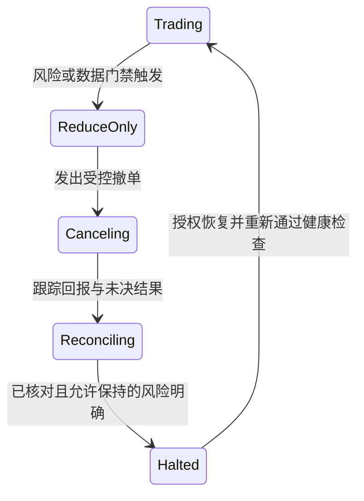

# 量化组合风控：敞口预占、PnL、资金对账与 Kill Switch

## 30 秒版（开场）

> 风控需要同时计入已成交持仓、活跃挂单和提交结果未知的订单，并把检查与额度预占放在一致的账户边界内。PnL、可用资金、保证金和风险敞口各有口径。停机控制应能阻止新增风险、追踪撤单与核对，而不是假设调用一次“取消全部”就已经清仓。

## 3 分钟版（精讲深度）

1. **先定义约束单位**：数量、名义金额、delta、保证金和损失预算不可混为一个数。
2. **检查和预占原子化**：多个策略并发下单不能分别通过同一份旧额度。
3. **事实驱动恢复**：成交、费用、资金划转与场所账户数据形成可审计的核对链。

## 10 分钟版（原理 + 图示）

### 分层风险

| 层级 | 检查 | 需要的事实 |
|------|------|------------|
| 订单 | 价格带、数量、最小单位、名义额、频率 | 主数据、可信且新鲜的价格、规则版本 |
| 策略 | 目标偏差、最大仓位、损失预算 | 本策略持仓、挂单和未决请求 |
| 账户 | 资金、总敞口、保证金、集中度 | 所有策略共享的持仓与预占 |
| 组合 / 场所 | 因子或 delta 暴露、流动性与对手方集中 | 统一单位、FX、合约乘数与场所资产分布 |
| 运行状态 | 行情陈旧、回报中断、对账差异、时钟异常 | 数据质量与连接健康，而非只有价格 |

相同标的的买卖挂单不能简单净掉后视为零风险：单边可能先成交。
在简单数量限制中，分别检查 `position + outstanding_buys` 的上界和 `position - outstanding_sells` 的下界，含提交未知及未确认撤单量。
期权、反向合约和保证金组合需要产品专属风险模型，不能直接套线性数量相加。

### 额度预占与并发

```text
接收带幂等键的下单意图
→ 在账户一致性边界内读取最新风险状态
→ 检查并持久化预占 / 订单意图
→ 按协议发送
→ 成交将相应预占转为实际持仓/资金影响
→ 确认拒单或撤销后释放对应剩余预占
→ 未知结果保持受限，进入恢复核对
```

可以使用账户分片单写者、数据库事务或其他带持久恢复语义的协调方式。
单机 mutex 只解决进程内并发，不能覆盖多实例、重启或双主。
失联后继续写入的旧实例要由 fencing/epoch 等机制阻止；恢复时需要区分本地预占与场所实际冻结。

### PnL 与账户口径

以单币种、线性资产的简单账户为例：`equity = cash + Σ(position_i × mark_price_i × multiplier_i)`，前提是现金与持仓估值没有重复包含。
多币种需指定 FX 来源与时间，期货结算、期权估值和反向合约需另建规则。

| 指标 | 需要固定的口径 |
|------|----------------|
| 已实现 PnL | 成本分配法、平仓匹配、合约乘数、费用是否包含 |
| 未实现 PnL | 标记价格来源、时间与陈旧度，区分可执行清算价值 |
| 净交易损益 | 已实现 + 未实现变化 + 费用/资金费/借券/融资等实际影响 |
| 可用资金 | 扣除冻结、保证金及产品规则，不能用总权益直接替代 |
| 收益率 | 外部入出金、分红、结算与基准的处理方式 |

持仓和现金来自逐笔事实，不应每分钟重新从目标权重“推算”实际仓位。
费用计入实际收取资产；返佣未确认时不能当作已到账现金。

### Kill Switch 的闭环



这是本地控制设计，不代表所有场所支持同名状态或同样的 reduce-only 参数。
必须逐场所验证权限、作用账户、订单类型、交易阶段与恢复方式。
例如 CME 的 Kill Switch 文档列有适用订单与市场状态限制、Mass Quotes 例外，阻断与级联撤单也可能并非同时完成。
停新单、撤挂单和实际平仓是三个不同动作，平仓本身还会产生执行与价格风险。

## 生产场景

行情或账户流陈旧时，阻止依赖该数据增加风险；对减少风险的请求也要核对产品支持和实际效果。
持仓、成交和现金分别核对，记录核对水位；场所快照与本地事件流不是天然同一时点。
有差异时先暂停相关账户与查找未决事件，避免直接覆盖账本掩盖原因。

## 排查与工具

监控 `reserved_exposure / unknown_order_age / reconciliation_gap / mark_age / pnl_breakdown / cancel_pending`。
为每次风险决定保存规则版本、输入水位、命中限额和处置原因；跟踪现金费用、持仓与 FX 各自产生的差异。
核对前明确场所是否支持历史成交分页、独立 drop copy、快照水位或其他恢复证据。

## 架构取舍

策略内风控反馈快，但账户共享限制需有统一权威边界；异步监控无法代替下单前的硬约束。
可交易价格更保守但噪声较大，标记价更平滑但可能偏离实际退出成本，需要明确分别用于损益、保证金还是风险压力。

## 深挖问答

1. **为什么不只检查当前净仓位？** → 挂单和未知请求可能继续成交，净仓位不足以表示最坏敞口。
2. **检查通过后再异步冻结是否可行？** → 会留下并发窗口；检查与预占需在一致性边界内完成。
3. **Kill Switch 后一定没有订单吗？** → 不一定，需核对范围、场所限制、撤单结果与晚到成交。
4. **为什么余额相等还可能有问题？** → 持仓、费用、冻结、币种和时间水位可能互相抵消或尚未结算。

## 反模式与事故

- 买卖挂单先净额相抵，再对剩余值检查限额。
- 用同一个错误行情同时驱动信号、估值和风险参考价。
- 人工恢复只重启进程，不核对订单和账户。
- 把本地预占加上场所冻结重复扣减，却没有定义二者映射。

## 证据边界与相关专题

本文为 `explanation_only`，没有账户接入、监管合规或真实资金验收。
关联：[OMS / EMS](S-QUANT-05-oms-ems-execution-algorithms.md)、[双分录账本](../18-web3-payments-stablecoin/S-PAY-07-postgresql-double-entry-ledger-lab.md)、[保证金与强平](../14-dex-cex-engineering/S-EXCH-04-futures-margin-liquidation.md)。

## 延伸阅读

- [CME Kill Switch](https://www.cmegroup.com/tools-information/webhelp/globex-credit-controls/Content/Kill-Switch.html)
- [QuantConnect Holdings](https://www.quantconnect.com/docs/v2/writing-algorithms/portfolio/holdings)
- [Binance Spot REST API](https://github.com/binance/binance-spot-api-docs/blob/master/rest-api.md)
