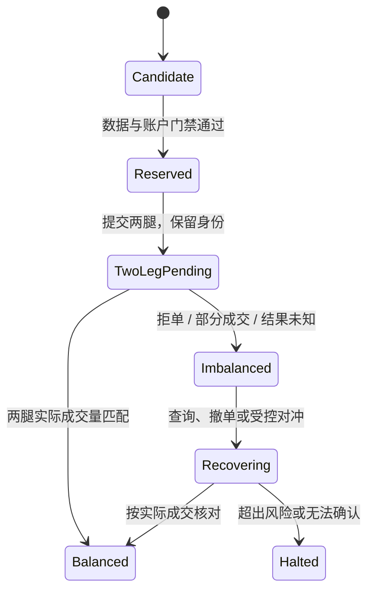

# 做市与跨市场套利：库存、逆向选择、腿风险和资金成本

## 30 秒版（开场）

> 做市通过报价提供流动性，同时承担库存与逆向选择风险；跨市场套利需要处理两条成交腿、资金分布和成本。屏幕上的价差不等于可实现利润，maker 返佣也不能单独证明盈利。工程核心是价格与数量可执行、库存有边界、单腿失败可处置、资金与损益可核对。

## 3 分钟版（精讲深度）

1. **做市管理库存**：报价宽度、倾斜和数量随库存、波动、数据陈旧度及风险状态变化。
2. **评价成交后价格变化**：赚到价差的成交，可能伴随后续不利变动。
3. **套利管理执行与资金**：两场所下单没有天然原子性，跨市场还要处理借贷、结算、保证金与对手方风险。

## 10 分钟版（原理 + 图示）

### 做市报价的教学模型

设 `fair` 是可审计的参考价格、`h` 为半价差、`q` 为净库存，`k` 将库存转换为价格偏移：

```text
bid = fair - h - k*q
ask = fair + h - k*q
```

`q > 0` 时两侧报价下移，表达降低继续买入、提高卖出的倾向；是否成交仍由真实市场决定。
这只是库存倾斜示意，不是完整 Avellaneda–Stoikov 解或可直接生产使用的参数公式。
原模型建立在特定价格过程、到达率和效用假设上；实际报价还需 tick/lot、费用、库存上限、排队与订单状态约束。

| 机制 | 需要控制 | 常见失效 |
|------|----------|----------|
| 价差 | 波动、费用、延迟与成交机会 | 价差过窄，成交后不利变动吞掉收入 |
| 库存倾斜 | 单边积累与再平衡 | 极端行情持续买入，库存越积越多 |
| 报价数量 | 深度、限额与可对冲规模 | 屏幕显示深度与实际成交能力不匹配 |
| 撤改节奏 | 新鲜度、排队优先级与消息配额 | 频繁撤改损失队列位置、耗尽限频预算 |
| STP | 多策略/关联账户自成交边界 | 为刷量或返佣忽视自成交规则与真实风险 |

### 逆向选择与 markout

对买入成交，可观察 `future_reference_mid - fill_price`；卖出取反，分别固定未来观察期限。
这是一种带符号的成交后价格表现指标；说明参考场所、时间、FX 与费用口径，不能把它直接当最终策略收益。
不同期限可暴露短期延迟问题与较长期库存风险；不应事后挑选最好看的一个期限。

### 跨场所现货价差

在单位和币种相同、数量 `Q` 可执行的简化条件下：

```text
预估净差 = 卖出场所可执行收入(Q) - 买入场所可执行支出(Q)
           - 手续费 - 借贷/融资/换汇等相关成本
```

应按深度逐档估计现金流，不能用两边中间价相减再乘任意数量。
分别检查数据到达时间、订单簿有效性、最小数量、余额与借券能力。
为两场所提前配置资金能减少转账等待，却增加闲置资本与场所敞口；充值到账与资产可提现也不是同一状态。

### 双腿执行状态机



“同时发送”不能使两家交易场所形成一个事务。
补单前先确认原单是否已成交，按实际数量对冲；对冲本身有价格与流动性风险。
预先约定最大单腿量、最长暴露时间、最大可接受价格和停止条件，具体阈值由实际风险评估确定。

### 基差与资金费

期货与现货价差涉及融资、持有成本、合约到期与交割机制；简单 `F/S - 1` 只表示某个时点的相对价差。
永续资金费由场所和产品规则确定，费率、结算周期、持仓资格及支付方向需要逐项核对；预测值可能变化。
对冲名义金额还需考虑线性/反向合约、乘数与 delta，不能只把两腿张数设成相同。
资金费收入可能被价格风险、费用、借贷、保证金或清算损失抵消。

## 生产场景

波动或数据质量异常时减少报价规模或停止新增风险，并处理已在场订单。
跨场所分别维护资金、订单与连接状态；不要在某场所账户流中断时仅凭公共行情继续加仓。
链上对冲还需单独考虑交易 inclusion/finality、Gas、MEV 和重组，不能直接套中心化场所的成交状态。

## 排查与工具

监控库存、单腿暴露量与时长、双腿成交差、报价年龄、拒单、撤单和多期限 markout。
归因时分开价差收入、价格变动、手续费/返佣、资金费与借贷。
先排查是否使用了陈旧或单位错误的可执行价格，再判断模型是否退化。

## 架构取舍

激进吃单更容易完成对冲，但增加费用和冲击；被动挂单可能改善价格，但增加不成交与逆向选择风险。
对冲频率越高不一定总风险越低，还需考虑交易成本、最小数量、限频和订单未知窗口。

## 深挖问答

1. **为什么不认为双边挂单一定赚价差？** → 成交顺序不对称，库存变化和逆向选择可能超过价差。
2. **为什么不看到价差就立即跨所下单？** → 先核对可执行深度、数据时间、成本和账户约束。
3. **一腿超时为什么不能立刻对冲？** → 原腿可能已成交，需要恢复原订单事实，避免二次暴露。
4. **资金费策略是否没有方向风险？** → 对冲偏差、基差变化、保证金与场所风险仍然存在。

## 反模式与事故

- 将 maker 返佣或正资金费视为固定利润。
- 默认两腿都按看到的最优价全量成交。
- 用买方确认量与卖方目标量相抵，隐藏未完成风险。
- 只统计成交胜率，不统计库存、回撤与场所资金集中。

## 证据边界与相关专题

本文为 `explanation_only`，没有可运行做市机器人、套利程序或策略收益验收。
关联：[回测模型](S-QUANT-04-event-driven-backtesting.md)、[订单执行](S-QUANT-05-oms-ems-execution-algorithms.md)、[风控](S-QUANT-06-portfolio-risk-pnl-reconciliation.md)、[STP](../14-dex-cex-engineering/S-EXCH-21-self-trade-prevention-surveillance.md)。

## 延伸阅读

- [Avellaneda–Stoikov：High-frequency trading in a limit order book](https://math.nyu.edu/~avellane/HighFrequencyTrading.pdf)
- [CME：Equity Index Basis](https://www.cmegroup.com/education/courses/introduction-to-equity-index-products/what-is-equity-index-basis.html)
- [Bybit：Introduction to Funding Rate](https://www.bybit.com/en/help-center/article/Introduction-to-Funding-Rate)
