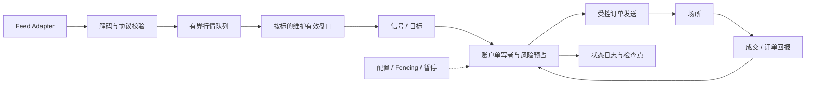

# Go 量化系统生产工程：有界队列、尾延迟、确定性与恢复门禁

## 30 秒版（开场）

> Go 可承担行情接入、交易网关、账户风险和控制面，但交易系统需要定义每段队列、顺序、恢复与尾延迟预算。行情增量和成交回报不能被随意丢弃；重启后必须先恢复订单、持仓和额度。性能结论要附硬件、负载、持续时间与持久化边界，不能把单次内存 benchmark 当作真实交易能力。

## 3 分钟版（精讲深度）

1. **显式所有权**：按账户或标的等业务边界分片，明确谁修改盘口、订单和风险。
2. **显式背压**：队列有界，溢出时使相关视图失效、停止新增风险并恢复，而非静默丢数据。
3. **显式恢复**：日志、检查点、场所核对与发布控制组成一个闭环。

## 10 分钟版（原理 + 图示）

单写者减少同一状态的竞争，但不自动解决跨账户、跨分片与外部场所的一致性。
发布、故障切换或网络分区时仍需 epoch/fencing 与场所协议配合，避免旧实例继续发送订单。

### 不同消息的拥塞策略

| 数据 | 可采用的策略 | 必须满足 |
|------|--------------|----------|
| 已声明可合并的最新 BBO 展示值 | 按标的覆盖旧值 | 消费者知道它不是完整事件流，能检测年龄 |
| 订单簿增量 | 有界缓冲；溢出后标记无效并重建 | 不把缺失增量后的簿继续视为正确 |
| 成交 / 订单私有回报 | 保留恢复路径、去重与序号核对 | 不静默丢弃，失败时停止相关新增风险 |
| 指标 / 非关键日志 | 按策略采样或丢弃并计数 | 与交易事实日志分离 |
| 暂停与撤单控制 | 明确优先级和受控调度 | 不依赖已被普通新单完全占满的本地队列；仍遵守场所限制 |

增加缓冲只能延迟暴露过载；还要跟踪队列驻留时间和最新输入水位。
过期策略信号可按有效期拒绝，但不能把已经提交、可能成交的订单当作过期消息删除。

### 延迟预算与测量

分开测量 `receive → decode → queue → decision → risk → send → ack`。
`ack` 可能只是接受请求或接受订单，不能直接等同于成交；场所排队与成交回报也需单独记录。
单进程耗时使用单调时钟；跨主机或交易所时间比较需记录时钟同步误差，不能用不可靠差值报告纳秒精度。

| 维度 | 报告要求 |
|------|----------|
| 分位数 | P50/P99/P99.9、最大值与超预算事件，样本数明确 |
| 负载 | 消息速率、突发、标的/账户数、订单/撤单比例与消息大小 |
| 持久性 | 内存、异步落盘、同步持久化的边界 |
| 环境 | Go 版本、CPU/内存、容器限额、网络与存储 |
| 结果 | 延迟、队列年龄、丢弃/失效、错误率与恢复时间一起报告 |

闭环压测客户端若必须等上一个请求返回才发下一个，会隐藏服务停顿期间本应排队的请求（coordinated omission）。
应同时描述到达模型与测量边界，用符合实际突发的负载验证背压。

### Go 运行时与内存

先用 CPU/heap profile、执行 trace 和运行时指标定位分配、锁、调度与 I/O，再调整对象布局、批量或复用。
对象池会引入所有权与内存驻留问题；不能在消费者仍持有切片时复用底层缓冲。
`GOGC` 在 GC CPU 与内存之间取舍，`GOMEMLIMIT` 是软内存限制；二者都不保证固定尾延迟，也不能代替容器资源规划。
极低延迟路径是否采用 Go，应由同一目标硬件与真实负载下的证据决定。

### 故障矩阵与恢复

| 故障注入 | 预期不变量 |
|----------|------------|
| 行情重复 / 断序 / 队列溢出 | 不重复应用；无效视图停止驱动新增风险 |
| 发送成功后进程崩溃 | 恢复原订单身份，查询/补流，避免盲目再下单 |
| 撤单与部分成交交错 | 成交幂等记账，剩余风险持续受控 |
| 私有回报断流 | 账户进入恢复限制，核对后恢复 |
| 双主或旧实例复活 | 旧 epoch 不再拥有发送和修改权 |
| 配置发布 / 回滚 | 规则版本可追溯，旧代码兼容已经持久化的状态 |

检查点需记录事件水位、订单、持仓、预占和规则版本；恢复日志后还需与场所事实核对。
本地状态回滚无法撤销已经成交的交易，错误资金影响需要审计下的补偿处理。

## 生产场景

按研究重放 → 历史回测 → 仿真环境 → 受控生产的门禁逐层验证；每层声明数据与成交假设。
仿真也要核对是否使用了真实行情、真实订单接口或有副作用的适配器，环境名称不能代替隔离措施。
发布前冻结版本并准备暂停、查询未决订单和恢复核对流程。

## 排查与工具

先找最早变大的队列年龄，再比较 GC、调度、锁、系统调用与场所响应时间。
追踪键覆盖信号、风险、订单和成交，不在热路径上无界构造标签或同步打印完整 payload。
用 [Go diagnostics](https://go.dev/doc/diagnostics) 与库内 [pprof / trace](../02-memory-gc/S-MEM-11-pprof-vs-trace.md) 建立证据。

## 架构取舍

进程内分片减少网络与序列化，但扩大故障域；服务拆分便于隔离但增加时序与恢复成本。
同步持久化改善已确认状态的恢复边界，代价是存储延迟；异步日志需明确可丢失区间及外部订单核对方式。

## 深挖问答

1. **为什么不用无限 goroutine 消化行情？** → 无法约束内存、调度和状态顺序，过载时还可能处理越来越旧的数据。
2. **为什么不能丢掉一个深度增量继续运行？** → 后续视图可能不再正确，需按 feed 规则恢复连续性。
3. **为什么不关闭 GC 来解决延迟？** → 内存增长与 OOM 会变成更大故障，先建立测量并约束分配。
4. **恢复完 WAL 为何还要查场所？** → 崩溃窗口中可能已有本地未获知的接受、撤单或成交。

## 反模式与事故

- 只报平均延迟或单标的内存吞吐。
- 行情、成交、指标都采用同一个“队列满就丢”规则。
- 用容器重启代表订单与账户恢复成功。
- 将多个策略的独立进程当成账户级风险隔离。

## 证据边界与相关专题

本文为 `explanation_only`，故障矩阵是验收设计，尚无本模块压测或生产接入报告。
关联：[行情](S-QUANT-02-market-data-microstructure.md)、[OMS / EMS](S-QUANT-05-oms-ems-execution-algorithms.md)、[风控](S-QUANT-06-portfolio-risk-pnl-reconciliation.md)、[撮合 WAL](../14-dex-cex-engineering/S-EXCH-18-wal-snapshot-replay.md)。

## 延伸阅读

- [Go GC Guide](https://go.dev/doc/gc-guide) · [Go Diagnostics](https://go.dev/doc/diagnostics)
- [FIX Session Layer](https://www.fixtrading.org/standards/fix-session-layer-online/)
- [Binance Spot WebSocket Streams](https://github.com/binance/binance-spot-api-docs/blob/master/web-socket-streams.md)
