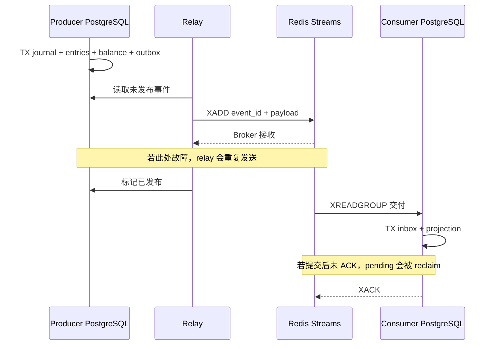

# Outbox 与 Inbox：真实消息重投和事务故障实战

## 30 秒版（开场）

> Outbox 让业务事实与待发布事件在同一个本地事务提交；relay 仍可能重复发送。Inbox 将消费去重与业务投影放进另一个本地事务，提交后再 ACK。本例使用 PostgreSQL 两个数据库和 Redis Streams，注入发布后未标记、消费回滚、提交后未 ACK 三个故障窗口，验证业务事件只应用一次。它不是数据库和 Broker 的跨系统 exactly-once 事务。

## 3 分钟版（精讲深度）

1. **生产端原子性**：journal、余额、分录、outbox 同事务。业务提交后 broker 暂时不可用，事件仍保留在数据库等待投递。
2. **消费端原子性**：`(consumer_id,event_id)` 唯一键 + 原 payload 绑定；首次消费才更新投影，两者一起提交或回滚。
3. **ACK 与重放**：Broker 消息 ID 和业务事件 ID 分开。消费提交后才 ACK；故障后的 pending 消息 reclaim，再按业务 ID 幂等处理。

## 10 分钟版（原理 + 图示）



| 身份 | 示例 | 作用 |
|------|------|------|
| 业务事件 ID | `bus-1` | 多次投递保持稳定，Inbox 去重依据 |
| Broker entry ID | `...-0` / `...-1` | 每次 XADD 不同，标识一条投递记录 |
| Consumer ID | `accounting` | 同一事件允许被多个逻辑投影各处理一次 |
| Worker ID | `worker-dead` / `worker-restarted` | 进程实例，不能作为业务去重身份 |

`consumer.sql` 的 Inbox 保存原始 JSONB：相同 ID、不同 payload 不是普通重试，必须报冲突。
投影按 **consumer + currency** 累计转账原子单位和事件数，是教学用成交量式读模型，不是资金余额账本。
跨币种不相加，不把该投影当成用户资金权威数据。

脚本在故障边界主动省略 relay 标记或 ACK，模拟进程退出后的持久状态；
它实际操作独立数据库事务、Broker entry 与 PEL，并非用内存 map 模拟消息队列。
本例不是常驻 relay/worker 服务，也不模拟操作系统杀进程的全部时序。

Redis 使用单实例 AOF `appendfsync=always` 便于实验，不能据此声称复制 failover 零丢失。
生产端不能只凭网络 ACK 就忽略 broker durability、保留期和灾难恢复策略；
若 broker 丢失已标记 published 的消息，需要基于 outbox 留存/归档与消费水位对账恢复。
Inbox 解决重复副作用，不解决消息永久丢失。

## 生产场景

- 支付成功事件、账户过账和链上确认通知需要向多个读模型投递时，可共享本地事务事实再异步扇出。
- 多 relay 需要领取租约、竞争控制、超时恢复和顺序域；不能简单把 `published=true` 当成领取标记。
- 同一聚合的顺序敏感事件需 version/sequence 与 gap 检测；本例用单业务事件聚焦重投，不证明跨聚合全序。
- 毒消息应隔离并告警。DLQ 保留原 event ID、payload 与失败原因；修复重放不能换 ID 绕开去重。

## 排查与工具

```bash
python3 examples/postgres-reliability/verify.py --only outbox
```

| 注入点 | 持久状态 | 验收 |
|--------|----------|------|
| XADD 成功后不更新 outbox | Broker 有事件，outbox 仍未发布 | 重启投递形成两个 entry、一个业务 ID |
| 插入 Inbox 后事务故意除零 | 数据库回滚，Broker 消息仍 pending | Inbox 与投影均未生效 |
| 提交消费事务后不 XACK | Inbox/投影已提交，PEL 未清 | reclaim 后消费返回重复，不再累加 |
| 新 entry 携带相同业务 ID | Broker ID 不同 | 去重仍然生效 |
| 相同业务 ID 修改金额 | Inbox 已存在原 payload | 报 identity conflict，不静默吞掉 |

脚本用 `XCLAIM` 且 idle=0 精确触发重投，便于快速验证；生产应按处理时长与租约设置合理 idle，
结合 `XPENDING`/`XAUTOCLAIM` 防止活跃 worker 被过早抢占。只读 `>` 不会自动接管其他 worker 的 pending。

观测 Outbox 最老年龄、未发布量、PEL 最老年龄、重投次数、Inbox 冲突、投影水位与死信数量。
不能只看消费吞吐：吞吐正常时，也可能有一条资金事件长期卡住。

## 架构取舍

| 方案 | 优点 | 代价 |
|------|------|------|
| Polling Outbox | 易解释与独立调试 | 扫描/清理、领取恢复、顺序和多副本竞争需设计 |
| CDC Outbox | 从数据库日志投递，减少应用扫描 | 需管理 connector、offset、schema 和重建恢复 |
| Broker 内部事务 | 对 broker 内读写提供事务边界 | 不自动包括外部 PostgreSQL 或支付 API |

跨数据库拆分在本例是真实边界；虽然使用同一个 PostgreSQL 容器，生产端和消费端没有共享数据库事务。
Redis 便于本地演练；替换成 Kafka/RabbitMQ 时需重新验证各自的 ACK、重投、顺序和保留语义。

## 深挖问答

1. **为什么先提交 Inbox 再更新投影不行？** → 中间故障会留下“已消费但业务没做”的永久漏处理，必须同事务。
2. **为什么不能用 Redis SETNX 去重后写 PostgreSQL？** → 两个系统没有共享原子提交，中间失败会丢副作用或重复执行。
3. **为什么不能拿 Broker entry ID 去重？** → relay 重投会生成新 entry ID，但业务事实没有变。
4. **为什么不用全局 exactly-once？** → 本例依赖各自本地事务与幂等，没有引入跨 broker/数据库协调事务；外部 API 副作用仍要自己的幂等与核对。
5. **何时清 Inbox？** → 必须覆盖 broker 保留期、人工重放和灾难回放窗口，否则老事件会重新生效。

## 反模式与事故

- 业务写库后直接发消息，发送失败只写日志。
- XADD 前标记 published，或数据库提交前 XACK。
- 新部署换 consumer ID，导致历史事件被当成新投影处理。
- 长期只消费新消息，不接管 pending；或者提前清去重记录。

## 证据边界与相关链接

这是 PostgreSQL + Redis 单机集成演练；验证三个故障窗口、业务去重与消息身份绑定。
不覆盖 Broker HA、网络分区、跨区域恢复、完整 relay 调度器和生产吞吐。

- [双分录账本实战](../../18-web3-payments-stablecoin/S-PAY-07-postgresql-double-entry-ledger-lab.md)
- [数据库恢复演练](../postgresql/S-PG-04-pitr-restore-drill.md)
- [消息队列语义](../../03-system-design/S-ARCH-10-mq-semantics.md)
- [Debezium Outbox](https://debezium.io/documentation/reference/stable/transformations/outbox-event-router.html)
- [XREADGROUP](https://redis.io/docs/latest/commands/xreadgroup/) · [XACK](https://redis.io/docs/latest/commands/xack/)
