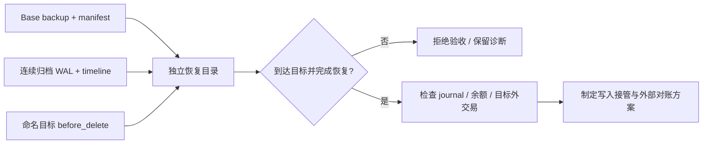

# PostgreSQL 恢复演练：误删、PITR 与 WAL 缺失验证

## 30 秒版（开场）

> 备份可用性要通过恢复证明：校验 base backup、连续归档 WAL，并把独立实例恢复到明确业务边界，再核对资金分录和余额。本例在 PostgreSQL 17 中先备份、再过账、创建命名恢复点、追加目标外交易并误删，验证恢复点前事实保留、之后事实消失；再移除必需 WAL，验证恢复必须失败。数据库能连接不等于已到达恢复目标。

## 3 分钟版（精讲深度）

1. **准备证据链**：物理 base backup、备份清单校验、连续 WAL、timeline、目标点和配置；逻辑 pg_dump 不能直接用于 WAL 物理恢复。
2. **在独立位置恢复**：保留原故障库，恢复目录独立，配置 `restore_command`、`recovery.signal` 和目标；确认到达目标并退出 recovery 后再验收。
3. **验收业务而非进程**：目标前 post-backup journal 必须存在，目标后 journal 必须不存在，账户余额应等于期初加分录；缺 WAL 不能降级成“尽可能启动即可”。

## 10 分钟版（原理 + 图示）



### 本例时间线

| 顺序 | 操作 | 验收意义 |
|------|------|----------|
| 1 | 写入 `restore-kept`，执行 `pg_basebackup -X stream` | 建立物理备份；`pg_verifybackup` 检查清单 |
| 2 | 切 WAL，写入 `after-base` | 强制证明后续 WAL 重放，而非只恢复备份文件 |
| 3 | 创建 `before_delete` 恢复点 | 目标在误删前，有明确 WAL 位置 |
| 4 | 目标前创建的两笔消息在目标后投递，外部效果和 Inbox 提交；一笔 ACK、一笔丢 ACK。再写 `after-target`，管理员 TRUNCATE journal/entries/outbox | 制造 PostgreSQL 水位与外部接收事实分离，以及目标后的合法提交与误删 |
| 5 | 切 WAL，等待目标段归档 | 目标不能只存在源机未归档 WAL 中 |
| 6 | 从 base + archive 恢复新实例 | 核对目标前后业务事实与余额 |
| 7 | 隔离恢复副本，核对外部回执，重建 Inbox/投影并处理 ACK/PEL，最后解除演练暂停 | PostgreSQL 恢复不会撤销 Redis 中的效果和 ACK；原 ID 重放不重复执行资金或外部动作 |
| 8 | 复制归档，删除目标所在必需段，再恢复另一目录 | 未到达目标必须报错，不能成为可写“成功恢复”实例 |

示例使用命名 restore point，降低墙钟时间、时区和事务边界歧义。事故往往没有预置恢复点，
需要根据审计、提交时间、transaction ID 或 LSN 确定目标，明确 inclusive 语义，并先在隔离副本核验。
恢复点是 WAL 标记，不是业务表中的一行记录，也不是逻辑备份。

恢复配置固定 PostgreSQL 17：

```conf
restore_command = 'cp /lab/archive/%f %p'
recovery_target_name = 'before_delete'
recovery_target_timeline = 'current'
recovery_target_action = 'promote'
```

脚本写入 `recovery.signal`，清除恢复副本中备份附带的 WAL 文件，确保测试从归档获取必需日志。
`current` 用于本实验单 timeline 场景；生产有 failover/timeline 分叉时，必须选择正确历史和目标分支，
不能机械复制这一项。归档中不存在某个探测文件可能正常，不能仅看一次 `cp` 失败判定恢复失败；
负例检查的是 PostgreSQL 明确报告未到达指定恢复目标，且实例无法继续提供可写服务。

### 恢复后的消息接管

本例物理备份同时包含 ledger 和 consumer 两个数据库，PITR 后两者一起回退；Redis 不回退。两笔目标前的 Outbox 又变成未发布，目标后写入的 Inbox/投影消失，但独立接收回执/效果计数仍在：一笔已 ACK，另一笔留在 PEL。这是账本恢复正确却仍不能直接启动业务的原因。

运行器先保持恢复副本仅在容器内 Unix socket 可访问，设置 `recovery_control.paused=true`，普通消费函数及运行器发布入口拒绝继续。操作员流程依次核对恢复库 journal/Outbox、原事件 payload 和外部回执；随后按原 ID 重放/claim，接收方幂等拒绝重复效果，`recover_consume` 同事务重建 Inbox、投影和恢复审计，再 XACK、标记恢复库 Outbox published。

`recover_consume` 持控制行锁，只在自身事务内临时放行并在提交前恢复暂停；普通消费者不能利用这个未提交窗口。故障验证还覆盖：删除门禁控制行后普通消费和操作员重放都拒绝，避免 SQL NULL 绕过检查；缺失恢复点后的原始事实、回执不可用、回执金额不匹配时拒绝；重放已提交但 XACK/Outbox 标记前中断，仍按 PEL/原 ID 恢复。两笔投影最终为 2 个事件、9 原子单位，外部效果各一次、PEL=0，账本 journal 数、余额和 drift 均不因重放变化，才解除本演练暂停。

独立回执使用 Redis Lua 原子绑定事件内容/效果计数，无 TTL；不是银行或真实支付渠道凭证。演练所有连接为 lab owner，门禁只覆盖示例消费函数与运行器 publisher，不是生产授权或全局写入 fencing；跨 PostgreSQL/Redis 也没有 ACID。生产需要所有写入口接入隔离协议、可信外部证据、完整业务范围核对和审批。缺少事实的业务继续人工处理，不能按“恢复库没有记录”重建付款。

## 生产场景

- 误删表、错误批量扣款、损坏投影：先停写与证据保全，在独立实例恢复，审查应保留的后续合法业务。
- 定期验证备份清单、归档连续性、恢复时长、目标可达性和账本一致性；副本会复制误删，不能代替备份。
- 恢复数据库不会撤销已经发出的付款、链上交易或已消费消息。接管前必须核对外部事实、Inbox/Outbox 与消费水位，防止旧快照重发副作用。
- 归档需异故障域、访问控制、不可变保留与容量告警。本例同容器目录只便于验证恢复机制，没有灾备隔离能力。

## 排查与工具

```bash
# 此入口现在同时需要本地 postgres:17-alpine 和 redis:7.4-alpine 镜像
python3 examples/postgres-reliability/verify.py --only recovery \
  --report /tmp/knowledge-recovery.json
```

自动检查：base manifest 可验证；恢复后不处于 recovery；journal 数与目标前一致；`after-base` 保留；
`after-target` 不存在；Bob 余额一致；`balance_drift` 为零。缺 WAL 负例要观察到
`recovery ended before configured recovery target was reached`，并检查连接不能成功。

`--only recovery` 为 3 组：目标恢复、消息/外部事实接管、缺 WAL 拒绝；完整账本/消息/恢复入口为 17 组。报告记录 selection，开始运行即清除旧报告，验证及清理成功后才原子写出成功 JSON。无 Docker 的启动失败、断言失败、清理失败及报告发布失败回归见 `python3 -m unittest discover -s examples/postgres-reliability -p test_verify.py`。

输出 `recovery_seconds` 只表示这次小型 fixture 的恢复启动与检查阶段耗时，不包括故障发现、
备份下载、审批、外部对账或业务切流，不是生产 RTO 承诺。报告同时记录真实 PostgreSQL 版本与本地镜像 ID。

## 架构取舍

| 手段 | 适用 | 边界 |
|------|------|------|
| 逻辑备份 | 表级导出、选择性迁移 | 不能直接结合物理 WAL 做 PITR |
| 物理备份 + WAL | 整个 cluster 恢复到目标 | 需完整日志与兼容版本，不能只还原某张表 |
| 只恢复派生投影 | 原事实可靠、仅读模型损坏 | 不能修复丢失或错误的资金事实 |
| HA replica | 主机故障降低中断 | 会同步错误写入，不代替隔离备份 |

## 深挖问答

1. **为什么 pg_verifybackup 通过仍不够？** → 它不能代替实际恢复和业务核对，目标之后需要的归档 WAL 仍可能缺失。
2. **为什么不直接恢复覆盖原库？** → 会损失取证材料，也无法比较误删后的合法交易；先隔离恢复再决定接管或补数据。
3. **为什么数据库 ready 还不能验收？** → hot standby 在恢复过程中也能接受查询，要确认目标到达、恢复状态和业务边界。
4. **缺 WAL 可以跳过继续吗？** → 不能跳过必需 WAL 并声称达到指定目标，应修复归档或选择另一个已核验恢复目标。
5. **恢复后直接启动 relay 可以吗？** → 不行。旧库的 published/inbox 水位可能落后真实外部副作用，必须先对账与隔离执行。

## 反模式与事故

- 只检查备份上传成功，不做恢复或业务查询。
- 将生产 archive 直接用于破坏性测试，或删除唯一归档副本。
- 把 pg_dump 当成 pg_basebackup，或者拿新主机的错误 timeline 恢复旧目标。
- 启动成功就立即切流，忽略支付渠道、链上执行和 Broker 水位。

## 证据边界与相关链接

演练只创建唯一名称容器和其中独立目录，未连接现有数据库，也不发布宿主机端口；结束后清理该次容器与匿名卷。
它实际执行 PostgreSQL 物理备份、WAL 重放、误删恢复与缺日志负例；不证明跨主机灾备、远程归档耐久性或生产 RPO/RTO。

恢复接管只核对本次两笔明确事件及对应消费方，不宣称覆盖所有支付/商户/外部账户的敞口，也不证明银行/链上付款可以被 PITR 撤销。

- [PostgreSQL WAL 与 HA](S-PG-03-wal-replication-pgx-ha.md)
- [账本实战](../../18-web3-payments-stablecoin/S-PAY-07-postgresql-double-entry-ledger-lab.md)
- [Outbox/Inbox 实战](../distributed/S-DIST-06-outbox-inbox-fault-lab.md)
- [PostgreSQL 17 PITR](https://www.postgresql.org/docs/17/continuous-archiving.html) · [pg_verifybackup](https://www.postgresql.org/docs/17/app-pgverifybackup.html)
